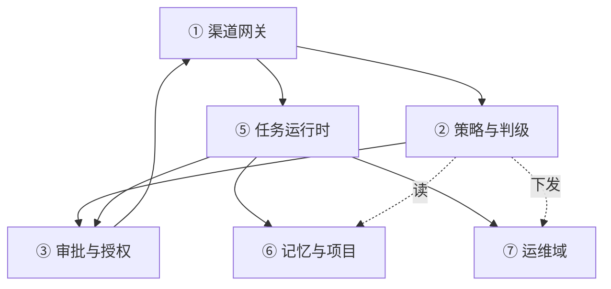

# 11 — 架构锚定

> **状态**：建议稿，待 owner 确认。
> **前置**：08 定义产品该有什么（119 项）；09 逐条判定实现路径；10 定产品语义。
> **本文只写"不随选型改变的结构"。** 换数据库、换渠道插件、换浏览器后端，**本文不应改动一行**。
> 具体用什么实现见 [12-技术栈选型](12-技术栈选型.md)。
>
> **锚定的含义**：本文的每一条都是**可检验的约束**，不是描述。
> 选型可以试错、可以替换；结构一旦违背，就是返工。

---

## 一、什么算架构

信息一多就"乱"，根因是没区分**结构**与**零件**。三条判定：

| 问题 | 是 → 架构（本文） | 否 → 选型（12） |
|---|---|---|
| 换一个实现，这条结论会变吗？ | 不会变 | 会变 |
| 它是否**约束**未来的选型？ | 是 | 不是，它本身是被约束的 |
| 破坏它是否要重写产品语义？ | 是 | 换掉重装即可 |

对同一件事的两种说法：

| 架构说法（11） | 选型说法（12） |
|---|---|
| 任务执行必须持租约，失租即停 | 租约落在 SQLite，用 CAS + 心跳 |
| 对话与业务状态分开存放 | 对话在 dsh session log，业务在 `ops.sqlite` |
| 所有外部依赖经端口 | 渠道用 `dsh-im`，浏览器用 Playwright |
| 任何第三方不得持有唯一数据副本 | 记忆插件只做检索，正本在自有库 |

> **判据**：一句话里出现具体产品名、版本号、语言、库名，它就是选型。

---

## 二、上下文边界

### 外部参与者

| 参与者 | 交互 | 方向 |
|---|---|---|
| owner | 微信 / 企微 / 飞书 消息、审批应答 | 双向 |
| 模型供应商 | 推理 API | 出站 |
| 目标服务器（被运维对象） | systemd / docker / 文件 / 进程 | 出站（受控） |
| 邮件服务器 | IMAP / SMTP | 双向 |
| 日历服务器 | CalDAV | 双向 |
| 公网内容 | 网页、搜索 | 出站（不可信） |
| 备份介质 | 本机磁盘 / 异地 | 出站 |
| 推送兜底通道 | 仅 P0 告警 | 出站 |

### 明确不承担（边界，不是待办）

| 不承担 | 原因 |
|---|---|
| 多租户 / 团队协作 | 单 owner；引入租户维度会污染全部 ID 与 schema |
| 桌面端 / Web UI | 入口就是渠道；加 UI 是另一个产品 |
| 模型训练 / 微调 | 只做调用与路由 |
| 通用工作流平台 | 只服务"自己的服务器"，不做通用编排 SaaS |
| 多机集群 / 高可用 | 单机故障用快照与重启解决，不用分布式共识 |

**边界一旦外扩，架构就要重做，不是加功能。** 想扩边界，先回来改本节。

---

## 三、结构（宏观抽象）

**此图不含任何具体产品**（除宿主 dsh 外），具体实现一律见 [12-技术栈选型](12-技术栈选型.md)。
**注入了选型后的同一张图**（哪些槽位已定、哪些还空着）见 [12 §三](12-技术栈选型.md)。

```
                外部世界：人 · 被运维对象 · 第三方服务
                           ▲   │
          回执 / 动作结果   │   │ 消息
                           │   ▼
  ① 入口        归一化 → 准入(fail-closed) → 分诊(R0–R3)
                           │
  ② 内核        决策(S1→S2) → 任务 ⇄ 审批 → 审计（一条链）
  （自有，      记忆治理 · 项目注册 · 巡检与告警策略 · 变更与回滚
    不可替换）             │
  ③ 端口        契约 + 契约测试 —— 唯一允许替换的边界
                           │
                           ▼
  ④ 适配器      A 工作区 · B 主机受控 · C 出网 · D 宿主自身
  与执行域      （全部可替换；四域即信任边界）

  侧面：数据面 = 会话账（对话） + 业务账（任务 / 审计 / 授权 / 记忆正本）
  底座：dsh     = 执行框架与插件宿主（会话事件流、工具管线、审批接口、沙箱、调度）
                  它被内核使用，但**不在判断链上**
```

### 读图三句话

> ② **不是一个大盒子**：它由 7 个模块组成，每个模块只写自己那几张表，见下「内核的拆分」。

1. **只有一条主线**：消息进 → 判断 → 排期 → 执行 → 结果出。
   任何绕开 ② 的旁路（例如适配器直接调执行）都是架构违规。
2. **可替换的外部实现只发生在 ③④**：②内部的判定实现可以换（DecisionPort），但结构不换；正本在侧面的数据面，
   任何适配器都不得持有唯一副本（AR5）。
3. **dsh 是底座不是内核**：它让 ②③④ 跑得起来，但"该不该做、做到什么程度"由 ② 决定。

### 决策层（S1 / S2 / Jev）

**决策不是"再加一个模型"，是内核里的一段固定链路：先快后慢、可降级、必留痕。**

```
消息/任务 ──▶ S1 快判（规则 · 启发式 · 缓存）──命中──▶ 执行（R0–R1）
                 │ 不确定 / 高风险 / 冲突
                 ▼
            S2 慢判（主模型推理）──▶ 执行（R2）或 审批（R3）
                 │ 仍无把握，且属"有明确得失"的判断
                 ▼
            Jev（外部期望值判级，可选）──▶ 只给建议，不直接执行
                 │ 任一环节不可用
                 ▼
            降级：S1 规则兜底 + 告知 owner（AR17）
```

五条规则：

1. **S1 先手**：先过确定性规则，命中即走，不调模型。浏览器场景尤其关键——
   选择器、页面模板、已录脚本优先，失败才升级视觉推理。
2. **只有"有明确得失"的判断才给 Jev**，且不可信原文（邮件正文、日志、代码）不出域（AR16）。
3. **Jev 只给建议，不下命令**；它停服不能改变执行能力（10 D16）。
4. **每次决策留痕**：`choice + confidence + reason` 进审计。
5. **DecisionPort 是内核内部接口**：只切换判定实现（规则集 / 模型 / Jev provider），
   不改变结构，也不属于 ③ 的外部可替换边界；Jev 作为外部调用经 ModelPort 出网。

### 选路梯子（先确定性，后模拟）

**任何任务按固定顺序挑执行通道，不许跳级：**

```
CLI / API ──没接口──▶ MCP 工具 ──没有──▶ 浏览器（持久登录）──没有──▶ GUI / 截屏
```

- 能用 `systemctl` / `docker` / 厂商 API 解决的，就不点页面——服务管理因此**不需要 GUI 自动化**。
- 跳级必须在任务计划里写明理由，并记为审计事件（否则 AR16 无从追）。
- 梯子只管"走哪条路"，不管"该不该做"；后者归决策层。

### 内核的拆分（7 个模块）

**为什么必须拆**：现在"内核"一个词同时装着判级、审批、任务、审计、记忆、项目、巡检。不拆会出现三个具体问题：

1. **任务状态被多方写** —— 崩溃后无法判断该信谁；
2. **审批无法复用** —— 渠道、任务、运维各自实现一遍"问人"；
3. **审计与业务耦合** —— 为了记审计去改业务表，或业务失败导致审计缺失。

**拆分原则（不是按时髦的领域划分）**：

| 原则 | 含义 |
|---|---|
| **单一写者** | 每张表只有一个模块可写；其他模块只能调它的 API（AR23） |
| **变更走 API，通知走事件** | 订阅者收到事件后，只能调 owner 的 API 或发新事件，**不能直接改表** |
| **决策无副作用** | 策略模块只返回 `allow / ask / block + reason`，不执行、不发通知、不写业务表 |
| **审计只订阅** | 审计是 sink，不被任何模块依赖；fail-closed 在各 owner 内部实现，不靠审计兜底 |
| **授权唯一长效形态是 Grant** | 渠道确认只给"本次"，不沉淀 |

> **不按"开发 / 生活"功能域拆**：两者共用任务、审批、审计与记忆，
> 按功能域切会立刻出现跨模块直写。切分依据是**数据所有权**，不是功能分类。

| # | 模块 | 职责（一句） | 拥有的数据 | 明确不做 |
|---|---|---|---|---|
| 1 | **渠道网关** | 归一化、身份映射、准入、去重、审批应答解析、出站回执 | `channel_bindings`、`inbound_seen` | 不判级、不建任务 |
| 2 | **策略与判级** | R0–R3、网络三档、域/路径白名单、选路梯子 | `policy_rules`（配置）、`decisions` | 不执行、不发通知 |
| 3 | **审批与授权** | 审批请求、Grant 生命周期、击杀开关 | `approvals`、`grants` | 不执行动作 |
| 4 | **审计与证据** | 哈希链、导出、完整性校验 | `audit_log` | 不被任何模块依赖 |
| 5 | **任务运行时** | 状态机、幂等、租约、调度、取消/重试 | `tasks`、`task_events`、`receipts` | **只有它能改任务状态** |
| 6 | **记忆与项目** | 记忆三态、项目注册与边界、检索门面 | `memory`（正本）、`projects` | 不直接改任务 |
| 7 | **运维域** | 巡检清单、告警策略、变更/快照/回滚 | `inspections`、`changes` | 只发现 + 报告，不擅自修复 |



> ④ 审计**不在依赖图里**：它订阅所有模块的事件，但没有任何模块依赖它。

### 胶水 / 内核 / 领域（什么不该进内核）

**两个必须防的退化**：① 胶水层里写进了业务判断；② 内核膨胀成什么都管的泥球。

**判据三问 —— 任一为"是"就不是胶水**：

1. 去掉它，会不会丢数据或丢状态？
2. 它有没有自己的失败语义（幂等、租约、回滚、超时拒绝）？
3. 换宿主（dsh 换成别的东西）之后，它是否仍然必须存在？

| 层 | 判据结果 | 允许做什么 | 举例 |
|---|---|---|---|
| **胶水**（`adapters/`） | 三问全否 | 只做格式映射、参数转换 | 消息转 `session.prompt`、事件转回执、MCP 工具包装 |
| **内核**（`kernel/`） | 三问皆是 | 跨域不变式、状态与证据 | 任务状态机、租约、Grant 撤销、哈希链、记忆三态 |
| **领域**（`domains/`） | 可增删 | 具体业务，经注册表接入 | 巡检清单、邮件摘要、报告模板、日历 |

**入核门**：往 `kernel/` 加文件，必须三问皆是；有一个"否"就落 `domains/`。
新增内核模块属于**架构变更**（要改本节），不是在代码里加一个目录。

**内核对外只暴露 4+1 个入口**：`decide` / `submitTask` / `requestApproval` / `appendAudit` + `memory.read/write`。
其余能力一律经端口；领域包不得 import 内核内部实现。

```
src/
├── kernel/     gateway · policy · approval · audit · task · memory · ops
├── ports/      契约 + 契约测试
├── adapters/   只做映射，零业务判断
└── domains/    巡检 · 邮件 · 日历 · 报告（经注册表接入）
```

### 架构健康三指标（不是代码质量指标）

| 指标 | 健康表现 | 恶化信号 |
|---|---|---|
| **换实现改动面** | 换渠道/工具只动 `adapters/` + 配置 | 必须改 `kernel/` → 边界已破 |
| **变更频率比** | 内核 < 适配器 | 内核变更更频繁 → 功能在往内核渗 |
| **契约测试覆盖** | 每个在用端口都有 conformance 用例 | 有端口无测试 → "可替换"是假的 |

> 完成度用**通过契约测试的端口数**衡量，不用代码行数。胶水行数天然占多数，这不是问题。

### 与 dsh 的挂载点（源码实测）

**结论：我们不是"绕过" dsh 编排，而是挂在它已有的扩展点上。**

| 模块 | dsh 扩展点 | 能力 |
|---|---|---|
| 渠道网关 | 渠道插件 + `ctx.sessions.prompt` | 入站注入、出站推送 |
| 策略与判级 | `tools/pre-execute`（返回 `allow / ask / block`）、`agent/pre-step`、`system-prompt/assemble`、`agent/request` | **执行前拦截**、步前干预、上下文策略、按请求选模型 |
| 审批与授权 | `approval/request`、`user-questions/request` waterfall | 挂外部应答器，fail-closed |
| 审计与证据 | `session/event` 订阅 + `tools/post-execute` | 全量事件 + 结果裁决 |
| 任务运行时 | 注册 `delegate_task` 工具；worker 自建 | dsh 的 `jobs` 是 session 作用域，跨会话队列只能自建 |
| 记忆与项目 | 注册检索工具；`system-prompt/assemble` 注入 | 检索结果按预算注入上下文 |
| 运维域 | 注册 `svcops` 工具；`schedule` 触发 | 定时巡检 + 受控执行 |

> **关键**：真正能"拦得住"的是 `tools/pre-execute`（返回 `ask` / `block`），
> `session/event` 是事后通知，**不能用来做准入**。把两者搞混，就会出现"日志里拒了，动作已执行"。

### 端口清单

| 端口 | 契约要点 | 可换性 |
|---|---|---|
| **ChannelPort** | 入站归一化、出站推送、审批应答、媒体上下行、身份映射 | 高（L2） |
| **NotifyPort** | 分级出路（静默 / 摘要 / 告警）、兜底通道 | 高（L2） |
| **ModelPort** | 补全、流式、用量回报 | 高（L1） |
| **DecisionPort** | 判级输入 → `choice + confidence + reason`；S1 / S2 / Jev 可切换 | 内核内部（换实现不改结构） |
| **ExecPort** | 工作区内命令与文件、超时、取消 | 中（L2） |
| **BrowserPort** | 会话持久化、截图、导航 | 高（L2） |
| **SvcOpsPort** | 服务起停、状态、日志、单元清单 | 中（L2） |
| **MailPort** | 收发、检索、草稿 | 高（L2） |
| **CalendarPort** | 日程读写、提醒 | 高（L2） |
| **SearchPort** | 检索、抓取、来源标注 | 高（L1） |
| **MemoryPort** | 写入进治理层、检索出结果（不含正本） | 中（L2） |
| **StoragePort** | 事务、CAS、只追加写入 | 低（L3，换库要迁移） |
| **SchedPort** | 定时触发、投递目标 | 中（L2） |

> **端口不是接口的别名，而是"契约 + 契约测试"。** 没有契约测试的端口不算端口，只是抽象类。

### dsh 的位置

**dsh 是宿主与执行框架，不是内核。**

| dsh 提供 | 我们提供 |
|---|---|
| agent loop、会话与事件流、工具管线、审批 seam、沙箱、子代理 | 判级规则、任务对象、审计链、记忆正本、准入、巡检语义、运维动作 |

结构上必须满足：**内核不 import 任何插件包**；内核只依赖端口契约与事件流。

---

## 四、对象模型与数据所有权

### 四个一等对象

| 对象 | 关键字段 | 正本 | 约束 |
|---|---|---|---|
| **Conversation** | `id`、渠道身份映射、消息序列、续跑点 | 会话账 | 一渠道可多会话，多轮可续 |
| **Task** | `id`、幂等键、目标、状态、计划、产物、租约 | 业务账 | 状态对齐 A2A（§六） |
| **Receipt** | `task_id`、结果、证据、diff/日志、可否回滚 | 业务账 | 结束幂等、可补发 |
| **Grant** | `id`、范围（本次/本会话/永久）、动作集、来源、过期、撤销 | 业务账 | 可枚举、可撤销（AR20） |

**这四者是产品结构**；08 的 A–M 域只是分析工具。**ID 方案只对这四个对象定义**，中间过程不发 ID。

### 数据清单

| 数据 | 正本位置 | 唯一写者 | 备份 | 可重建 |
|---|---|---|---|---|
| 对话与工具记录 | 会话日志（宿主） | 宿主 | 要 | 否（历史） |
| 任务与回执 | 业务库 | 任务执行器 | 要 | 否 |
| 审计 | 业务库（哈希链） | 审计写入器（只追加） | 要 | 否 |
| 授权 / 配对 / 身份映射 | 业务库 | 准入与判级 | 要 | 否 |
| 记忆正文 | 自有库或文件 | 记忆治理 | 要 | 否 |
| 记忆索引 / 向量 | 派生 | 记忆治理 | 否 | **是** |
| 成本台账 | 业务库（聚合） | 成本聚合 | 要 | 是（从事件重放） |
| 浏览器登录态 | 独立目录 | 浏览器适配器 | 视情况 | 是（需重登） |
| 凭据 | 宿主凭据服务（引用式） | 人 | 加密备份 | 否 |
| 插件与配置 | 版本化配置文件 | 人 | git | 是 |

**三条规则**

1. **单一写者**：每份数据只有一个写入者；其它组件只读或经端口请求。
2. **可重建的不算正本**：索引、缓存、派生视图永不作为唯一副本。
3. **第三方不得持有唯一数据副本**：任何插件卸载后，系统仍能凭自有数据恢复功能。

### 记忆的生命周期（三态）

| 态 | 规则 |
|---|---|
| **候选** | 新写入先进候选，**需一次确认**（或由策略按域自动放行）；不参与检索 |
| **生效** | 带来源、时间、置信度；参与检索，可被引用 |
| **过期 / 遗忘** | 到期降级回候选或归档；**遗忘是真删正文**，同时删派生索引 |

正文在自有库/文件，索引可重建（见上表）。记忆插件只做检索，不持正本（AR5）。

---

## 五、六条主流程（结构约束，不是步骤清单）

| 流程 | 结构约束 |
|---|---|
| **入站** | 渠道 → 归一化 → **准入（fail-closed）** → 分诊 → 直接会话 或 建任务；准入在分诊之前，不能反。**委派判据**：预计 >60s、需审批、跨断线、跨项目 → 建任务；否则直接会话 |
| **任务** | 幂等键 → `queued` → 取租约 → `running` → 终态 → 回执；回执必须可去重、可补发 |
| **审批** | 判级 → 审批请求 → 渠道应答 → **决定落库** → 恢复执行；重启后从库恢复，不从内存恢复 |
| **主动** | 定时 → 固定常驻会话 → 采集/巡检 → 判级 → 按打扰分级出站 |
| **变更** | 预演 → 快照 → 执行 → 验证 → 记录回滚点；没有快照不执行破坏性动作 |
| **恢复** | 进程重启 → 读库 → 回收过期租约 → 恢复等待态 → 补发未确认回执 |

---

## 六、状态与失败语义

### 任务状态机

```
queued ──▶ running ──▶ succeeded
  │           │  │
  │           │  └──▶ failed
  │           ├──▶ waiting_approval ──▶ running
  │           ├──▶ waiting_input ─────▶ running
  │           └──▶ paused ──▶ queued
  └──▶ cancelled
```

- **终态**：`succeeded` / `failed` / `cancelled`；终态不可回退，只能新建任务。
- **等待态是一等状态**：`waiting_approval` / `waiting_input` 必须落库，且能与会话侧对应上。

**A2A 只对齐模型，不实现协议**：状态与 A2A Task 一一映射
（`queued→submitted`、`running→working`、`waiting_input→input-required`、
`succeeded→completed`、`failed→failed`、`cancelled→canceled`；
`waiting_approval` 无对应，映射为 `input-required`）。
Task / Receipt 的字段名与 artifact 结构按 A2A 定义，**与 ID 方案一起冻结**。
入站 A2A（K10）会新增第二个公网入口，必须先改 AR12，不是加插件。

### 失败语义

| 场景 | 语义 |
|---|---|
| 准入不放行 | 不创建会话、不建任务、只记审计 |
| 审批无应答 / 超时 | 任务停在 `waiting_approval`，**不默许执行** |
| 审计写不进去 | **拒绝执行**（fail-closed），而不是"先做后补" |
| 失去租约 | 立即 abort，任务回 `queued`，不得继续写 |
| 工具参数不合约 | 直接报错，不猜测意图 |
| 超预算 | 立即中止当前任务并拒绝新任务，只保留告警与只读操作（AR19） |
| 第三方不可用 | 明确报错并降级到"告知 owner"，不静默改用别的通道 |

---

## 七、信任边界与执行域

| 域 | 能做什么 | 网络 | 准入要求 |
|---|---|---|---|
| **A 工作区**（沙箱） | 读写工作区、跑测试与构建 | `off` / `allowlist`（按工具） | 无审批（默认域） |
| **B 主机受控** | 起停服务、看日志、动进程 | 仅本机 | **必须审批** + 命令白名单 |
| **C 浏览器** | 出网导航、登录态操作 | `ask` / `allowlist` | 高风险动作审批 |
| **D 宿主自身** | 升级、改配置、改插件 | 出网 | **最高危**：快照 + 审批 + 回滚点 |

**内容信任规则**

1. 来自网页、邮件、外部 API 的文本**一律不可信**；不得进入指令层，只能作为数据。
2. 出站内容要过守卫：脱敏、长度、附件大小、目标白名单。
3. 跨域必须显式：A → B 要走 `SvcOpsPort` + 审批，不允许直接 `systemctl`。

### 授权与吊销

- **Grant 是唯一的长效授权形态**：范围（本次 / 本会话 / 永久）、动作集、来源、过期、撤销，全部落库（AR20）。
- **渠道来的确认只能返回"本次"**，不允许在对话里就地升格为永久。
- **全局中止**：一个开关同时做到"停所有任务 + 拒所有新入站 + 断渠道出站"，优先级高于任何 Grant。
- **紧急吊销**：撤销全部 Grant + 清空渠道配对的组合动作，一键可达，且写审计。

### 网络档位（绑定到工具，不绑定到进程）

| 档 | 行为 |
|---|---|
| `off` | 文件 / 进程类工具，不出网 |
| `allowlist` | 只允许包源、git 远端、部署目标、监控 API |
| `ask` | 其它出网逐次确认 |

**沙箱不提供网络隔离**（bwrap 无网络隔离参数，09 已复核），所以网络档位
**必须由出站守卫在工具层强制**，不能指望沙箱；所有出网动作记审计（AR18）。

---

## 八、部署形态（架构级，不含产品名）

- **一个进程组、一个实例、一个数据根目录、一个公网入口。**
- 渠道是唯一入站路径；管理面只走私有网或本地。
- 升级三拍：**快照 → 切换 → 验证**；验证失败即回滚，回滚窗口内不允许第两个变更。
- **看门狗与启动自检**：进程由服务管理器拉起；启动时跑自检清单
  （单实例、数据目录可写、业务库可读、必填配置齐全、渠道连通），任一失败即**拒绝启动**。
- **数据迁移**：schema 带版本号；升级 = 迁移前快照 → 迁移 → 校验。
  迁移不可逆时先复制库文件再改，不做"原地改表"。
- 容量假设（用于判断何时该改架构）：
  - 1 个 owner，≤ 10 个活跃项目，≤ 500 任务/天，业务库 ≤ 10 GB，单机内存 ≤ 8 GB。

---

## 九、架构不变量（AR）

| # | 不变量 | 违反后果 | 检验方式 |
|---|---|---|---|
| AR1 | **单实例单写者**：一个数据根，任务只有一个写入者 | 数据竞争、重复执行 | 启动时检查单实例；写者唯一性由租约强制 |
| AR2 | **双数据面**：对话记录与业务记录分离，互不复制 | 业务状态被对话压缩影响、无法查询 | 检查业务库是否出现消息正文 |
| AR3 | **内核无第三方**：内核不 import 插件包 | 换插件=改内核 | 依赖方向检查 |
| AR4 | **端口化**：prompt / skill 只认我们的工具名 | 插件改名即任务失效 | 搜 prompt 与 skill 里的包名 |
| AR5 | **正本自持**：第三方不得持有唯一副本 | 卸载即丢数据 | 卸载演练 |
| AR6 | **fail-closed + 分级默认**：准入/审批/审计/凭据失败即拒绝，自主等级按 §九·补 A 的 R0–R3 判 | 未授权执行 / 该确认的直接做了 | 故障注入 + 逐级用例 |
| AR7 | **幂等**：入站与建任务按幂等键去重 | 重复副作用（发两封邮件、跑两次部署） | 重放同一条消息 |
| AR8 | **租约与单 workspace 单写任务** | 静默覆盖他人改动 | 并发压测 |
| AR9 | **等待态落库**：重启后可恢复 | 任务卡死或误执行 | 重启演练 |
| AR10 | **审批一等**：任务与会话两侧都能找回决策 | 恢复后重复问或直接放行 | 重启后查审批记录 |
| AR11 | **四域隔离 + 限域双闸**：域/目录为主闸，动作风险只上调，取更严者（见 §九·补 B） | 沙箱逃逸、误伤主机、合法命令改非法路径 | 域边界用例 + 越域用例 |
| AR12 | **单一公网入口** | 攻击面失控 | 端口扫描 |
| AR13 | **不静默降级** | 问题被掩盖，行为不可解释 | 故意传错参数 |
| AR14 | **变更可回滚**：破坏性动作前有快照 | 一次失误不可逆 | 回滚演练 |
| AR15 | **无审计即未完成**：不可审计的动作不算成功 | "做过但说不清" | 抽查终态任务是否都有审计链 |
| AR16 | **决策留痕 + 内容不出域**：每次自动判级写 `choice + confidence + reason`；不可信原文不送外部判级 | 决策不可解释、数据外泄 | 抽查判级记录 + 出网抓包 |
| AR17 | **决策可降级**：S1 / S2 / Jev 任一不可用即回落，不得卡住任务 | 判级服务故障导致全线停摆 | 断开 Jev / 禁用 S2 演练 |
| AR18 | **网络按工具档位**：出网必须在 `off` / `allowlist` / `ask` 内，沙箱不提供网络隔离 | 任意出网、数据外泄 | 域 A 内直连测试 |
| AR19 | **预算硬停**：超限即中止任务并拒绝新任务，不做软提醒 | 成本失控 | 设小额上限跑任务 |
| AR20 | **授权可撤销**：Grant 可枚举、可撤销、带来源与过期；全局中止优先级最高 | 幽灵授权、"关不掉" | 撤销演练 + 中止演练 |
| AR21 | **生成物不可手改**：类型 / 客户端 / 文档等生成物，CI 重生成后 diff 必须为空 | 手改被覆盖，或生成物与 schema 脱节 | 删一行生成物后重生成 |
| AR22 | **文档与代码同源**：文档中的数字、版本、路径必须来自生成物或配置 | 文档持续漂移（本项目已多次发生） | 篡改一个数字后跑校验 |
| AR23 | **单一写者**：每张表只有 owner 模块可写，其他模块只能调它的 API；事件不得反向改状态 | 崩溃后状态不可信，并发覆盖无法归因 | 注入一次跨模块直写后跑 lint |
| AR24 | **目录即边界**：`kernel/` 不 import `adapters/`、`domains/`；`adapters/` 只 import `ports/`；`domains/` 只用内核公开 API | 胶水写进业务、内核变泥球，且无法自动发现 | CI 跑依赖图 lint，违规即失败 |

> 以上 24 条是**验收清单**，不是口号。每条在实施时都要有一个能跑通的检验。

### 九·补 A — 自主与确认的默认配比（R0–R3）

判级依据是**可逆性 × 影响半径**，不是"操作类型清单"——后者永远列不全。

| 等级 | 内容 | 默认行为 |
|---|---|---|
| **R0 只读** | 读文件、搜索、`status`、看日志、网页抓取 | **全自主**，不通知 |
| **R1 局部可逆** | 工作区内编辑、跑测试/构建、建分支、改未提交代码 | **全自主**，事后一份摘要 |
| **R2 共享可逆** | 推分支、开 PR、装包（依赖安装）、改需重启生效的配置、发邮件**草稿** | **自主执行 + 事后通知**，保留回滚点 |
| **R3 不可逆 / 越出系统边界** | 部署、改线上数据、重启或停服务、发邮件给真人、读凭据、改宿主与插件、删除非工作区文件 | **必须确认，无例外** |

配套四条（比配比本身更重要）：

1. **确认粒度是"计划"，不是"动作"。** 一次确认授权一组已列出的动作，不允许对每一步单独打断。
2. **范围三档：本次 / 本会话 / 永久。** 从渠道来的确认**只给"本次"**（`allowed-once`）；
   本会话与永久必须显式立 Grant（带范围、过期、来源），可在权限中心逐条撤销（AR20）。
3. **超时即拒绝**（fail-closed），不默许执行。
4. **自主不越域**：域 A 可全自主；域 B/D 无论等级都需确认，因为沙箱管不住它们。

> 一句话：**工作区内自主，主机上确认，出站要确认，不可逆必确认。**

### 九·补 B — 限域双闸（域/目录为主闸，动作风险只上调）

| 闸 | 性质 | 依据 | 能否被绕过 |
|---|---|---|---|
| **主闸：域 / 目录范围** | 硬约束、静态可验、可被机制强制 | workspace 根、单元/容器注册表、凭据与数据目录 | 否 |
| **调制：动作风险** | 软约束、启发式、可漏判 | 判级规则 | 只能**上调**，不能下调 |

主闸用域/目录，因为只有它可被强制；纯操作类型分级管不住"合法命令改非法路径"，
纯目录锁死又会漏掉 `systemctl` / `docker` 这类不落在目录里的运维动作。

| 域 | 硬约束（静态可验） | 基线等级 |
|---|---|---|
| **A 工作区** | 读写限 workspace 根；禁 symlink 逃逸；**凭据目录与业务库目录永远不可写**（内核自身除外） | R1 自主 |
| **B 主机受控** | 命令白名单 + 目标 unit/容器名必须在注册表内；不允许自由 shell | R3 确认 |
| **C 浏览器** | 独立 profile；可出网，但登录态操作与表单提交需确认 | R2 / R3 |
| **D 宿主自身** | 只允许走自有升级脚本；变更前必须留快照与回滚点 | R3 确认 |

两条规则：

1. **取更严者（deny overrides）**：两闸任一拒绝即拒绝，且拒绝必须记录"是哪一闸拒的"。
2. **越域即升级**：域 A 内写 workspace 之外 → 自动按 R3 处理，不靠人判断。

---

## 十、架构假设（不成立就要改架构）

| # | 假设 | 若不成立 |
|---|---|---|
| S1 | 单 owner、无多租户 | 全库加租户维度，ID 方案重做 |
| S2 | 单机足够 | 需要分布式租约与外部协调，AR1 改写 |
| S3 | 被运维对象是 Linux + systemd 系 | `SvcOpsPort` 重写适配（结构不变） |
| S4 | 渠道可持续可达（不被风控） | 渠道适配器替换；若全渠道不可用，产品形态需重估 |
| S5 | 模型 API 可用且成本可接受 | 决策层降级为"本地规则 + 人工确认" |
| S6 | 单进程足够承载任务量 | 拆 worker 进程；租约已为拆分预留 |
| S7 | 依赖可锁定（可 pin、有许可证与维护者） | 该依赖必须替换或自建，且不准进内核（AR3） |

> S1–S7 任何一个变了，**先回来改本节与相关 AR，再改代码**。

---

## 十一、不可逆决策（现在冻结）

| # | 决策 | 为什么不可逆 |
|---|---|---|
| 1 | **ID 方案**（Conversation / Task / Receipt / Grant） | 写进审计与回执后，改名会断引用 |
| 2 | **数据目录布局** | 备份、迁移、卸载都依赖它 |
| 3 | **审计格式**（字段 + 哈希链算法） | 链一旦开始，改算法即不可验证 |
| 4 | **渠道身份映射**（外部 ID ↔ owner） | 历史消息与授权都绑在它上面 |
| 5 | **公网暴露面** | 一旦泄露不可撤回 |

---

## 十二、与 12 的边界

- **本文没有回答"用什么"**：数据库、运行时、渠道插件、浏览器后端、备份工具，全部在 [12-技术栈选型](12-技术栈选型.md)。
- **12 的每条选型都必须挂在本文的一个端口上**；挂不上的，说明它是架构级变更，先改本文。
- **选型不适用时的处理顺序**：换适配器（不动内核）→ 若端口契约不够用，改端口（小）→ 若 AR 被违背，改架构（大，必须记录）。
