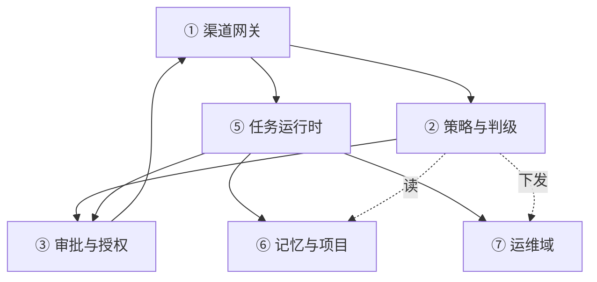
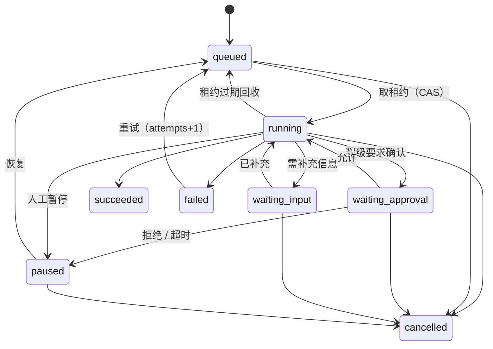

# 11 — 架构锚定

> **状态**：**定稿 v1（2026-10-29）** —— 结构由 owner 逐轮确认：#1/#2/#4 已定，AR1–AR33 已拍板。
> 改动结构须显式修订并递增版本；**不因选型变化而改本文**。
> **前置**：08 定义产品该有什么（119 项）；09 逐条判定实现路径；10 定产品语义。
> **本文只写"不随选型改变的结构"。** 换数据库、换渠道插件、换浏览器后端，**本文不应改动一行**。
> 具体用什么实现见 [12-技术栈选型](12-技术栈选型.md)。
>
> **锚定的含义**：本文的每一条都是**可检验的约束**，不是描述。
> 选型可以试错、可以替换；结构一旦违背，就是返工。

---

## 一、什么算架构

信息一多就"乱"，根因是没区分**结构**与**零件**。三条判定：

| 问题 | 是 → 架构（本文） | 否 → 选型（12） |
|---|---|---|
| 换一个实现，这条结论会变吗？ | 不会变 | 会变 |
| 它是否**约束**未来的选型？ | 是 | 不是，它本身是被约束的 |
| 破坏它是否要重写产品语义？ | 是 | 换掉重装即可 |

对同一件事的两种说法：

| 架构说法（11） | 选型说法（12） |
|---|---|
| 任务执行必须持租约，失租即停 | 租约落在 SQLite，用 CAS + 心跳 |
| 对话与业务状态分开存放 | 对话在 dsh session log，业务在 `ops.sqlite` |
| 所有外部依赖经端口 | 渠道用 `dsh-im`，浏览器用 Playwright |
| 任何第三方不得持有唯一数据副本 | 记忆插件只做检索，正本在自有库 |

> **判据**：一句话里出现具体产品名、版本号、语言、库名，它就是选型。

---

## 二、上下文边界

### 外部参与者

| 参与者 | 交互 | 方向 |
|---|---|---|
| owner | 微信 / 企微 / 飞书 消息、审批应答 | 双向 |
| 模型供应商 | 推理 API | 出站 |
| 目标服务器（被运维对象） | systemd / docker / 文件 / 进程 | 出站（受控） |
| 邮件服务器 | IMAP / SMTP | 双向 |
| 日历服务器 | CalDAV | 双向 |
| 公网内容 | 网页、搜索 | 出站（不可信） |
| 备份介质 | 本机磁盘 / 异地 | 出站 |
| 推送兜底通道 | 仅 P0 告警 | 出站 |

### 明确不承担（边界，不是待办）

| 不承担 | 原因 |
|---|---|
| 多租户 / 团队协作 | 单 owner；引入租户维度会污染全部 ID 与 schema |
| 自研原生客户端 / 多端 UI 框架 | 移动与桌面复用 IM 客户端（飞书/企微/微信）；Web 复用 dsh GUI + 少量自建管理页。不做原生 App、不做 IDE |
| 模型训练 / 微调 | 只做调用与路由 |
| 通用工作流平台 | 只服务"自己的服务器"，不做通用编排 SaaS |
| 多机集群 / 高可用 | 单机故障用快照与重启解决，不用分布式共识 |

**边界一旦外扩，架构就要重做，不是加功能。** 想扩边界，先回来改本节。

### 2.1 客户端（交互面）

**客户端只是交互面（surface），不含业务逻辑。** 三端差异只在呈现能力与交互带宽，不在权限、不在数据。

| 形态 | 是什么 | 说明 |
|---|---|---|
| **移动端** | 手机上的界面 | 随身、单手、碎片时间 |
| **桌面端** | 电脑上的常驻界面 | 值守、大屏、键盘输入 |
| **Web 端** | 浏览器界面 | 深度操作、管理、排障 |

> **客户端不绑定任何具体产品**。同一形态可由 IM 手机端、自建 App、浏览器承担，属选型（12）。

**四条共同契约**：

1. **不持有业务状态**：会话、任务、审批的正本都在服务端；关掉客户端不丢东西。
2. **权限不按客户端区分**：同一 owner 在手机能批的，在 Web 也能批；差别只在"能否做管理动作"。
3. **可同时在线**：手机发起、桌面应答、Web 查看，看到同一份状态。
4. **都经同一入口**：客户端的任何消息都必须经渠道进入网关（准入/去重/分诊/审计）。

**三端职责**

| 形态 | 负责 | 动作 | 不做 |
|---|---|---|---|
| **移动端**（指挥台） | 随时下达、**审批主战场**、紧急中止、收通知 | 文字/语音/图片/文件；确认/拒绝/改成…；"停掉所有任务"；"现在在跑什么" | 大 diff、长日志、配置、Grant、审计 |
| **桌面端**（值守台） | 长时间盯任务、看滚动进度、批量粘贴 | 同移动端；外加拖文件、复制大段输出、长时间挂推送 | 深度查看（diff 高亮、结构化表格）、管理动作 |
| **Web 端**（控制台） | 深度操作 + 管理 + 排障 | 多会话；diff/日志/产物；任务看板；**审批中心**；项目注册；巡检清单；配置；审计检索与导出；kill switch | 离线通知（页面关着收不到，通知走渠道） |

**一句话**：**执行面三端都有，管理面只在 Web 渠道。**

### 2.2 渠道（连通性角色）

> **渠道 = 客户端与服务端之间的连通性提供者。只保证"能送达、能带回身份断言、能声明自身限制"，不承载任何业务语义。**

**渠道契约（4 项必需 + 3 项可选）**

| # | 项 | 要求 |
|---|---|---|
| 1 | **入站投递** | 把消息送到服务端，附**渠道消息 ID**（用于去重） |
| 2 | **出站投递** | 把消息送到指定外部身份 |
| 3 | **身份断言** | 给出 `(channel_id, external_user_id)`；**渠道不保证可信**，可信由服务端配对/签名判定 |
| 4 | **能力与限制声明** | 长度上限、富媒体、交互控件、延迟特征、能否主动推送；**运行时协商**，不编译期写死 |
| 5 | 送达回执（可选） | 可提供，但**不得依赖** |
| 6 | 历史拉取（可选） | 同上 |
| 7 | 在线状态（可选） | 同上 |

**渠道内部做别的业务不限制，但带来三个后果**：

1. **不能依赖渠道的送达状态**做回执确认 → 回执由服务端记录并重试。
2. **渠道可能改写、限流、延迟、乱序** → 服务端自己做去重（渠道消息 ID）、排序、超时。
3. **渠道能力会变**（平台改版、限长、下线功能）→ 能力声明必须运行时协商。

> **渠道是不可靠管道，服务端是唯一可信侧。**

**三种渠道实现族（并列，不是降级关系）**

| 实现族 | 连通性靠什么 | 控制力 | 身份可信 | 适用 |
|---|---|---|---|---|
| **第三方平台** | 平台开放接口 | 低（受平台规则） | 中（平台账号） | 快速上线、已有账号 |
| **自建公网中继** | 自有服务器 + 自研客户端协议 | **高** | 高（自签令牌） | 完整体验、交互控件 |
| **直连 / 隧道** | 局域网、VPN、SSH | 高 | 高（本机身份） | 运维、单机管理 |

**自建中继是一等选项**：只做"转发 + 鉴权 + 排队"，**不存业务正本**；两端协议（客户端↔中继、中继↔服务端）各自独立，可分别替换。

**呈现协议与连通性解耦（自建 Web 渠道可选）**：客户端 ↔ 服务端这一段可用标准化事件流协议
（候选 **AG-UI**：16 类事件、传输无关、SSE/WS 皆可），把对话流、工具调用、长任务进度做成一等 UI。
但它**既不是渠道也不是端口**——不提供身份断言与去重键，仍须经网关（AR12）；且必须接受三条限权：

| # | 限权 | 依据 |
|---|---|---|
| 1 | **状态只读**：`STATE_SNAPSHOT` / `STATE_DELTA` 只装视图投影，不得装任务、审批、授权正本 | AR2 / AR5 / AR23 |
| 2 | **审批不走 run 内中断**：`interrupt` 只用于补充输入（澄清、选参数），授权决策仍走 Gateway → `Approval.answer` | AR10 / §5.8 |
| 3 | **快照不是正本**：`MESSAGES_SNAPSHOT` 只是渲染副本，对话正本在会话账 | AR2 |

> 触发采用的条件见 [12 §六](12-技术栈选型.md)；未触发时用宿主自带 GUI + 少量自建页面。

**渠道不承载业务**：渠道实现里不得出现判级、任务、审批、审计语义（AR27）。

### 2.3 渠道 × 客户端可达矩阵

| 渠道实现族 | 移动端 | 桌面端 | 浏览器 | 终端 | 无客户端 |
|---|---|---|---|---|---|
| 第三方 IM 平台 | ✅ | ✅ | ✅（网页版） | ❌ | — |
| 自建中继 + 自研客户端 | ✅ | ✅ | ✅ | ❌ | — |
| 自建中继 + Web | — | — | ✅ | — | — |
| 直连 / 隧道 | ❌ | ❌ | ✅ | ✅ | — |
| 邮件 | ✅ | ✅ | ✅ | ✅ | — |
| Agent 对 Agent | — | — | — | — | ✅ |
| 告警 / 系统入站 | — | — | — | — | ✅ |

```
客户端（形态） ──> 渠道（连通性） ──> 网关 ──> 服务端
```

**两个关键观察**：

- **渠道可以没有客户端**（agent 对 agent、告警入站）→ "客户端"不是架构主轴。
- **一个客户端可接多个渠道**（浏览器既能开 Web 渠道，也能开第三方平台网页版）。

**五条锚定**：

1. 三端同权；**执行面全开、管理面仅 Web 渠道**（AR26）。
2. **所有渠道入口归一化到同一网关**（AR12），物理接入点可多个、逐个登记。
3. **审批消息按渠道能力渲染**：有交互控件就发按钮，没有就发"要做什么 + 影响 + 选项"，30 秒内可答。
4. 不开发原生客户端。
5. **渠道实现不做业务**（AR27），业务全部在服务端。


---

## 三、结构（宏观抽象）

**此图不含任何具体产品**（除宿主 dsh 外），具体实现一律见 [12-技术栈选型](12-技术栈选型.md)。
**注入了选型后的同一张图**（哪些槽位已定、哪些还空着）见 [12 §三](12-技术栈选型.md)。

```
                外部世界：人 · 被运维对象 · 第三方服务
                           ▲   │
          回执 / 动作结果   │   │ 消息
                           │   ▼
  ① 入口        归一化 → 准入(fail-closed) → 分诊(R0–R3)
                           │
  ② 内核        决策(S1→S2) → 任务 ⇄ 审批 → 审计（一条链）
  （自有，      记忆治理 · 项目注册 · 巡检与告警策略 · 变更与回滚
    不可替换）             │
  ③ 端口        契约 + 契约测试 —— 唯一允许替换的边界
                           │
                           ▼
  ④ 适配器      A 工作区 · B 主机受控 · C 出网 · D 宿主自身
  与执行域      （全部可替换；四域即信任边界）

  侧面：数据面 = 会话账（对话） + 业务账（任务 / 审计 / 授权 / 记忆正本）
  底座：dsh     = 执行框架与插件宿主（会话事件流、工具管线、审批接口、沙箱、调度）
                  它被内核使用，但**不在判断链上**
```

### 读图三句话

> ② **不是一个大盒子**：它由 7 个模块组成，每个模块只写自己那几张表，见下「内核的拆分」。

1. **只有一条主线**：消息进 → 判断 → 排期 → 执行 → 结果出。
   任何绕开 ② 的旁路（例如适配器直接调执行）都是架构违规。
2. **可替换的外部实现只发生在 ③④**：②内部的判定实现可以换（DecisionPort），但结构不换；正本在侧面的数据面，
   任何适配器都不得持有唯一副本（AR5）。
3. **dsh 是底座不是内核**：它让 ②③④ 跑得起来，但"该不该做、做到什么程度"由 ② 决定。

### 决策层（S1 / S2 / Jev）

**决策不是"再加一个模型"，是内核里的一段固定链路：先快后慢、可降级、必留痕。**

```
消息/任务 ──▶ S1 快判（规则 · 启发式 · 缓存）──命中──▶ 执行（R0–R1）
                 │ 不确定 / 高风险 / 冲突
                 ▼
            S2 慢判（主模型推理）──▶ 执行（R2）或 审批（R3）
                 │ 仍无把握，且属"有明确得失"的判断
                 ▼
            Jev（外部期望值判级，可选）──▶ 只给建议，不直接执行
                 │ 任一环节不可用
                 ▼
            降级：S1 规则兜底 + 告知 owner（AR17）
```

五条规则：

1. **S1 先手**：先过确定性规则，命中即走，不调模型。浏览器场景尤其关键——
   选择器、页面模板、已录脚本优先，失败才升级视觉推理。
2. **只有"有明确得失"的判断才给 Jev**，且不可信原文（邮件正文、日志、代码）不出域（AR16）。
3. **Jev 只给建议，不下命令**；它停服不能改变执行能力（10 D16）。
4. **每次决策留痕**：`choice + confidence + reason` 进审计。
5. **DecisionPort 是内核内部接口**：只切换判定实现（规则集 / 模型 / Jev provider），
   不改变结构，也不属于 ③ 的外部可替换边界；Jev 作为外部调用经 ModelPort 出网。

### 选路梯子（先确定性，后模拟）

**任何任务按固定顺序挑执行通道，不许跳级：**

```
CLI / API ──没接口──▶ MCP 工具 ──没有──▶ 浏览器（持久登录）──没有──▶ GUI / 截屏
```

- 能用 `systemctl` / `docker` / 厂商 API 解决的，就不点页面——服务管理因此**不需要 GUI 自动化**。
- 跳级必须在任务计划里写明理由，并记为审计事件（否则 AR16 无从追）。
- 梯子只管"走哪条路"，不管"该不该做"；后者归决策层。

### 入口层（Gateway，模块 ①）

**入口层是唯一把"外部不可信"变成"内部可信"的地方。** 它只做连通之后的六件事，不做任何判断与执行。

**职责**

| # | 职责 | 具体 |
|---|---|---|
| 1 | **持久化与去重** | 原始消息先落 `inbox`，唯一键 `(channel_id, msg_id)`——**落库即去重**；重复消息返回上次结果引用 |
| 2 | **身份解析与准入** | `(channel_id, external_user_id)` → `actor`；未配对、白名单外、渠道停用 → 静默拒绝 + 审计 |
| 3 | **能力协商** | 取渠道能力声明（长度、富媒体、交互控件、能否主动推送）并缓存，供出站渲染 |
| 4 | **分诊** | 调 Policy 得意图：`approval_answer` / `control` / `chat|command` / `event` |
| 5 | **路由** | 按意图分发；维护"渠道会话 → dsh session"粘性映射，避免同一对话分裂 |
| 6 | **出站与回执** | 订阅结果 → 按**打扰分级 + 渠道能力**渲染 → 交付；失败重试、降级、标记未送达 |

**动作**

| 动作 | 输入 | 输出 |
|---|---|---|
| `accept` | 渠道原始消息 | 内部 `InboundMessage` |
| `admit` | `InboundMessage` | `allow / reject`（原因码只进审计） |
| `resolve` | 渠道身份 | `actor` 或 `unpaired` |
| `triage` | `InboundMessage` | `Intent` |
| `route` | `Intent` | `Approval.answer` / `TaskRuntime.*` / 会话 prompt / `dispatcher` |
| `deliver` | 内部消息 | 成功 / 失败 / 未送达 |
| `correlate` | 任意 | 贯穿全链的 `correlation_id` |

**处理顺序（顺序错了就会丢消息或重复执行）**

```
渠道适配器
   │ raw
   ▼
[1] 落库(唯一键 = channel+msg_id) ──重复──▶ 返回已处理引用（幂等）
   ▼
[2] 身份解析 + 准入 ──未配对/白名单外──▶ 静默拒绝 + 审计
   ▼
[3] 能力协商（缓存）
   ▼
[4] 分诊（调 Policy，网关不自己判级）
   ▼
[5] 路由 ┬ approval_answer → Approval.answer   ← 旁路，不进会话
        ├ control        → TaskRuntime / Approval 控制
        ├ chat|command   → 会话 prompt 或 TaskRuntime.submit
        └ event          → dispatcher
   ▼
[6] 出站：订阅结果 → 打扰分级 → 按渠道能力渲染 → 交付 → 重试/降级
```

**为什么先落库**：处理中崩溃时消息仍在 `inbox`，重启可重放；唯一键保证只处理一次。这是"至少一次 + 幂等"，比"恰好一次"更好实现也更可靠（AR28）。

**拥有的数据**

| 数据 | 性质 |
|---|---|
| `inbox` | 已接收消息 + 处理状态（可重建，非正本） |
| `actor 配对` | `(channel_id, external_user_id) → actor`，**正本** |
| `会话路由` | `(channel, thread) → session_id`，可重建 |
| `渠道能力缓存` | 可失效重建 |

**不做**：不判级、不决定审批结果、不建任务状态、不执行工具、不存业务正本、不实现渠道协议（AR27）。

**失败语义**

| 场景 | 行为 |
|---|---|
| 准入拒绝 | 静默（不回细节）+ 审计 + 计入限流 |
| 去重命中 | 返回原回执引用，不重复执行 |
| 分诊/Policy 不可用 | fail-closed：不进执行，回"当前不可用"，消息留 `inbox` 待重试 |
| 出站失败 | 重试 → 降级通道 → 标记 `undelivered`；**不重放审批**（由 Approval 重投） |
| 紧急模式 | 仅放行控制指令（状态查询、恢复、全局中止） |
| 队列积压 | 超上限拒新入站并告警，不无限堆积 |

### 内核的拆分（7 个模块）

**为什么必须拆**：现在"内核"一个词同时装着判级、审批、任务、审计、记忆、项目、巡检。不拆会出现三个具体问题：

1. **任务状态被多方写** —— 崩溃后无法判断该信谁；
2. **审批无法复用** —— 渠道、任务、运维各自实现一遍"问人"；
3. **审计与业务耦合** —— 为了记审计去改业务表，或业务失败导致审计缺失。

**拆分原则（不是按时髦的领域划分）**：

| 原则 | 含义 |
|---|---|
| **单一写者** | 每张表只有一个模块可写；其他模块只能调它的 API（AR23） |
| **变更走 API，通知走事件** | 订阅者收到事件后，只能调 owner 的 API 或发新事件，**不能直接改表** |
| **决策无副作用** | 策略模块只返回 `allow / ask / block + reason`，不执行、不发通知、不写业务表 |
| **审计只订阅** | 审计是 sink，不被任何模块依赖；fail-closed 在各 owner 内部实现，不靠审计兜底 |
| **授权唯一长效形态是 Grant** | 渠道确认只给"本次"，不沉淀 |

> **不按"开发 / 生活"功能域拆**：两者共用任务、审批、审计与记忆，
> 按功能域切会立刻出现跨模块直写。切分依据是**数据所有权**，不是功能分类。

| # | 模块 | 职责（一句） | 拥有的数据 | 明确不做 |
|---|---|---|---|---|
| 1 | **渠道网关** | 归一化、身份映射、准入、去重、审批应答解析、出站回执 | `channel_bindings`、`inbound_seen` | 不判级、不建任务 |
| 2 | **策略与判级** | R0–R3、网络三档、域/路径白名单、选路梯子 | `policy_rules`（配置）、`decisions` | 不执行、不发通知 |
| 3 | **审批与授权** | 审批请求、Grant 生命周期、击杀开关 | `approvals`、`grants` | 不执行动作 |
| 4 | **审计与证据** | 哈希链、导出、完整性校验 | `audit_log` | 不被任何模块依赖 |
| 5 | **任务运行时** | 状态机、幂等、租约、调度、取消/重试 | `tasks`、`task_events`、`receipts` | **只有它能改任务状态** |
| 6 | **记忆与项目** | 记忆三态、项目注册与边界、检索门面 | `memory`（正本）、`projects` | 不直接改任务 |
| 7 | **运维域** | 巡检清单、告警策略、变更/快照/回滚 | `inspections`、`changes` | 只发现 + 报告，不擅自修复 |



> ④ 审计**不在依赖图里**：它订阅所有模块的事件，但没有任何模块依赖它。

### 编排策略（用扩展点组合，不替换循环）

**能做与不能做的分界**：

| 层次 | 手段 | 做不做 |
|---|---|---|
| **观察** | `session/event` | 做（审计、出站） |
| **干预** | 公开扩展点 hook | **做，成体系** |
| **替换** | 改 `ReactLoopAgent` 本体 | 不做（= fork） |

我们做的是**编排策略**——把宿主暴露的扩展点组合成我们的行为规则，而不是换掉循环。

**可编排的七个维度**

| 维度 | 干预什么 | 落点 |
|---|---|---|
| 步进控制 | 每步前注入/裁剪上下文；判断继续、暂停、转人工 | `agent/pre-step` |
| 上下文构建 | 项目规则、记忆、技能、当前目标注入系统提示 | `system-prompt/assemble` |
| 模型路由 | 按任务类型/成本/能力选模型与参数 | `agent/request` |
| 工具治理 | 工具可见性、参数校验、拦截、降级替代 | 工具注册 + `tools/pre-execute` |
| 终止与升级 | 步数/预算上限 → 暂停、转人工、换模型重试 | `pre-step` + 任务层预算 |
| 上下文压缩 | 何时压缩、保留什么（决策与证据必须保留） | compaction 策略 |
| 子代理编排 | 是否委派、深度上限、子代理能力集 | subagent + 能力集（权限边界另验） |

**三条边界，防止"编排"滑向"接管"**：

1. **只做加法与拦截**：不改工具配对协议、不改会话持久化格式、不改状态迁移语义。
2. **声明式、可关闭、留痕**：每条干预都是可配置策略，触发即写审计（AR16）；关掉全部编排策略，基础对话仍要能跑。
3. **不依赖具体插件名**：编排规则里不得出现插件/工具产品名（AR4），否则换实现即失效。

**归属**：编排策略是 **Policy 的"编排策略"子职责**，不新增模块。任务级参数（步数上限、预算）存在 TaskRuntime 的任务对象上，Policy 只读不改——这样"谁能改任务"仍只有 TaskRuntime。

### 胶水 / 内核 / 领域（什么不该进内核）

**两个必须防的退化**：① 胶水层里写进了业务判断；② 内核膨胀成什么都管的泥球。

**判据三问 —— 任一为"是"就不是胶水**：

1. 去掉它，会不会丢数据或丢状态？
2. 它有没有自己的失败语义（幂等、租约、回滚、超时拒绝）？
3. 换宿主（dsh 换成别的东西）之后，它是否仍然必须存在？

| 层 | 判据结果 | 允许做什么 | 举例 |
|---|---|---|---|
| **胶水**（`adapters/`） | 三问全否 | 只做格式映射、参数转换 | 消息转 `session.prompt`、事件转回执、MCP 工具包装 |
| **内核**（`kernel/`） | 三问皆是 | 跨域不变式、状态与证据 | 任务状态机、租约、Grant 撤销、哈希链、记忆三态 |
| **领域**（`domains/`） | 可增删 | 具体业务，经注册表接入 | 巡检清单、邮件摘要、报告模板、日历 |

**入核门**：往 `kernel/` 加文件，必须三问皆是；有一个"否"就落 `domains/`。
新增内核模块属于**架构变更**（要改本节），不是在代码里加一个目录。

**内核对外只暴露 4+1 个入口**：`decide` / `submitTask` / `requestApproval` / `appendAudit` + `memory.read/write`。
其余能力一律经端口；领域包不得 import 内核内部实现。

```
src/
├── kernel/     gateway · policy · approval · audit · task · memory · ops
├── ports/      契约 + 契约测试
├── adapters/   只做映射，零业务判断
└── domains/    巡检 · 邮件 · 日历 · 报告（经注册表接入）
```

### 架构健康三指标（不是代码质量指标）

| 指标 | 健康表现 | 恶化信号 |
|---|---|---|
| **换实现改动面** | 换渠道/工具只动 `adapters/` + 配置 | 必须改 `kernel/` → 边界已破 |
| **变更频率比** | 内核 < 适配器 | 内核变更更频繁 → 功能在往内核渗 |
| **契约测试覆盖** | 每个在用端口都有 conformance 用例 | 有端口无测试 → "可替换"是假的 |

> 完成度用**通过契约测试的端口数**衡量，不用代码行数。胶水行数天然占多数，这不是问题。

### 与 dsh 的挂载点（源码实测）

**结论：我们不是"绕过" dsh 编排，而是挂在它已有的扩展点上。**

| 模块 | dsh 扩展点 | 能力 |
|---|---|---|
| 渠道网关 | 渠道插件 + `ctx.sessions.prompt` | 入站注入、出站推送 |
| 策略与判级 | `tools/pre-execute`（返回 `allow / ask / block`）、`agent/pre-step`、`system-prompt/assemble`、`agent/request` | **执行前拦截**、步前干预、上下文策略、按请求选模型 |
| 审批与授权 | `approval/request`、`user-questions/request` waterfall | 挂外部应答器，fail-closed |
| 审计与证据 | `session/event` 订阅 + `tools/post-execute` | 全量事件 + 结果裁决 |
| 任务运行时 | 注册 `delegate_task` 工具；worker 自建 | dsh 的 `jobs` 是 session 作用域，跨会话队列只能自建 |
| 记忆与项目 | 注册检索工具；`system-prompt/assemble` 注入 | 检索结果按预算注入上下文 |
| 运维域 | 注册 `svcops` 工具；`schedule` 触发 | 定时巡检 + 受控执行 |

> **关键**：真正能"拦得住"的是 `tools/pre-execute`（返回 `ask` / `block`），
> `session/event` 是事后通知，**不能用来做准入**。把两者搞混，就会出现"日志里拒了，动作已执行"。

### 端口与适配器（配对界定）

**关系是单向的**：**端口先定义、适配器后实现**。反过来（装个插件就多一个端口）就是架构倒置。

**四条硬规则**

| # | 规则 | 破坏后的表现 |
|---|---|---|
| 1 | **端口由内核定义**，适配器不得反向定义端口 | 内核被插件牵着走，端口数随依赖增长 |
| 2 | **端口只描述能力**：契约内不得出现协议名、命令行、产品名（AR32） | 换供应商要改内核；"可替换"变成口号 |
| 3 | **适配器只做映射**：无判级、无重试策略、无状态判断 | 换个渠道，重试语义就变（AR24） |
| 4 | **错误必须翻译成端口语义**，不得把实现侧的错误码抛给内核 | 内核被迫懂某个工具的退出码，端口名存实亡 |

**可换性三级**（本文与 12 的 L1/L2/L3 口径）

| 级别 | 含义 | 换它要做什么 | 动数据吗 |
|---|---|---|---|
| **L1 配置级** | 换 provider | 改配置、重启 | 否 |
| **L2 适配器级** | 换实现 | 写一个适配器 + 过该端口的契约测试；可能需重登/重连 | 否 |
| **L3 迁移级** | 换引擎 | 迁移脚本 + 停机窗口 + 回滚演练 | **是** |

**三类端口（13 个端口不是平级的）**

| 类 | 端口 | 换它意味着 |
|---|---|---|
| **外部能力** | Channel · Notify · Mail · Calendar · Search · Model · Browser · SvcOps | 换供应商或协议 |
| **本地资源** | Exec · Storage | 换运行时或存储引擎，**可能动数据** |
| **内核内部接缝** | Decision · Memory · Sched | 换判级实现 / 换检索门面 / 换宿主调度包装，**不改结构** |

**逐端口界定**

| 端口 | 核心动作 | 明确不做 | 失败翻译 | 级别 |
|---|---|---|---|---|
| **ChannelPort** | `deliver` / `receive` / `identify` / `capabilities` | 不建会话、不做审批、不判级（AR27） | `Unavailable` / `Rejected` / `TooLarge` | L2 |
| **NotifyPort** | `notify(level, payload)` | 不做对话、不承载审批应答 | `Unavailable` | L2 |
| **ModelPort** | `complete` / `stream` / `usage` | **不选模型**（路由在内核） | `RateLimited` / `Transient` / `BudgetExceeded` | L1 |
| **DecisionPort** | `evaluate(input) → choice+confidence+reason` | **不执行、不发通知、不写业务表** | `Unavailable` → 降级 S1（AR17） | 内部 |
| **ExecPort** | `run(argv, cwd, timeout, cancel)` / 文件读写 | 不判断命令风险（AR11 在内核） | `PermissionDenied` / `Timeout` / `NotFound` | L2 |
| **BrowserPort** | `navigate` / `snapshot` / `act` / `profile(name)` | **不得暴露任意命令执行** | `LoginRequired` / `Blocked` / `Timeout` | L2 |
| **SvcOpsPort** | `list` / `status(unit)` / `start` / `stop` / `logs(unit)` | 不做健康判定与告警策略（属模块⑦） | `UnitNotFound` / `PermissionDenied` / `NotSupported` | L2 |
| **MailPort** | `send` / `fetch` / `search` / `draft` | 不做发送审批、不做可信收件人判定 | `AuthFailed` / `QuotaExceeded` / `Transient` | L2 |
| **CalendarPort** | `list` / `create` / `update` / `delete` | 不做提醒调度（走 SchedPort） | `Conflict` / `AuthFailed` | L2 |
| **SearchPort** | `search` / `fetch` | 不做来源可信判定 | `Blocked` / `RateLimited` | L1 |
| **MemoryPort** | `write`（进治理层）/ `search`（出结果） | **不持有正本**（AR5） | `Unavailable` → 降级为无记忆 | L2 |
| **StoragePort** | `tx` / `cas` / `appendOnly` | 不建业务表、不做状态机 | `Conflict` / `Corrupt` | L3 |
| **SchedPort** | `schedule` / `cancel` | 不投递到非原 session | `Unavailable` | L2 |

**适配器（五职责，缺一不可）**

| 职责 | 要求 |
|---|---|
| 连接与凭据 | **引用式**解析，逐操作取；不缓存明文 |
| 请求构造 | 只做"参数 → 协议"映射 |
| 结果映射 | 协议响应 → 端口结构 |
| **错误翻译** | 映射到上表的端口错误；**必须区分 Transient 与 Permanent** |
| **能力声明 + 健康探测** | 能力运行时协商（§2.2 第 4 项）；启动探活，失败即摘除 |

**三不写**：判级 / 重试策略 / 状态判断——出现在 `adapters/` 就是边界破了。

**多适配器并存**：一个端口可挂多个适配器（如多渠道、多服务管理器），但**选择规则属于内核**，适配器不得"抢单"；单个适配器探活失败只摘它自己，不影响同端口的其他实例。

**端口 ↔ 内核模块（谁在用）**

```
① 网关 ──▶ Channel · Notify · Decision(分诊)
② 策略 ──▶ Decision · Model          （只问，不执行）
③ 审批 ──▶ Channel(出站渲染)
④ 审计 ──▶ （不调任何端口，只订阅事件）
⑤ 任务 ──▶ Exec · Browser · SvcOps · Mail · Calendar · Search · Model
⑥ 记忆 ──▶ Memory · Storage
⑦ 运维 ──▶ SvcOps · Sched · Notify
```

> **④ 审计不调端口**——这是"不被任何模块依赖"的另一种说法。

**四条最容易破的边界**

1. **"重启某个服务"走 Exec 还是 SvcOps？** → **有专用端口的能力不得走通用端口**，否则限域双闸只能按命令字符串判，会漏。**SvcOps 的判定粒度是 unit，不是命令行。**
2. **BrowserPort 能否起子进程？** → 不能。能起进程就等于绕开 Exec 的闸。
3. **StoragePort 会不会变成泥球？** → 它被全部 7 个模块共用，因此只允许"事务 / CAS / 只追加"三种原语，**不得承载业务语义**。
4. **同一件事走 Channel 还是 Notify？** → Channel = 对话与审批应答；Notify = 打扰分级出口（可跨渠道兜底，仅 P0）。**同一条消息只走一个**，否则双发。

> **端口不是接口的别名，而是"契约 + 契约测试"。** 没有契约测试的端口不算端口，只是抽象类。
> 换适配器的判据：拔掉它，内核仍能编译、单测仍绿，且给出**明确的不可用**而非静默降级。

### dsh 的位置

**dsh 是宿主与执行框架，不是内核。**

| dsh 提供 | 我们提供 |
|---|---|
| agent loop、会话与事件流、工具管线、审批 seam、沙箱、子代理 | 判级规则、任务对象、审计链、记忆正本、准入、巡检语义、运维动作 |

结构上必须满足：**内核不 import 任何插件包**；内核只依赖端口契约与事件流。

**底座契约（6 条）**

| # | 契约 | 为什么 | 怎么验 |
|---|---|---|---|
| 1 | **装配必须可验证** | peer 不匹配时宿主会**静默跳过整个 bundle**，表现为"插件消失" | 启动自检验 **7 个模块全部注册成功**；缺一即拒绝启动，不接受"部分可用" |
| 2 | **扩展点分级** | 我们挂在 7 个点上，其中有的只是内部实现 | 分「受支持 API」/「内部实现」；后者可观察、**不得依赖**；升级只验前者 |
| 3 | **loop 崩溃 ≠ 任务停摆** | 若任务靠 agent loop 驱动，loop 一崩队列全停 | 任务由**自有 worker 驱动宿主工具管线**；loop 崩只影响对话面，队列可重投 |
| 4 | **升级必须过闸** | 宿主明文承诺破坏兼容 | 零干预基线（AR29）+ V1–V10 冒烟 + 端口契约测试；任一失败即回滚 |
| 5 | **单一 bundle** | 多 bundle 放大 peer 匹配面 | **一个自有 bundle**，内部按 7 模块分包 |
| 6 | **注入边界** | 宿主能力是"缝"，不是"面" | 只经端口与扩展点使用；**内核不得 import 宿主内部包**（与 AR24 同源） |

### 组装与启动（部署视图）

**准确表述**：内核是我们写的一组模块（入口、策略、任务、审批、审计、记忆、运维），各自持有自己的数据，通过**端口契约**调用外部实现，通过 **dsh 扩展点**使用宿主能力。它被打包成 bundle，由 dsh 在启动时装载；此后 **dsh 的 agent loop 负责对话，内核的 worker 负责任务**，两者同进程运行。内核在 `pre-execute`、审批 waterfall、事件流上拦截与记账，**不接管 agent loop**。

**三个容易被说反的点**：

| 容易说成 | 准确说法 |
|---|---|
| 内核组织各端口能力 | 内核**定义**端口契约；适配器**实现**；宿主**提供**运行时能力 |
| 记忆/任务/权限/审计是端口 | 它们是**内核模块**（持正本）；端口只是它们的外部替换点 |
| 先构建插件再接 dsh | dsh 启动时**装载 bundle**，我们的代码成为进程的一部分 |

```
我们仓库                          运行中的服务器
├ kernel/    ──打包──┐
├ ports/             ├─ bundle（cordis.patch.yml + plugins）
├ adapters/          │        │ dsh plugin add -w
└ domains/   ────────┘        ▼
                        systemd → dsh 进程（--profile web）
                              ├─ dsh 运行时：会话 / 工具 / 模型 / 沙箱 / 调度
                              ├─ 我们的 bundle：
                              │    ├─ 入口层 → 渠道适配器
                              │    ├─ 策略 / 审批 / 审计 / 记忆 / 运维
                              │    └─ 任务 worker
                              ├─ 循环 1：dsh agent loop（对话）
                              └─ 循环 2：内核 worker（任务、租约、恢复）
```

**启动四步（顺序固定）**：

1. dsh 自检并装载 bundle；
2. 内核**启动自检**：`dispatcher` 存在、数据目录可写、`schedule` 已绑定（缺则重建）、**已装插件注册的动作集 ⊆ 接入剖面允许集**（超出即拒绝启动）；
3. 内核**恢复**：回收过期租约、重放 `inbox` 未处理消息、重投未答审批、补发未送达回执；
4. 打开入站，开始服务。

缺第 2、3 步，重启就会丢任务、丢审批。

**三种"接入 dsh"的具体形态**：

| 形态 | 做什么 | 例子 |
|---|---|---|
| **注册工具** | 让模型能调用我们的能力 | `delegate_task`、`svcops`、`memory_search` |
| **挂 hook** | 在关键点拦截或改写 | `tools/pre-execute`（准入闸）、`agent/pre-step`、`system-prompt/assemble` |
| **订事件** | 只观察、只记账 | `session/event` → 审计、出站 |

### 宿主已提供的能力（按需启用，不必自建）

以下是 dsh 仓库里已存在、可直接为我所用的能力。**判据不变**：有 seam 就不自建；用了就要写退出路径。

| 能力 | 宿主包 | 我们可以怎么用 | 状态 |
|---|---|---|---|
| **管理面 UI** | `ui-approval` `ui-jobs` `ui-plan` `ui-permission-presets` `ui-agent-preset` `ui-plugin-manager` `ui-settings-session-log` `ui-deliverables` `ui-trajectory` `ui-secret-mask` | 审批、会话内作业、计划、权限预设、插件管理、会话日志、交付物、轨迹、脱敏**都已现成** | 采用 |
| **计划级审批** | `plan/plan-mode` | 先出计划→批准→执行，状态随 resume/fork 存活；正好是"确认计划而非单动作" | 采用 |
| **大输出外溢** | `spill` + `spill-local` + `spill-policy` | 超长日志/diff 落盘并返回 locator，替代"1800 字切段" | 采用 |
| **类型契约生成** | `typert`（registry / generator / protocol） | 构建期从类型生成 schema 与声明，对应 N3/N5；**只在构建期，不进运行期** | 采用 |
| **远端执行** | `ssh` `fs-ssh` `subprocess-ssh` `sandbox-ssh` | B 域可跨主机；多机运维不必自建传输 | 验收后采用 |
| **事件入站** | `experimental/webhook` | 无客户端渠道（告警/CI）。**内置动作是新建 root Session，违反 AR25** → 必须注册自定义规则走 Gateway→dispatcher | 改后采用 |
| **并行隔离** | `experimental/worktree` | 每任务一个 worktree，对应 E4 同项目并行 | 验收后采用 |
| **语音转写** | `experimental/speech-to-text`(+`sensevoice`) | A8 语音输入；实验性，需验收 | 验收后采用 |
| **可观测导出** | `telemetry/otel` | traces/metrics 直接导出，省自建管线 | P2 |
| **测试件** | `test-support/*`（`llm-replay` `llm-mock-server` `session-snapshot` `agent-loop-testkit` `tool-testkit`） | L1 契约测试与行为回归的基础设施 | 采用 |
| **限域策略** | `sandbox-policy` `fs-observation-policy` | AR11 双闸的一部分可复用 | 采用 |
| **工作流 / PTC** | `workflow` `tool-workflow` `workflow-ptc` `ptc-runtime*` | 多步脚本化执行；**只作执行域与步骤实现，不接管编排**（AR29） | 评估后采用 |
| **目标对象** | `goal` `tool-goal` `command-goal` | D21 已定不引入 Goals；只借用计划展示 | 不采用 |

**明确不采用**：`product-analytics`、`personalized-recommendations`、`plugin-recommendations`、`brand-official`、`dockkit`、`liveshare-protocol`、`translator`、`cot-translation`、`ralph`、`claude-code-mods`、`hooks-codex`、`cua-macos`、`win32-process`、`computer-use`（服务器无桌面）、`agent-team-profile` / `subagent-oar`（共享父治理；未过 AR30 不采用）。

**三处对既有判断的修正**：

1. **Web 管理面不再"大部分要自建"**：审批、会话内作业、计划、权限预设、插件管理、会话日志、交付物、轨迹、脱敏都现成；**只需自建**跨会话任务视图、审计检索与导出、Grant 管理。
2. **审批可复用 `plan-mode`**：不必从零做"计划确认"交互；我们只补渠道侧应答与持久化。
3. **语音与远端执行不必自研**：ASR 与 SSH 传输都在仓库里，只需验收。

### 社区插件候选（按端口归类，2026-10-29 实测）

**证据等级 E2**：GitHub 元数据 + 读过 README，**未安装、未运行**。此表只回答"哪个槽位有没有现成供给"，
**不改变本文任何结构**；换掉其中任何一项，§二/§三/§九 不应改动一行。

| 槽位（对应 §三 / §四） | 候选 | 实测事实 | 判定 |
|---|---|---|---|
| **ChannelPort** | `dsh-im-gateway@0.3.3`（MIT，106 tests，25+ 平台） | 统一会话 + **远程审批 + 交互提问** | **二选一**，与 12 现有 `dsh-im` 冒烟对比；其"统一会话/远程审批"**不得绕过 Gateway（AR12）与审批解耦（§5.8）** |
| **ChannelPort** | `dsh-clawbot`（MIT，11★） | 微信 iLink 网关 + 主动通知 | 与 WFXM iLink 资产重叠，**参考** |
| **客户端 / 移动通道** | `dsh-pocket`（2.5k★，**GPL-2.0**）、`dsh-mobile`（679★，MIT，含 `mobile-gateway` WebSocket） | 前者扫码同屏 dsh web；后者原生 App + 独立网关插件 | pocket **不进核心**（GPL）；mobile-gateway 可作渠道适配候选 |
| **MemoryPort** | `EverOS`（13.7k★，Apache-2.0） | **Markdown 为正本** + SQLite/LanceDB 派生索引；Python | **架构参考**（与我们 AR5 同向），不直接采用（语言栈不符） |
| **MemoryPort** | `dsh-meow-memory`（331★，MIT，七层 SQLite）、`graph-memory`（663★，MIT，知识图谱） | 均为插件自持存储 | **只做索引/检索**；正本必须我们持有（AR5） |
| **DecisionPort（Jev）** | `jev-dsh-decision`（266★，**无 License**） | 原生 bundle；`jev_status` / `jev_check_connection` / `jev_evaluate` + skill；**不执行、不接管主 agent** | 与 10 D16 一致（只给建议）；但**无许可证 → 不可进核心**，仅作外部可选 provider |
| **审计展示层** | `dsh-replay`（MIT，适配 `0.2.1-rc.2`） | 只读回放、成本、审计、fork 树、可分享 HTML；**不重发模型、不写日志** | 采用为"看审计"的展示层；**跨会话查询与哈希链仍自建**（§四 审计正本） |
| **成本（I5）** | `dsh-cost-meter`（569★，MIT）、`dsh-cost-ledger@0.1.4` | 会话/模型成本、预算工具 | 采用其一；**成本聚合正本仍在业务库** |
| **MCP / 技能治理（K2）** | `dsh-mcp-manager`（22★，MIT） | Settings UI + HTTP API；改 profile 的 `cordis.patch.yml`；工具数健康 | 管理面采用；**配置写入属管理面动作 → 只走 Web 渠道并记审计** |
| **多 agent** | `dsh-agent-team-gui`（283★，MIT） | 成员级模型/工具策略 + Run Center | **AR30 验收后可评估**；未过 AR30 前仅参考（子代理共享父治理） |
| **工具层效率** | `dsh-ops`（4.7k★，MIT） | **实为 token 效率工具**：替换官方 read/glob/grep、`tools_addition` 动态加载、渐进披露 | 可评估；前置 **AR31**（声明 `replaces` 且仍过同一闸）；未过前不引入 |
| **SvcOpsPort** | 实测：systemd 检索 **7 个且全 0★**（仅"重启按钮/自启动"）；`backup` 检索 **0**；`opskat`（701★）为 **GPL-3.0** 独立面板 | 无可用服务器运维插件 | **确认 `svcops` 必须自建**（Step 4 立项成立） |

**三处对既有判断的修正**：

1. **`dsh-ops` 不是服务器运维工具。** 先前把它当作"低层运维工具包"是误读；它是**工具层 token 效率插件**。
   因此 **主机运维（systemd/docker）的空白没有被社区填补**，`svcops` 自建结论不变且更硬。
2. **渠道出现第二个成熟选项。** `dsh-im-gateway` 与 `dsh-im` 能力重叠且自带审批/交互提问 → 12 由"采用 dsh-im"
   改为"**二选一，冒烟对比后定**"。但二者都**不能把会话语义直接接到宿主 session**，必须过 Gateway。
3. **桌面端客户端确实存在，但不改变结论。** `dsh-desktop`（33.9k★ / 16.9k★）是 **Windows/macOS 本地打包 dsh 的桌面壳**，
   不是"远程控制 Linux 服务器"。**"不做原生客户端、远程操作走 Web 渠道"（§2.1 / AR26）不变。**

> **目录数字不可作供给依据**：各插件目录自报 280+ / 1,819"真插件" / 6,000+ / 11,000+，互相矛盾；
> GitHub topic 实测为 293（`deepseek-harness-plugins`）与 922（`deepseek-harness-plugin`）。**逐个核验，不看目录。**

### 第三方插件接入剖面（按能力面接入，不按整包）

**问题**：AR27 的检验方式（lint 查"渠道目录里有没有判级/审批分支"）对**自研适配器**有效，
对**第三方插件**无效——我们改不了它的源码，但可以让它**只能启用一部分能力**。

**规则**：接入单位不是"整包装或不装"，而是**动作剖面（capability profile）**。

| 动作类别 | 默认 | 归属 |
|---|---|---|
| `send` / `receive` / `identity` / `capability` | **允许** | 渠道契约四项（§2.2） |
| `session.create` / `session.route` | **禁用** | 网关的会话粘性映射（§三 入口层） |
| `approval.decide` / `approval.persist` | **禁用** | 审批模块（§5.8 审批与渠道解耦） |
| `task.create` / `task.update` | **禁用** | 任务运行时（AR23 单一写者） |
| `config.write` | **禁用** | 管理面（AR26） |
| `tool.register` | **允许，但须声明 `replaces`** | 并接入同一 `tools/pre-execute`（AR31） |

**可检验**：启动自检比对"实际注册的动作集 ⊆ 剖面允许集"，超出即 fail-closed **拒绝启动**。

**淘汰条件（比准入评分更硬）**：插件无法关闭上表"禁用"项 → **整包拒绝**，不接受"先用着，以后再收"。

**为什么不做源码审查**：第三方插件会升级，审查一次下个版本即失效；剖面比对**每次启动都跑**，且不受升级影响。

> 这条机制同时把"能装插件就不自建"从**信任问题**降级为**配置问题**：装不装看评分，能不能越界看剖面。

---

## 四、对象模型与数据所有权

### 四个一等对象

| 对象 | 关键字段 | 正本 | 约束 |
|---|---|---|---|
| **Conversation** | `id`、渠道身份映射、消息序列、续跑点、**`role`**（`interactive` / `dispatcher` / `task`） | 会话账 | 一渠道可多会话，多轮可续；**`dispatcher` 全局唯一**（§5.8） |
| **Task** | `id`、幂等键、目标、状态、计划、产物、租约、**`session_id`**、**`start_cursor`** | 业务账 | 状态对齐 A2A（§六）；与 Conversation **1:1**，可"会话升级"（§5.8） |
| **Receipt** | `task_id`、结果、证据、diff/日志、可否回滚 | 业务账 | 结束幂等、可补发 |
| **Grant** | `id`、范围（本次/本会话/永久）、动作集、来源、过期、撤销 | 业务账 | 可枚举、可撤销（AR20） |

**这四者是产品结构**；08 的 A–M 域只是分析工具。**ID 方案只对这四个对象定义**，中间过程不发 ID。

### 数据清单

| 数据 | 正本位置 | 唯一写者 | 备份 | 可重建 |
|---|---|---|---|---|
| 对话与工具记录 | 会话日志（宿主） | 宿主 | 要 | 否（历史） |
| 任务与回执 | 业务库 | 任务执行器 | 要 | 否 |
| 审计 | 业务库（哈希链） | 审计写入器（只追加） | 要 | 否 |
| 授权 / 配对 / 身份映射 | 业务库 | 准入与判级 | 要 | 否 |
| **profile 配置**（`cordis.patch.yml`） | 部署目录 | **管理面（仅 Web 渠道，AR26）** | 要 | 否（人工可重建，但会丢变更） |
| 记忆正文 | 自有库或文件 | 记忆治理 | 要 | 否 |
| 记忆索引 / 向量 | 派生 | 记忆治理 | 否 | **是** |
| 成本台账 | 业务库（聚合） | 成本聚合 | 要 | 是（从事件重放） |
| 浏览器登录态 | 独立 profile 目录（按名索引） | 浏览器适配器 | 视情况 | 是（需重登） |
| 凭据 | 宿主凭据服务（引用式） | 人 | 加密备份 | 否 |
| 插件与配置 | 版本化配置文件 | 人 | git | 是 |

**三条规则**

1. **单一写者**：每份数据只有一个写入者；其它组件只读或经端口请求。
2. **可重建的不算正本**：索引、缓存、派生视图永不作为唯一副本。
3. **第三方不得持有唯一数据副本**：任何插件卸载后，系统仍能凭自有数据恢复功能。

### 数据面的读写规则

对象与所有权只回答"是谁的"；这一节回答"**怎么流**"。

| # | 规则 | 具体 |
|---|---|---|
| 1 | **写只经 owner API** | 任何模块不得直写他表；宿主事件也不能直接改业务表 |
| 2 | **读也只经 API / 只读视图** | 跨表 join 只允许出现在 owner 自己提供的只读视图里（AR33） |
| 3 | **一个事务只跨一个库** | 对话账与业务账之间不做分布式事务；跨库用"游标 + 事件补偿" |
| 4 | **投影只订阅、可重放、幂等** | 审计 / 成本 / 看板都是投影；投影失败**不回滚业务**，按游标重放 |
| 5 | **迁移按模块独立** | 每个模块持有自己的 schema 版本；迁移失败即拒绝启动，**不回退到半旧 schema** |
| 6 | **保留分层** | 热（可检索）→ 温（归档）→ 冷（仅备份）；**审计不进归档**，只增不删 |
| 7 | **快照点一致** | 会话日志 + 业务库 + 配置取同一"数据面快照点"；恢复时按该点对齐 |
| 8 | **数据分级** | 三级：可进审计 / 只进哈希 / **禁止落盘**；不可信原文出域（AR16）在此落地 |

> **对话账只经公开事件读**：不直接解析 session 文件——宿主升级会改格式。

### 记忆的生命周期（三态）

| 态 | 规则 |
|---|---|
| **候选** | 新写入先进候选，**需一次确认**（或由策略按域自动放行）；不参与检索 |
| **生效** | 带来源、时间、置信度；参与检索，可被引用 |
| **过期 / 遗忘** | 到期降级回候选或归档；**遗忘是真删正文**，同时删派生索引 |

正文在自有库/文件，索引可重建（见上表）。记忆插件只做检索，不持正本（AR5）。

---

## 五、六个生命周期

> 每个生命周期都必须回答四问：**状态归谁 / 什么触发迁移 / 失败怎么办 / 崩溃后怎么恢复**。
> 答不上这四问的流程，等于没设计。

### 5.1 任务



| 迁移 | 触发者 | 租约 | 失败 / 超时 |
|---|---|---|---|
| 建任务 → `queued` | 渠道网关（幂等键 `insertIfAbsent`） | 无 | 重复提交返回同一任务 ID |
| `queued` → `running` | 任务运行时（期望 status + leaseId 的 CAS） | **持有**，心跳续租 | 抢不到则留在队列 |
| `running` → `waiting_approval` / `waiting_input` / `paused` | 任务运行时 | **冻结**（不续租、不计超时） | 不解冻就会被别的 worker 回收 |
| `waiting_*` → `running` | 任务运行时（收到决定） | 重新取租约 | 决定已落库才恢复 |
| `running` → 终态 | 任务运行时 | 释放 | 回执**一次写入**，重复完成不覆盖 |
| `running` → `queued` | 租约过期 | 释放 | `attempts+1`；超上限 → `failed`，不静默重试 |

**四条硬约束**：

1. **只有任务运行时能改任务状态**（AR23）。
2. **`waiting_*` 与 `paused` 冻结租约** —— 否则"等人 10 分钟"会被判成崩溃。
3. **幂等键由入站生成**（渠道 + 消息 ID），回执按 `task-done:<id>` 去重；两处同源。
4. **任务与会话 1:1** —— 一个任务绑定一个会话，`resume` 复用同一会话，**不并发 resume**（这是"单写者"的具体含义）；允许会话升级（§5.8），升级后仍是一对一。

**不引入 `scheduled` 状态**：定时由调度器触发"建新任务"，不让任务长期挂着未来时间。

### 5.2 审批

```
requested ──> delivered ──> answered(allow | deny)
     │             │
     │             └──> 投递失败 ──> 降级通道 ──> 仍未送达 ──> expired
     └──> expired（超时）
```

| 规则 | 说明 |
|---|---|
| **确认对象是计划** | 审批挂 `plan + decision`，不是单条命令；一次确认授权一组已列动作 |
| **必须自持久化** | 进程重启后未答的审批要能重投递；**不依赖宿主的审批内存态** |
| **一审批一应答** | nonce 只接受一次；重复应答无效，记审计 |
| **超时 = expired** | 不回许执行；任务转 `paused` 并通知，**不是 `failed`**（避免自动重试风暴） |
| **应答可能是修改要求** | "改成这样"落 `waiting_input`，不是拒绝 |
| **击杀开关** | 一次性撤销全部 Grant、拒绝新入站、停止 `queued` 任务 |

### 5.3 入站

```
到达 ─> 归一化 ─> 准入(fail-closed) ─> 去重 ─> 分诊 ─> 路由 ─> 执行 ─> 回执
```

| 规则 | 说明 |
|---|---|
| **审批应答旁路** | 命中未决审批的消息**直接进审批**，不进会话；否则会重复消费或被误读 |
| **准入在分诊之前** | 顺序不能反（AR6） |
| **拒绝对外静默** | 不返回失败细节，只记审计，避免探测 |
| **委派判据** | 预计 >60s、需审批、跨断线、跨项目 → 建任务；否则直接会话 |
| **去重键** | 渠道 + 消息 ID；重放安全 |

### 5.4 变更（运维）

```
planned ─> dry_run ─> snapshot ─> approved ─> applied ─> verified ─┬─> kept
                                                                  └─> rolled_back
```

| 规则 | 说明 |
|---|---|
| **无快照不执行** | 破坏性动作的前置条件，不是建议 |
| **回滚是失败分支** | 属于同一生命周期，不另开流程 |
| **必须有验证步骤** | `applied` 之后要能判定是否生效，否则不算完成 |
| **半应用检测** | 重启后按快照 + 变更记录判定"应用了一半"→ 自动回滚 |

### 5.5 记忆

```
候选 ─> 生效 ─> 过期/归档 ─> 真删
```

- **候选需一次确认**（复用审批生命周期），不能由 agent 自己升格；
- **遗忘是真删正文 + 派生索引**，不是打标记；
- 索引可从正文重建，正文不可丢（AR5）。

### 5.6 进程与部署

```
自检 ─> 恢复(回收过期租约 / 重投递审批 / 补发回执) ─> 服务 ─> 排空 ─> 停机
                                         升级：快照 → 停接单 → 排空 → 迁移 → 自检 → 恢复
```

| 阶段 | 必须做的事 |
|---|---|
| **启动** | 自检失败即拒绝启动（不"带病起"）；含"`dispatcher` 存在且 schedule 已绑定"，缺失则重建并重挂 |
| **恢复** | 先回收过期租约，再重投递未答审批，最后补发未确认回执 |
| **升级** | 快照 → 停止接单 → 等在跑任务结束（超时则标记）→ 迁移 → 自检 → 恢复 |
| **停机** | 排队任务归还租约；不丢审计缓冲 |

### 5.7 端到端流程（从消息到应答）

上一节是状态视角；这一节回答"一条消息进来，dsh 里发生了什么、我们插在哪"。

**一条硬结论**：不管哪个场景，**agent loop 都是 dsh 的**。我们只在四个位置介入：

1. **入站前后**（网关：准入、去重、分诊、出站）；
2. **`tools/pre-execute`**（唯一能拦住的闸）；
3. **审批应答**（`approval/request` waterfall + 入库）；
4. **`session/event` / `tools/post-execute`**（审计与进度）。

```
渠道 → 网关(归一化 → 准入 → 去重) → 分诊 → ┬─ 直接会话
                                            └─ 建任务
      dsh: prompt → agent loop → [pre-step] → 模型 → [pre-execute] → 工具 → [post-execute]
                                                                        │
      ← 出站(进度/结果/回执) ← 审计(全链路) ←───────────────────────────┘
```

**三个分叉决定流程形态**，其余都是同一条骨架：

| 分叉 | 判据 | 结果 |
|---|---|---|
| **A 会话 or 任务** | >60s / 需审批 / 跨断线 / 跨项目 | 任务；否则直接会话，不进队列 |
| **B 自主 or 确认** | R0–R3（`pre-execute` 返回 allow / ask / block） | 直接执行 / 插审批 |
| **C 谁触发** | 用户消息 / 定时 / 外部告警 | 会话 / 固定常驻会话 + 任务 / 分诊 |

**九类场景对照**：

| 场景 | 能力 | 形态 | dsh 落点 | 内核介入 | 出站 |
|---|---|---|---|---|---|
| 1 问答 / 闲聊 | A1 A2 B1 J10 | 会话 | `sessions.prompt` | 只审计 | 单条回复 |
| 2 读码 / 改码 / 跑测试 | C1–C5 B3 C8 | 会话；超 60s 转任务 | fs / shell / lsp | `pre-execute` 判 R1 放行 | 进度 + diff 摘要 |
| 3 长任务、断线续跑 | D1–D11 A5 A7 I3 | 任务 | `delegate_task` → 租约 | 幂等键、租约、回执 | 进度 + `task-done` |
| 4 破坏性操作 | H1 H4 C6 | 会话内插审批 | `pre-execute` → ask → `approval/request` | Grant、审计 | 确认请求 + 结果 |
| 5 定时巡检 / 日报 | G1–G3 B4 | 任务（调度触发） | `schedule` → 常驻会话 | 巡检策略、打扰分级 | 报告 |
| 6 邮件读 / 摘要 / 发 | J1–J3 K7 | 会话 + 发送前审批 | `dsh-email` | 发送按 R3 确认 | 摘要 + 草稿 |
| 7 浏览器任务 | J7 J8 C7 D6 | 任务（可能等人登录） | 梯子 S1→S2→Playwright | 提交/登录前 ask；`waiting_input` | 截图 + 结论 |
| 8 服务变更 / 回滚 | C6 M1 M2 | 任务 + 变更生命周期 | `svcops` + 快照 | R3 审批、回滚点 | 结果 + 回滚指令 |
| 9 崩溃 / 多渠道 | A7 D10 I1 I3 | 恢复流程 | 重启 | 回收租约、重投审批、补发回执 | 补发通知 |

**一个真实时序**（场景 2 + 4 + 8 叠加）："修掉这个 bug，然后重启 api"

1. 网关：准入 → 去重 → 分诊 → **判据 A 命中"跨断线"** → 建任务；
2. 任务 `queued` → 取租约 → `running` → `sessions.prompt`；
3. agent loop：读文件 → 改代码 → 跑测试；`pre-execute` 每次返回 **allow（R1）**；
4. 走到 `systemctl restart api`：`pre-execute` 返回 **ask（R3）** → `approval/request` → 问你；
5. 任务转 `waiting_approval`，**租约冻结**；
6. 你回"确认"：网关**旁路**识别为审批应答 → 决定落库 → 任务回 `running`；
7. 重启 → 验证 → `succeeded` → 回执 → "已修复 + 回滚点"；
8. 全程进审计哈希链。

> **两套审批不能混**：**会话内审批**只阻塞当前 turn，没有任务状态；
> **任务内审批**会让任务进 `waiting_approval` 并冻结租约。

**本节暴露的 4 个点（均已落定，见 §5.8）**：

| # | 缺口 | 影响 |
|---|---|---|
| G1 | 浏览器登录态能否跨任务保持（场景 7 的 `waiting_input`） | **已定**：独立 profile 作为资源，任务借用不持有（§5.8） |
| G2 | 定时任务需要**固定的管理会话**（`schedule` 只能投原 session） | **已定**：唯一 `dispatcher` 会话，只建任务不执行业务（§5.8） |
| G3 | 手机上应答桌面端发起的审批（nonce 跨渠道认人） | **已定**：审批与渠道解耦，nonce + actor 判定，先答生效（§5.8） |
| G4 | 会话跑着跑着"超 60s 转任务"，中间状态如何交接 | **已定**：会话升级，不新建、不重跑（§5.8） |

### 5.8 四个落定：dispatcher、会话升级、浏览器 profile、审批非渠道绑定

**G2 —— 唯一 `dispatcher` 会话**

- `Conversation.role = dispatcher` 全局只有一个；所有定时/外部触发都投递到它。
- 它**只做判级与建任务**，不执行业务；建完即返回。
- 它的 session id 存业务库，**是可重建的派生对象**，不是真源；损坏时新建并重挂 schedule。
- 拒绝的替代：每次触发新建会话（宿主不支持）、每个定时器一个会话（多写入者）、外部 cron 直接建任务（两份调度真源）。
- **附带约束**：宿主必须**以 web 形态常驻**——`schedule` 在纯 headless 组合里挂不上（§5.6 自检项）。

**G4 —— 会话升级，不做交接**

- 会话执行到 **turn 边界**并判定超阈值时，**不新建会话**，只给当前 Conversation 补建 Task，`task.session_id = 当前会话`，随即持有租约。
- 记录 `start_cursor`：恢复时从该事件序号之后继续，**之前的工具调用不重跑**。
- 三条硬规则：只在工具调用之间升级；对用户不可见（不打断等待）；升级前的副作用按分级处理，不重放。
- 拒绝的替代：转任务时重跑（成本翻倍、副作用重复）、复制上下文到新会话（两份真源，且违反 1:1）。

**G1 —— 浏览器登录态：独立 profile 是资源，任务只借用**

- **profile 是独立资源**，按名字索引（如 `default`），有自己的目录与生命周期；**不属于任何任务、不随任务结束清理**。
- 登录态在任务之间保持；**同一 profile 同时只允许一个任务使用**（资源锁，失败即排队，不并发）。
- 需要人登录/扫码时，任务进 `waiting_input` 并通知；**完成登录后原地继续**，租约冻结。
- 检测到被登出（出现登录页）→ 自动转 `waiting_input`，**不盲目重试**。
- 凭据与 cookie **不进审计、不进日志、不进回执**；导出快照必须脱敏。
- 可重建性：登录态丢失重登即可（数据清单已标"是（需重登）"）。

**G3 —— 审批与渠道解耦**

- 审批对象有自己的 `id` + `nonce`，绑定 `task + plan`；**不绑定渠道消息 id**。
- 投递是"一对多"：可同时推到多个渠道，**首个有效应答生效**，其余标记 `superseded` 并提示"已处理"。
- 应答匹配 = **nonce + actor**；actor 由身份映射表统一，同一 owner 的多渠道身份映射到同一 `actor_id`。
- nonce 一次性、带过期、长度足以防猜；**未配对身份即使拿到 nonce 也拒绝**。
- 迟到/重复应答返回"已处理"，记审计但不改状态。
- 审计必须记录：哪个渠道、哪个身份、何时应答（AR10）。


### 六个生命周期放在一起

| 生命周期 | 状态归谁 | 崩溃后 |
|---|---|---|
| 任务 | 任务运行时 | 租约过期 → 重排队；超 `attempts` → `failed` |
| 审批 | 审批与授权 | 重投递未答项；未答超时 → `expired` → 任务 `paused` |
| 入站 | 渠道网关 | 消息已落库，按去重键重放 |
| 变更 | 运维域 | 按快照判定半应用 → 自动回滚 |
| 记忆 | 记忆与项目 | 只重建索引，正文不动 |
| 进程 | 部署层 | 自检 + 租约回收 + 排空 |

### 由此锚定的五条（写进实现约束）

1. **任务 ↔ 会话 1:1**，不并发 resume；
2. **`waiting_*` / `paused` 冻结租约**；
3. **审批自持久化**，重启重投递，超时转 `expired`、任务 `paused`；
4. **工具按副作用分三级**：只读（可自动重试）/ 可查证（先查后做）/ 不可查证（禁止自动重试，转人工）；
5. **取消两阶段**：先发协作式停止信号，超过阈值强杀；强杀记 `failed` 并注明原因。

---

## 六、状态与失败语义

### 任务状态机

状态与迁移的完整定义在 **§5.1**，此处只列不变式：

- **终态**：`succeeded` / `failed` / `cancelled`；终态不可回退，只能新建任务。
- **等待态是一等状态**：`waiting_approval` / `waiting_input` 必须落库，且能与会话侧对应上；**其间冻结租约**。
- **`paused` 不是失败**：审批拒绝/超时、人工暂停都进 `paused`，可恢复到 `queued`。

**A2A 只对齐模型，不实现协议**：状态与 A2A Task 一一映射
（`queued→submitted`、`running→working`、`waiting_input→input-required`、
`succeeded→completed`、`failed→failed`、`cancelled→canceled`；
`waiting_approval` 与 `paused` 无对应，均映射为 `input-required`）。
Task / Receipt 的字段名与 artifact 结构按 A2A 定义，**与 ID 方案一起冻结**。
入站 A2A（K10）会新增第二个公网入口，必须先改 AR12，不是加插件。

### 失败语义

| 场景 | 语义 |
|---|---|
| 准入不放行 | 不创建会话、不建任务、只记审计 |
| 审批超时 / 无应答 | 审批转 `expired`，**不默许执行**；任务进 `paused` 并通知 |
| 审计写不进去 | **拒绝执行**（fail-closed），而不是"先做后补" |
| 失去租约 | 立即 abort，任务回 `queued`，不得继续写 |
| 崩溃时正在执行工具 | 按副作用分级：只读可重试；可查证先查后做；**不可查证禁止自动重试，转人工** |
| 取消超时 | 两阶段：协作信号 → 超阈值强杀；强杀记 `failed` 并注明原因 |
| 工具参数不合约 | 直接报错，不猜测意图 |
| 超预算 | 立即中止当前任务并拒绝新任务，只保留告警与只读操作（AR19） |
| 第三方不可用 | 明确报错并降级到"告知 owner"，不静默改用别的通道 |

---

## 七、信任边界与执行域

| 域 | 能做什么 | 网络 | 准入要求 |
|---|---|---|---|
| **A 工作区**（沙箱） | 读写工作区、跑测试与构建 | `off` / `allowlist`（按工具） | 无审批（默认域） |
| **B 主机受控** | 起停服务、看日志、动进程 | 仅本机 | **必须审批** + 命令白名单 |
| **C 浏览器** | 出网导航、登录态操作 | `ask` / `allowlist` | 高风险动作审批 |
| **D 宿主自身** | 升级、改配置、改插件 | 出网 | **最高危**：快照 + 审批 + 回滚点 |

**内容信任规则**

1. 来自网页、邮件、外部 API 的文本**一律不可信**；不得进入指令层，只能作为数据。
2. 出站内容要过守卫：脱敏、长度、附件大小、目标白名单。
3. 跨域必须显式：A → B 要走 `SvcOpsPort` + 审批，不允许直接 `systemctl`。

### 授权与吊销

- **Grant 是唯一的长效授权形态**：范围（本次 / 本会话 / 永久）、动作集、来源、过期、撤销，全部落库（AR20）。
- **渠道来的确认只能返回"本次"**，不允许在对话里就地升格为永久。
- **全局中止**：一个开关同时做到"停所有任务 + 拒所有新入站 + 断渠道出站"，优先级高于任何 Grant。
- **紧急吊销**：撤销全部 Grant + 清空渠道配对的组合动作，一键可达，且写审计。

### 网络档位（绑定到工具，不绑定到进程）

| 档 | 行为 |
|---|---|
| `off` | 文件 / 进程类工具，不出网 |
| `allowlist` | 只允许包源、git 远端、部署目标、监控 API |
| `ask` | 其它出网逐次确认 |

**沙箱不提供网络隔离**（bwrap 无网络隔离参数，09 已复核），所以网络档位
**必须由出站守卫在工具层强制**，不能指望沙箱；所有出网动作记审计（AR18）。

---

## 八、部署形态（架构级，不含产品名）

- **一个进程组、一个实例、一个数据根目录、一个公网入口。**
- 渠道是唯一入站路径；管理面只走私有网或本地。
- 升级三拍：**快照 → 切换 → 验证**；验证失败即回滚，回滚窗口内不允许第两个变更。
- **看门狗与启动自检**：进程由服务管理器拉起；启动时跑自检清单
  （单实例、数据目录可写、业务库可读、必填配置齐全、渠道连通、**7 个模块全部注册成功**、**插件动作集 ⊆ 接入剖面**），任一失败即**拒绝启动**。
- **数据迁移**：schema 带版本号；升级 = 迁移前快照 → 迁移 → 校验。
  迁移不可逆时先复制库文件再改，不做"原地改表"。
- 容量假设（用于判断何时该改架构）：
  - 1 个 owner，≤ 10 个活跃项目，≤ 500 任务/天，业务库 ≤ 10 GB，单机内存 ≤ 8 GB。

#### 可观测性与配置（架构级）

**审计是业务面，不能替代可观测性。** 两者来源不同：审计回答"谁做了什么"，可观测回答"系统还活着吗、慢在哪"。

| 项 | 约定 |
|---|---|
| **贯穿标识** | `correlation_id` 从入站贯穿到回执；跨任务、审批、端口调用不换 ID |
| **日志** | 结构化 + 字段白名单；**PII 与不可信原文禁止落日志**（与 §四 数据分级一致） |
| **指标** | 只四类：任务（队列 / 时长 / 失败）、审批（待办 / 超时）、端口（错误 / 延迟）、队列积压；不另建业务指标 |
| **trace** | 出网调用与工具调用必须可归到 `correlation_id`；采样可调，**审计不采样** |
| **配置分层** | 默认值（代码）→ 环境（部署）→ 管理面覆盖（唯一写者，AR26） |
| **热更新边界** | "必须重启"的列成清单（端口装配、适配器替换、bundle 变更）；其余可热更；**任何热更写审计** |

---

## 九、架构不变量（AR）

| # | 不变量 | 违反后果 | 检验方式 |
|---|---|---|---|
| AR1 | **单实例单写者**：一个数据根，任务只有一个写入者 | 数据竞争、重复执行 | 启动时检查单实例；写者唯一性由租约强制 |
| AR2 | **双数据面**：对话记录与业务记录分离，互不复制 | 业务状态被对话压缩影响、无法查询 | 检查业务库是否出现消息正文 |
| AR3 | **内核无第三方**：内核不 import 插件包 | 换插件=改内核 | 依赖方向检查 |
| AR4 | **端口化**：prompt / skill 只认我们的工具名 | 插件改名即任务失效 | 搜 prompt 与 skill 里的包名 |
| AR5 | **正本自持**：第三方不得持有唯一副本 | 卸载即丢数据 | 卸载演练 |
| AR6 | **fail-closed + 分级默认**：准入/审批/审计/凭据失败即拒绝，自主等级按 §九·补 A 的 R0–R3 判 | 未授权执行 / 该确认的直接做了 | 故障注入 + 逐级用例 |
| AR7 | **幂等**：入站与建任务按幂等键去重 | 重复副作用（发两封邮件、跑两次部署） | 重放同一条消息 |
| AR8 | **租约与单 workspace 单写任务** | 静默覆盖他人改动 | 并发压测 |
| AR9 | **等待态落库**：重启后可恢复 | 任务卡死或误执行 | 重启演练 |
| AR10 | **审批一等且与渠道解耦**：任务与会话两侧都能找回决策；应答按 `nonce + actor` 判定，任一渠道先答即生效 | 恢复后重复问、直接放行、或换个渠道就答不了 | 重启后查审批记录；双渠道同时应答只生效一次 |
| AR11 | **四域隔离 + 限域双闸**：域/目录为主闸，动作风险只上调，取更严者（见 §九·补 B） | 沙箱逃逸、误伤主机、合法命令改非法路径 | 域边界用例 + 越域用例 |
| AR12 | **唯一入站网关（逻辑）**：物理可有多个渠道接入点，但全部终结于同一网关，且每个暴露面必须登记 | 攻击面失控、绕过准入 | 端口扫描 + 渠道接入点清单与实现比对 |
| AR13 | **不静默降级** | 问题被掩盖，行为不可解释 | 故意传错参数 |
| AR14 | **变更可回滚**：破坏性动作前有快照 | 一次失误不可逆 | 回滚演练 |
| AR15 | **无审计即未完成**：不可审计的动作不算成功 | "做过但说不清" | 抽查终态任务是否都有审计链 |
| AR16 | **决策留痕 + 内容不出域**：每次自动判级写 `choice + confidence + reason`；不可信原文不送外部判级 | 决策不可解释、数据外泄 | 抽查判级记录 + 出网抓包 |
| AR17 | **决策可降级**：S1 / S2 / Jev 任一不可用即回落，不得卡住任务 | 判级服务故障导致全线停摆 | 断开 Jev / 禁用 S2 演练 |
| AR18 | **网络按工具档位**：出网必须在 `off` / `allowlist` / `ask` 内，沙箱不提供网络隔离 | 任意出网、数据外泄 | 域 A 内直连测试 |
| AR19 | **预算硬停**：超限即中止任务并拒绝新任务，不做软提醒 | 成本失控 | 设小额上限跑任务 |
| AR20 | **授权可撤销**：Grant 可枚举、可撤销、带来源与过期；全局中止优先级最高 | 幽灵授权、"关不掉" | 撤销演练 + 中止演练 |
| AR21 | **生成物不可手改**：类型 / 客户端 / 文档等生成物，CI 重生成后 diff 必须为空 | 手改被覆盖，或生成物与 schema 脱节 | 删一行生成物后重生成 |
| AR22 | **文档与代码同源**：文档中的数字、版本、路径必须来自生成物或配置 | 文档持续漂移（本项目已多次发生） | 篡改一个数字后跑校验 |
| AR23 | **单一写者**：每张表只有 owner 模块可写，其他模块只能调它的 API；事件不得反向改状态 | 崩溃后状态不可信，并发覆盖无法归因 | 注入一次跨模块直写后跑 lint |
| AR24 | **目录即边界**：`kernel/` 不 import `adapters/`、`domains/`；`adapters/` 只 import `ports/`；`domains/` 只用内核公开 API | 胶水写进业务、内核变泥球，且无法自动发现 | CI 跑依赖图 lint，违规即失败 |
| AR25 | **触发单一入口**：所有自动触发经唯一 `dispatcher` 会话，它只建任务不执行业务 | 多个调度源抢建任务、审计分散、状态两份真源 | 启动自检拒绝"多 dispatcher"；绕过 dispatcher 建任务的调用直接失败 |
| AR26 | **三端同权但不绕网关**：客户端必须经渠道进入网关；执行面全开，管理面（Grant/配置/插件/审计导出）仅 **Web 渠道** | 两个入口两套语义；管理动作从移动端误触 | 绕过网关的请求被拒；管理接口在非 Web 渠道返回"请到 Web" |
| AR27 | **渠道不承载业务**：渠道实现只做转发、鉴权、身份断言与能力声明 | 业务逻辑渗进渠道，换渠道即改业务；渠道劫持语义 | 代码评审 + lint：渠道目录内不得出现判级/任务/审批/审计分支 |
| AR28 | **入站先落库、落库即去重**：任何入站先持久化到 `inbox` 再处理，唯一键 `(channel_id, msg_id)` | 崩溃丢消息；重复执行产生副作用 | 同一 msg_id 重放两次，只产生一次执行与同一回执 |
| AR29 | **编排只干预不替换**：所有编排干预走公开扩展点、声明式可关闭、写审计；不得改变宿主协议不变量（工具配对、会话格式、状态机） | 隐式 fork：升级即碎，且行为无法解释 | **零干预基线**：关闭全部编排策略后，基础对话与任务仍能跑通 |
| AR30 | **子代理权限不得放大**：`effective = parent_grant ∩ task_scope`；跨域子任务需显式授权；父撤销 Grant 即子代理立即失效；子代理动作仍过同一 `tools/pre-execute` 闸并写审计 | 子代理成为提权后门（与 WFXM"子代理不继承全部权限"方向相反） | 建子任务越域用例：父无该域授权时子代理必须被拒；撤销父 Grant 后子代理立即失效 |
| AR31 | **工具可换、闸不可绕**：工具实现可替换，但准入闸、参数校验、审计落点不可绕过；替换工具须在注册时声明 `replaces` 并接入同一 pre-execute 链 | 换掉 read/glob/grep 即绕开限域双闸（AR11） | 替换工具后重跑准入用例集：`block` 必须仍生效 |
| AR32 | **端口契约实现无关**：`ports/` 内不得出现协议名、命令行、产品名，只允许能力动词 + 结构化数据；端口由内核定义，适配器不得反向新增 | 端口退化为某个实现的抽象类，"可替换"变假 | lint 扫 `ports/` 出现协议/命令关键字即失败；新增端口必须同时改本节 |
| AR33 | **跨模块只经 API 或事件**：禁止直读他模块的表，跨表查询的唯一合法形态是 owner 提供的只读视图 | 表结构变成公共 API，任何迁移都波及全局 | 代码审查 + 依赖图检查：模块间无跨表查询 |

> 以上 33 条是**验收清单**，不是口号。每条在实施时都要有一个能跑通的检验。

### 九·补 A — 自主与确认的默认配比（R0–R3）

判级依据是**可逆性 × 影响半径**，不是"操作类型清单"——后者永远列不全。

| 等级 | 内容 | 默认行为 |
|---|---|---|
| **R0 只读** | 读文件、搜索、`status`、看日志、网页抓取 | **全自主**，不通知 |
| **R1 局部可逆** | 工作区内编辑、跑测试/构建、建分支、改未提交代码 | **全自主**，事后一份摘要 |
| **R2 共享可逆** | 推分支、开 PR、装包（依赖安装）、改需重启生效的配置、发邮件**草稿** | **自主执行 + 事后通知**，保留回滚点 |
| **R3 不可逆 / 越出系统边界** | 部署、改线上数据、重启或停服务、发邮件给真人、读凭据、改宿主与插件、删除非工作区文件 | **必须确认，无例外** |

配套四条（比配比本身更重要）：

1. **确认粒度是"计划"，不是"动作"。** 一次确认授权一组已列出的动作，不允许对每一步单独打断。
2. **范围三档：本次 / 本会话 / 永久。** 从渠道来的确认**只给"本次"**（`allowed-once`）；
   本会话与永久必须显式立 Grant（带范围、过期、来源），可在权限中心逐条撤销（AR20）。
3. **超时即拒绝**（fail-closed），不默许执行。
4. **自主不越域**：域 A 可全自主；域 B/D 无论等级都需确认，因为沙箱管不住它们。

> 一句话：**工作区内自主，主机上确认，出站要确认，不可逆必确认。**

### 九·补 B — 限域双闸（域/目录为主闸，动作风险只上调）

| 闸 | 性质 | 依据 | 能否被绕过 |
|---|---|---|---|
| **主闸：域 / 目录范围** | 硬约束、静态可验、可被机制强制 | workspace 根、单元/容器注册表、凭据与数据目录 | 否 |
| **调制：动作风险** | 软约束、启发式、可漏判 | 判级规则 | 只能**上调**，不能下调 |

主闸用域/目录，因为只有它可被强制；纯操作类型分级管不住"合法命令改非法路径"，
纯目录锁死又会漏掉 `systemctl` / `docker` 这类不落在目录里的运维动作。

| 域 | 硬约束（静态可验） | 基线等级 |
|---|---|---|
| **A 工作区** | 读写限 workspace 根；禁 symlink 逃逸；**凭据目录与业务库目录永远不可写**（内核自身除外） | R1 自主 |
| **B 主机受控** | 命令白名单 + 目标 unit/容器名必须在注册表内；不允许自由 shell | R3 确认 |
| **C 浏览器** | 独立 profile；可出网，但登录态操作与表单提交需确认 | R2 / R3 |
| **D 宿主自身** | 只允许走自有升级脚本；变更前必须留快照与回滚点 | R3 确认 |

两条规则：

1. **取更严者（deny overrides）**：两闸任一拒绝即拒绝，且拒绝必须记录"是哪一闸拒的"。
2. **越域即升级**：域 A 内写 workspace 之外 → 自动按 R3 处理，不靠人判断。

---

## 十、架构假设（不成立就要改架构）

| # | 假设 | 若不成立 |
|---|---|---|
| S1 | 单 owner、无多租户 | 全库加租户维度，ID 方案重做 |
| S2 | 单机足够 | 需要分布式租约与外部协调，AR1 改写 |
| S3 | 被运维对象是 Linux + systemd 系 | `SvcOpsPort` 重写适配（结构不变） |
| S4 | 渠道可持续可达（不被风控） | 渠道适配器替换；若全渠道不可用，产品形态需重估 |
| S5 | 模型 API 可用且成本可接受 | 决策层降级为"本地规则 + 人工确认" |
| S6 | 单进程足够承载任务量 | 拆 worker 进程；租约已为拆分预留 |
| S7 | 依赖可锁定（可 pin、有许可证与维护者） | 该依赖必须替换或自建，且不准进内核（AR3） |

> S1–S7 任何一个变了，**先回来改本节与相关 AR，再改代码**。

---

## 十一、不可逆决策（现在冻结）

| # | 决策 | 为什么不可逆 |
|---|---|---|
| 1 | **ID 方案**（Conversation / Task / Receipt / Grant） | 写进审计与回执后，改名会断引用 |
| 2 | **数据目录布局** | 备份、迁移、卸载都依赖它 |
| 3 | **审计格式**（字段 + 哈希链算法） | 链一旦开始，改算法即不可验证 |
| 4 | **渠道身份映射**（外部 ID ↔ owner） | 历史消息与授权都绑在它上面 |
| 5 | **公网暴露面** | 一旦泄露不可撤回 |

---

## 十二、与 12 的边界

- **本文没有回答"用什么"**：数据库、运行时、渠道插件、浏览器后端、备份工具，全部在 [12-技术栈选型](12-技术栈选型.md)。
- **12 的每条选型都必须挂在本文的一个端口上**；挂不上的，说明它是架构级变更，先改本文。
- **选型不适用时的处理顺序**：换适配器（不动内核）→ 若端口契约不够用，改端口（小）→ 若 AR 被违背，改架构（大，必须记录）。
