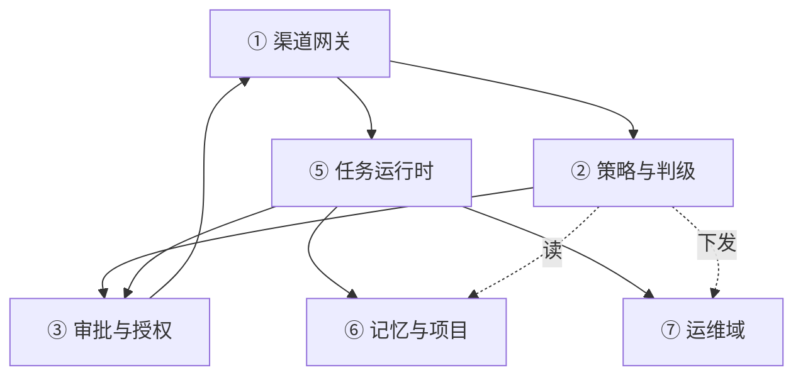
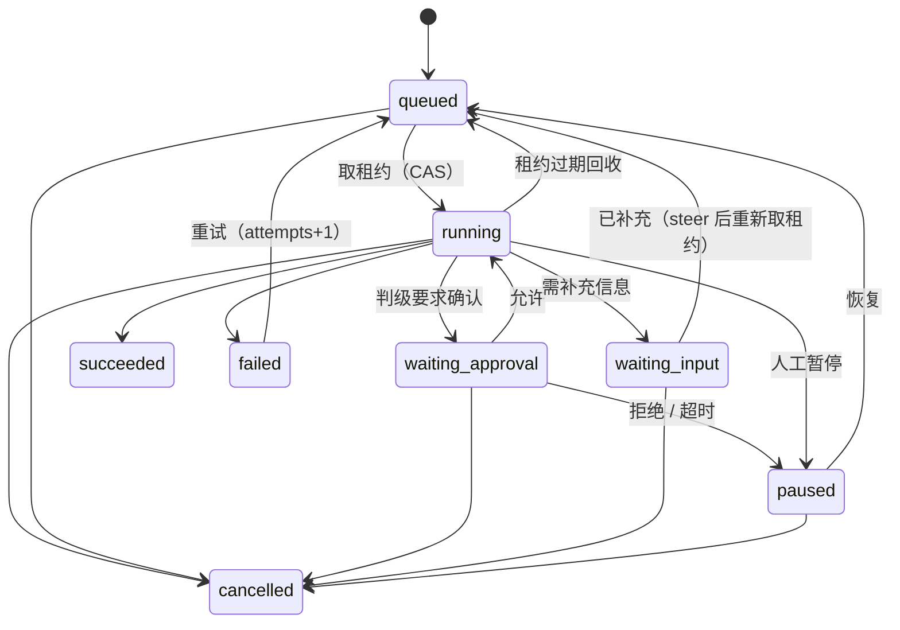

# 11 — 架构锚定

> **状态**：**定稿 v2.1（2026-11-03）** —— v1（2026-10-29，10-30 补 AR34）→ v2 回写 **C 方案**（唯一 `orchestrator` 前台），
> v2.1 经 owner 确认 **B1 线程/订阅与 B4 并发写生效**（AR8 改写、AR35–AR37 并入 §九）。
> 改动结构须显式修订并递增版本；**不因选型变化而改本文**。
> **前置**：08 定义产品该有什么（122 项）；09 逐条判定实现路径；10 定产品语义；13 定两个核心痛点的机制。
> **本文只写"不随选型改变的结构"。** 换数据库、换渠道插件、换浏览器后端，**本文不应改动一行**。
> 具体用什么实现见 [12-技术栈选型](12-技术栈选型.md)。
>
> **锚定的含义**：本文的每一条都是**可检验的约束**，不是描述。
> 选型可以试错、可以替换；结构一旦违背，就是返工。

---

## 一、什么算架构

信息一多就"乱"，根因是没区分**结构**与**零件**。三条判定：

| 问题 | 是 → 架构（本文） | 否 → 选型（12） |
|---|---|---|
| 换一个实现，这条结论会变吗？ | 不会变 | 会变 |
| 它是否**约束**未来的选型？ | 是 | 不是，它本身是被约束的 |
| 破坏它是否要重写产品语义？ | 是 | 换掉重装即可 |

对同一件事的两种说法：

| 架构说法（11） | 选型说法（12） |
|---|---|
| 任务执行必须持租约，失租即停 | 租约落在 SQLite，用 CAS + 心跳 |
| 对话与业务状态分开存放 | 对话在 dsh session log，业务在 `ops.sqlite` |
| 所有外部依赖经端口 | 渠道用 `dsh-im`，浏览器用 Playwright |
| 任何第三方不得持有唯一数据副本 | 记忆插件只做检索，正本在自有库 |

> **判据**：一句话里出现具体产品名、版本号、语言、库名，它就是选型。

---

## 二、上下文边界

### 外部参与者

| 参与者 | 交互 | 方向 |
|---|---|---|
| owner | IM 消息（v1 飞书；微信仅 P1 兜底通知）、审批应答 | 双向 |
| 模型供应商 | 推理 API | 出站 |
| 目标服务器（被运维对象） | systemd / docker / 文件 / 进程 | 出站（受控） |
| 邮件服务器 | IMAP / SMTP | 双向 |
| 日历服务器 | CalDAV | 双向 |
| 公网内容 | 网页、搜索 | 出站（不可信） |
| 备份介质 | 本机磁盘 / 异地 | 出站 |
| 推送兜底通道 | 仅 P0 告警 | 出站 |

### 明确不承担（边界，不是待办）

| 不承担 | 原因 |
|---|---|
| 多租户 / 团队协作 | 单 owner；引入租户维度会污染全部 ID 与 schema |
| 自研原生客户端 / 多端 UI 框架 | 移动与桌面复用 IM 客户端（飞书/企微/微信）；Web 复用 dsh GUI + 少量自建管理页。不做原生 App、不做 IDE |
| 模型训练 / 微调 | 只做调用与路由 |
| 通用工作流平台 | 只服务"自己的服务器"，不做通用编排 SaaS |
| 多机集群 / 高可用 | 单机故障用快照与重启解决，不用分布式共识 |

**边界一旦外扩，架构就要重做，不是加功能。** 想扩边界，先回来改本节。

### 2.1 客户端（交互面）

**客户端只是交互面（surface），不含业务逻辑。** 三端差异只在呈现能力与交互带宽，不在权限、不在数据。

| 形态 | 是什么 | 说明 |
|---|---|---|
| **移动端** | 手机上的界面 | 随身、单手、碎片时间 |
| **桌面端** | 电脑上的常驻界面 | 值守、大屏、键盘输入 |
| **Web 端** | 浏览器界面 | 深度操作、管理、排障 |

> **客户端不绑定任何具体产品**。同一形态可由 IM 手机端、自建 App、浏览器承担，属选型（12）。
>
> **客户端只与"人"对接。** 被运维对象、第三方服务、备份介质**不经客户端**：它们由**端口层 / 适配器**
> 直连（域 B / 域 C / 宿主），备份与还原属 ⑦ 运维域。把这三类画到客户端下面，会把"人机交互"和"机器对接"混为一谈。

**四条共同契约**：

1. **不持有业务状态**：会话、任务、审批的正本都在服务端；关掉客户端不丢东西。
2. **权限不按客户端区分**：同一 owner 在手机能批的，在 Web 也能批；差别只在"能否做管理动作"。
3. **可同时在线**：手机发起、桌面应答、Web 查看，看到同一份状态。
4. **都经同一入口**：客户端的任何消息都必须经渠道进入网关（准入/去重/分诊/审计）。

**三端职责**

| 形态 | 负责 | 动作 | 不做 |
|---|---|---|---|
| **移动端**（指挥台） | 随时下达、**审批主战场**、紧急中止、收通知 | 文字/语音/图片/文件；确认/拒绝/改成…；"停掉所有任务"；"现在在跑什么" | 大 diff、长日志、配置、Grant、审计 |
| **桌面端**（值守台） | 长时间盯任务、看滚动进度、批量粘贴 | 同移动端；外加拖文件、复制大段输出、长时间挂推送 | 深度查看（diff 高亮、结构化表格）、管理动作 |
| **Web 端**（控制台） | 深度操作 + 管理 + 排障 | 多会话；diff/日志/产物；任务看板；**审批中心**；项目注册；巡检清单；配置；审计检索与导出；kill switch | 离线通知（页面关着收不到，通知走渠道） |

**一句话**：**执行面三端都有，管理面只在 Web 渠道。**

### 2.2 渠道（人机连通性角色）

> **渠道 = 人与服务端之间的连通性提供者。只保证"能送达、能带回身份断言、能声明自身限制"，不承载任何业务语义。**
>
> **渠道只指"人机交互面"。** 凡是"服务主动调用的外部能力"（邮件、日历、搜索、浏览器、模型、服务管理、A2A 出站委托）
> 都是**端口 + 工具**，不是渠道；凡是"机器推来的事件"（告警 webhook、CI 回调、A2A 入站）都是**事件源**，
> 只进网关/调度，不做对话与渲染（**v1 预留不启用**，三类入口见 §2.3）。

**渠道契约（4 项必需 + 3 项可选，仅适用于人机渠道）**

| # | 项 | 要求 |
|---|---|---|
| 1 | **入站投递** | 把消息送到服务端，附**渠道消息 ID**（用于去重） |
| 2 | **出站投递** | 把消息送到指定外部身份 |
| 3 | **身份断言** | 给出 `(channel_id, external_user_id)`；**渠道不保证可信**，可信由服务端配对/签名判定（人机渠道必需） |
| 4 | **能力与限制声明** | 长度上限、富媒体、交互控件、延迟特征、能否主动推送；**运行时协商**，不编译期写死 |
| 5 | 送达回执（可选） | 可提供，但**不得依赖** |
| 6 | 历史拉取（可选） | 同上 |
| 7 | 在线状态（可选） | 同上 |

**渠道内部做别的业务不限制，但带来三个后果**：

1. **不能依赖渠道的送达状态**做回执确认 → 回执由服务端记录并重试。
2. **渠道可能改写、限流、延迟、乱序** → 服务端自己做去重（渠道消息 ID）、排序、超时。
3. **渠道能力会变**（平台改版、限长、下线功能）→ 能力声明必须运行时协商。

> **渠道是不可靠管道，服务端是唯一可信侧。**

**三种渠道实现族（并列，不是降级关系）**

| 实现族 | 连通性靠什么 | 控制力 | 身份可信 | 适用 |
|---|---|---|---|---|
| **第三方平台** | 平台开放接口 | 低（受平台规则） | 中（平台账号） | 快速上线、已有账号 |
| **自建公网中继** | 自有服务器 + 自研客户端协议 | **高** | 高（自签令牌） | 完整体验、交互控件 |
| **直连 / 隧道** | 局域网、VPN、SSH | 高 | 高（本机身份） | 运维、单机管理 |

**自建中继是一等选项**：只做"转发 + 鉴权 + 排队"，**不存业务正本**；两端协议（客户端↔中继、中继↔服务端）各自独立，可分别替换。

**呈现协议与连通性解耦（自建 Web 渠道可选）**：客户端 ↔ 服务端这一段可用标准化事件流协议
（候选 **AG-UI**：16 类事件、传输无关、SSE/WS 皆可），把对话流、工具调用、长任务进度做成一等 UI。
但它**既不是渠道也不是端口**——不提供身份断言与去重键，仍须经网关（AR12）；且必须接受三条限权：

| # | 限权 | 依据 |
|---|---|---|
| 1 | **状态只读**：`STATE_SNAPSHOT` / `STATE_DELTA` 只装视图投影，不得装任务、审批、授权正本 | AR2 / AR5 / AR23 |
| 2 | **审批不走 run 内中断**：`interrupt` 只用于补充输入（澄清、选参数），授权决策仍走 Gateway → `Approval.answer` | AR10 / §5.8 |
| 3 | **快照不是正本**：`MESSAGES_SNAPSHOT` 只是渲染副本，对话正本在会话账 | AR2 |

> 触发采用的条件见 [12 §六](12-技术栈选型.md)；未触发时用宿主自带 GUI + 少量自建页面。

**渠道不承载业务**：渠道实现里不得出现判级、任务、审批、审计语义（AR27）。

### 2.3 渠道 × 客户端可达矩阵

| 渠道实现族 | 移动端 | 桌面端 | 浏览器 | 终端 |
|---|---|---|---|---|
| 第三方 IM 平台 | ✅ | ✅ | ✅（网页版） | ❌ |
| 自建中继 + 自研客户端 | ✅ | ✅ | ✅ | ❌ |
| 自建中继 + Web | — | — | ✅ | — |
| 直连 / 隧道 | ❌ | ❌ | ✅ | ✅ |

```
人   ──> 客户端（形态） ──> 渠道（人机连通性）──┐
                                               ▼
机器 ──> 事件源（预留：webhook / CI / A2A 入站）──> ① 渠道网关 ──> 服务端（orchestrator 前台）
                                               ▲   ⚠ v1 不启用（需公网入口，与"零入站"冲突）
服务端 ──> 端口层（Mail / Calendar / Search / Browser / Model / SvcOps / A2A 委托）──> 外部
```

**三类入口，一份网关（AR12）**

| 类 | 谁发起 | 例 | 需要什么 | v1 |
|---|---|---|---|---|
| **渠道**（人机） | 人 | 飞书长连接、Web 渠道 | 身份断言、能力协商、出站渲染、会话粘性 | ✅ 启用 |
| **事件源**（机器） | 外部系统 | 告警 webhook、CI 回调、A2A 入站 | 准入 + 幂等；**不渲染、不对话** | ⏸ **预留，不实现** |
| **能力**（出站） | 服务端自己 | 邮件、日历、搜索、浏览器、模型、SvcOps、A2A 委托 | 端口契约 + 闸；**不属于入口** | ✅ 启用 |

> **事件源为什么 v1 是空的**：部署基线是**零入站**（[16 §三](16-部署与运行.md)），外部 webhook 必须有公网入口；
> 而真正的告警源（unit 失败、备份失败、磁盘水位）在本机就能由巡检观测，不需要别人推。
> **定时器 `schedule` 不是入口**，它由内核自己到点触发。A2A 入站是 P2。
> 分类保留是为了将来扩展不返工：要启用事件源，必须先改 AR12 并解决公网入口。

**两个关键观察**：

- **入口不等于渠道**：没有客户端的是**事件源**，不是"另一种渠道"。把它叫渠道，会顺手套上渠道契约
  （身份断言、能力协商、出站渲染），而这些对它根本不成立。
- **一个客户端可接多个渠道**（浏览器既能开 Web 渠道，也能开第三方平台网页版）。

**五条锚定**：

1. 三端同权；**执行面全开、管理面仅 Web 渠道**（AR26）。
2. **所有入口（渠道 + 事件源）归一化到同一网关**（AR12），物理接入点可多个、逐个登记；**出站能力不进网关**。v1 只有渠道这一类入口。
3. **审批消息按渠道能力渲染**：有交互控件就发按钮，没有就发"要做什么 + 影响 + 选项"，30 秒内可答。
4. 不开发原生客户端。
5. **渠道实现不做业务**（AR27），业务全部在服务端。


---

## 三、结构（宏观抽象）

**此图不含任何具体产品**（除宿主 dsh 外），具体实现一律见 [12-技术栈选型](12-技术栈选型.md)。
**注入了选型后的同一张图**（哪些槽位已定、哪些还空着）见 [12 §三](12-技术栈选型.md)。

```
   人（经客户端）                    被运维对象 · 第三方服务 · 备份介质
        │ 消息                                  │ 动作 / 回执（双向受控）
        ▼                                      ▼
   接入层        渠道（人机连通性）：只保证送达 / 身份断言 / 能力协商
        │
        ▼
   内核（自有，不可替换）—— 7 个模块，① 就是入口
     ① 渠道网关   归一化 → 准入(fail-closed) → 分诊(R0–R3)
     ② 策略判级   S1 规则 → S2 主模型（可降级）
     ③ 审批授权   approvals + grants（唯一长效授权）
     ⑤ 任务运行时 状态机 · 租约 · Verifier · Outbox
     ⑥ 记忆与项目 事实版本化 · project_id 隔离
     ⑦ 运维域     巡检 · 变更 · 快照 · 回滚
     ④ 审计与证据 横切 sink：订阅全部事件，不被任何模块依赖
        │
   端口层        契约 + 契约测试 —— 唯一允许替换的边界
        │
        ▼
   适配器与执行域  A 工作区 · B 主机受控 · C 出网 · D 宿主自身  ◀── 外部三方在此直连
                  （全部可替换；四域即信任边界）

  侧面：数据面 = 会话账（对话） + 业务账（任务 / 审计 / 授权 / 记忆正本）
  底座：dsh     = 执行框架与插件宿主（会话事件流、工具管线、审批接口、沙箱、调度）
                  它被内核使用，但**不在判断链上**
```

> **编号只有一套**：①–⑦ 是内核**模块 ID**，不是执行顺序——④ 审计是横切 sink，编号在中间、位置在底部。
> **层次只叫名字、不编号**（接入层 / 内核 / 端口层 / 适配器与执行域）。
> 早前版本层次也用 ①②③④，与模块号撞车（② 既是"内核"又是"策略"），已废。

> **只有「人」经渠道进来，并由内核的 ① 渠道网关接住**；被运维对象、第三方服务、备份介质接在**适配器**（双向），
> 备份与还原归 ⑦ 运维域。把后三者画进入口会让人误以为它们也要过准入与分诊。

### 读图三句话

> **内核不是一个大盒子**：它由 7 个模块组成（①–⑦），每个模块只写自己那几张表，见下「内核的拆分」。

1. **只有一条主线**：消息进 → 判断 → 排期 → 执行 → 结果出。
   任何绕开内核的旁路（例如适配器直接调执行）都是架构违规。
2. **可替换的外部实现只发生在端口层与适配器**：内核内部的判定实现可以换（DecisionPort），但结构不换；正本在侧面的数据面，
   任何适配器都不得持有唯一副本（AR5）。
3. **dsh 是底座不是内核**：它让内核 / 端口 / 适配器跑得起来，但"该不该做、做到什么程度"由内核决定。

### 决策层（S1 / S2 / Jev）

**决策不是"再加一个模型"，是内核里的一段固定链路：先快后慢、可降级、必留痕。**

```
消息/任务 ──▶ S1 快判（规则 · 启发式 · 缓存）──命中──▶ 执行（R0–R1）
                 │ 不确定 / 高风险 / 冲突
                 ▼
            S2 慢判（主模型推理）──▶ 执行（R2）或 审批（R3）
                 │ 仍无把握，且属"有明确得失"的判断
                 ▼
            Jev（外部期望值判级，可选）──▶ 只给建议，不直接执行
                 │ 任一环节不可用
                 ▼
            降级：S1 规则兜底 + 告知 owner（AR17）
```

五条规则：

1. **S1 先手**：先过确定性规则，命中即走，不调模型。浏览器场景尤其关键——
   选择器、页面模板、已录脚本优先，失败才升级视觉推理。
2. **只有"有明确得失"的判断才给 Jev**，且不可信原文（邮件正文、日志、代码）不出域（AR16）。
3. **Jev 只给建议，不下命令**；它停服不能改变执行能力（10 D16）。
4. **每次决策留痕**：`choice + confidence + reason` 进审计。
5. **DecisionPort 是内核内部接口**：只切换判定实现（规则集 / 模型 / Jev provider），
   不改变结构，也不属于 ③ 的外部可替换边界；Jev 作为外部调用经 ModelPort 出网。

### 选路梯子（先确定性，后模拟）

**任何任务按固定顺序挑执行通道，不许跳级：**

```
CLI / API ──没接口──▶ MCP 工具 ──没有──▶ 浏览器（持久登录）──没有──▶ GUI / 截屏
```

- 能用 `systemctl` / `docker` / 厂商 API 解决的，就不点页面——服务管理因此**不需要 GUI 自动化**。
- 跳级必须在任务计划里写明理由，并记为审计事件（否则 AR16 无从追）。
- 梯子只管"走哪条路"，不管"该不该做"；后者归决策层。

### 模块 ①：渠道网关（唯一的入口）

**模块 ① 是内核里唯一把"外部不可信"变成"内部可信"的地方。** 它是七个模块中的第一个，不是内核之外的一层；
它只做连通之后的六件事，不做任何判断与执行。

**职责**

| # | 职责 | 具体 |
|---|---|---|
| 1 | **持久化与去重** | 原始消息先落 `inbox`，唯一键 `(channel_id, msg_id)`——**落库即去重**；重复消息返回上次结果引用 |
| 2 | **身份解析与准入** | `(channel_id, external_user_id)` → `actor`；未配对、白名单外、渠道停用 → 静默拒绝 + 审计 |
| 3 | **能力协商** | 取渠道能力声明（长度、富媒体、交互控件、能否主动推送）并缓存，供出站渲染 |
| 4 | **分诊 + 旁路判断** | 调 Policy 得意图：`approval_answer` / `control` / `chat\|command` / `event`；审批应答、结构化命令、未配对身份、重复消息**在网关旁路，不进模型**（AR25 v2） |
| 5 | **路由** | 按意图分发到 `orchestrator`（唯一前台）或旁路；维护"渠道会话 → dsh session"粘性映射，避免同一对话分裂 |
| 6 | **出站与回执** | 订阅结果 → 按**打扰分级 + 渠道能力**渲染 → 交付；失败重试、降级、标记未送达 |

**动作**

| 动作 | 输入 | 输出 |
|---|---|---|
| `accept` | 渠道原始消息 | 内部 `InboundMessage` |
| `admit` | `InboundMessage` | `allow / reject`（原因码只进审计） |
| `resolve` | 渠道身份 | `actor` 或 `unpaired` |
| `triage` | `InboundMessage` | `Intent` |
| `route` | `Intent` | `Approval.answer` / `TaskRuntime.*` / `orchestrator` 会话 |
| `deliver` | 内部消息 | 成功 / 失败 / 未送达 |
| `correlate` | 任意 | 贯穿全链的 `correlation_id` |

**处理顺序（顺序错了就会丢消息或重复执行）**

```
渠道适配器
   │ raw
   ▼
[1] 落库(唯一键 = channel+msg_id) ──重复──▶ 返回已处理引用（幂等）
   ▼
[2] 身份解析 + 准入 ──未配对/白名单外──▶ 静默拒绝 + 审计
   ▼
[3] 能力协商（缓存）
   ▼
[4] 分诊 + 旁路判断（调 Policy，网关不自己判级）
   ▼
[5] 路由 ┬ approval_answer → Approval.answer      ← 旁路，不进会话、不进模型
        ├ control        → TaskRuntime / Approval 控制 ← 结构化命令旁路
        ├ chat|command   → orchestrator（唯一前台）
        └ event          → orchestrator
   ▼
[6] 出站：① 的 outbox 订阅结果 → 打扰分级 → 按渠道能力渲染 → 交付 → 重试/降级
```

> **H2 落地（2026-11-19，Slice BB）**：第 [2] 步的「白名单外」不再是口号——
> `plugins/gateway/src/admission.ts` 在去重之后、分诊之前做渠道 allowlist、每主体
> 固定窗口限流、单条内容上限；拒绝保留 `inbox` 行与 `route_decisions`（原因码只进审计），
> 静默不回消息。未配对 `/bind` 的配对口令同样受限流保护，防止以配对为入口刷消息。

**为什么先落库**：处理中崩溃时消息仍在 `inbox`，重启可重放；唯一键保证只处理一次。这是"至少一次 + 幂等"，比"恰好一次"更好实现也更可靠（AR28）。

**拥有的数据**

| 数据 | 性质 |
|---|---|
| `inbox` | 已接收消息 + 处理状态（可重建，非正本） |
| `actor 配对` | `(channel_id, external_user_id) → actor`，**正本** |
| `会话路由` | `(channel, thread) → session_id`，可重建 |
| `渠道能力缓存` | 可失效重建 |

**不做**：不判级、不决定审批结果、不建任务状态、不执行工具、不存业务正本、不实现渠道协议（AR27）。

**失败语义**

| 场景 | 行为 |
|---|---|
| 准入拒绝 | 静默（不回细节）+ 审计 + 计入限流 |
| 去重命中 | 返回原回执引用，不重复执行 |
| 分诊/Policy 不可用 | fail-closed：不进执行，回"当前不可用"，消息留 `inbox` 待重试 |
| 出站失败 | 重试 → 降级通道 → 标记 `undelivered`；**不重放审批**（由 Approval 重投） |
| 紧急模式 | 仅放行控制指令（状态查询、恢复、全局中止） |
| 队列积压 | 超上限拒新入站并告警，不无限堆积 |

### 内核的拆分（7 个模块）

**为什么必须拆**：现在"内核"一个词同时装着判级、审批、任务、审计、记忆、项目、巡检。不拆会出现三个具体问题：

1. **任务状态被多方写** —— 崩溃后无法判断该信谁；
2. **审批无法复用** —— 渠道、任务、运维各自实现一遍"问人"；
3. **审计与业务耦合** —— 为了记审计去改业务表，或业务失败导致审计缺失。

**拆分原则（不是按时髦的领域划分）**：

| 原则 | 含义 |
|---|---|
| **单一写者** | 每张表只有一个模块可写；其他模块只能调它的 API（AR23） |
| **变更走 API，通知走事件** | 订阅者收到事件后，只能调 owner 的 API 或发新事件，**不能直接改表** |
| **决策无副作用** | 策略模块只返回 `allow / ask / block + reason`，不执行、不发通知、不写业务表 |
| **审计只订阅** | 审计是 sink，不被任何模块依赖；fail-closed 在各 owner 内部实现，不靠审计兜底 |
| **授权唯一长效形态是 Grant** | 渠道确认只给"本次"，不沉淀 |

> **不按"开发 / 生活"功能域拆**：两者共用任务、审批、审计与记忆，
> 按功能域切会立刻出现跨模块直写。切分依据是**数据所有权**，不是功能分类。

| # | 模块 | 职责（一句） | 拥有的数据 | 明确不做 |
|---|---|---|---|---|
| 1 | **渠道网关** | 归一化、身份映射、准入、去重、审批应答解析、出站回执 | `inbox`、`actors`、`channel_bindings`、`session_routes`（能力缓存驻内存） | 不判级、不建任务 |
| 2 | **策略与判级** | R0–R3、网络三档、域/路径白名单、选路梯子 | `policy_rules`（配置）、`decisions` | 不执行、不发通知 |
| 3 | **审批与授权** | 审批请求、Grant 生命周期、击杀开关 | `approvals`、`grants` | 不执行动作 |
| 4 | **审计与证据** | 哈希链、导出、完整性校验 | `audit_log` | 不被任何模块依赖 |
| 5 | **任务运行时** | 状态机、幂等、租约、调度、取消/重试 | `tasks`、`task_events`、`task_assertions`、`receipts`、`outbox` | **只有它能改任务状态** |
| 6 | **记忆与项目** | 记忆三态、项目注册与边界、检索门面 | `memory_facts`、`memory_edges`（正本）、`projects` | 不直接改任务 |
| 7 | **运维域** | 巡检清单、告警策略、变更/快照/回滚 | `inspections`、`changes`、`snapshots` | 只发现 + 报告，不擅自修复 |



> ④ 审计**不在依赖图里**：它订阅所有模块的事件，但没有任何模块依赖它。

### 编排策略（用扩展点组合，不替换循环）

**能做与不能做的分界**：

| 层次 | 手段 | 做不做 |
|---|---|---|
| **观察** | `session/event` | 做（审计、出站） |
| **干预** | 公开扩展点 hook | **做，成体系** |
| **替换** | 改 `ReactLoopAgent` 本体 | 不做（= fork） |

我们做的是**编排策略**——把宿主暴露的扩展点组合成我们的行为规则，而不是换掉循环。

**可编排的七个维度**

| 维度 | 干预什么 | 落点 |
|---|---|---|
| 步进控制 | 每步前注入/裁剪上下文；判断继续、暂停、转人工 | `agent/pre-step` |
| 上下文构建 | 项目规则、记忆、技能、当前目标注入系统提示 | `system-prompt/assemble` |
| 模型路由 | 按任务类型/成本/能力选模型与参数 | `agent/request` |
| 工具治理 | 工具可见性、参数校验、拦截、降级替代 | 工具注册 + `tools/pre-execute` |
| 终止与升级 | 步数/预算上限 → 暂停、转人工、换模型重试 | `pre-step` + 任务层预算 |
| 上下文压缩 | 何时压缩、保留什么（决策与证据必须保留） | compaction 策略 |
| 子代理编排 | 是否委派、深度上限、子代理能力集 | subagent + 能力集（权限边界另验） |

**三条边界，防止"编排"滑向"接管"**：

1. **只做加法与拦截**：不改工具配对协议、不改会话持久化格式、不改状态迁移语义。
2. **声明式、可关闭、留痕**：每条干预都是可配置策略，触发即写审计（AR16）；关掉全部编排策略，基础对话仍要能跑。
3. **不依赖具体插件名**：编排规则里不得出现插件/工具产品名（AR4），否则换实现即失效。

**归属**：编排策略是 **Policy 的"编排策略"子职责**，不新增模块。任务级参数（步数上限、预算）存在 TaskRuntime 的任务对象上，Policy 只读不改——这样"谁能改任务"仍只有 TaskRuntime。

### 胶水 / 内核 / 领域（什么不该进内核）

**两个必须防的退化**：一是胶水层里写进了业务判断；二是内核膨胀成什么都管的泥球。

**判据三问 —— 任一为"是"就不是胶水**：

1. 去掉它，会不会丢数据或丢状态？
2. 它有没有自己的失败语义（幂等、租约、回滚、超时拒绝）？
3. 换宿主（dsh 换成别的东西）之后，它是否仍然必须存在？

| 层 | 判据结果 | 允许做什么 | 举例 |
|---|---|---|---|
| **胶水**（`adapters/`） | 三问全否 | 只做格式映射、参数转换 | 消息转 `session.prompt`、事件转回执、MCP 工具包装 |
| **内核**（`kernel/`） | 三问皆是 | 跨域不变式、状态与证据 | 任务状态机、租约、Grant 撤销、哈希链、记忆三态 |
| **领域**（`domains/`） | 可增删 | 具体业务，经注册表接入 | 巡检清单、邮件摘要、报告模板、日历 |

**入核门**：往 `kernel/` 加文件，必须三问皆是；有一个"否"就落 `domains/`。
新增内核模块属于**架构变更**（要改本节），不是在代码里加一个目录。

**内核对外只暴露 4+1 个入口**：`decide` / `submitTask` / `requestApproval` / `appendAudit` + `memory.read/write`。
其余能力一律经端口；领域包不得 import 内核内部实现。

```
src/
├── kernel/     gateway · policy · approval · audit · task · memory · ops
├── ports/      契约 + 契约测试
├── adapters/   只做映射，零业务判断
└── domains/    巡检 · 邮件 · 日历 · 报告（经注册表接入）
```

### 架构健康三指标（不是代码质量指标）

| 指标 | 健康表现 | 恶化信号 |
|---|---|---|
| **换实现改动面** | 换渠道/工具只动 `adapters/` + 配置 | 必须改 `kernel/` → 边界已破 |
| **变更频率比** | 内核 < 适配器 | 内核变更更频繁 → 功能在往内核渗 |
| **契约测试覆盖** | 每个在用端口都有 conformance 用例 | 有端口无测试 → "可替换"是假的 |

> 完成度用**通过契约测试的端口数**衡量，不用代码行数。胶水行数天然占多数，这不是问题。

### 与 dsh 的挂载点（源码实测）

**结论：我们不是"绕过" dsh 编排，而是挂在它已有的扩展点上。**

| 模块 | dsh 扩展点 | 能力 |
|---|---|---|
| 渠道网关 | 渠道插件 + `ctx.sessions.prompt` | 入站注入、出站推送 |
| 策略与判级 | `tools/pre-execute`（返回 `allow / ask / block`）、`agent/pre-step`、`system-prompt/assemble`、`agent/request` | **执行前拦截**、步前干预、上下文策略、按请求选模型 |
| 审批与授权 | `approval/request`、`user-questions/request` waterfall | 挂外部应答器，fail-closed |
| 审计与证据 | `session/event` 订阅 + `tools/post-execute` | 全量事件 + 结果裁决 |
| 任务运行时 | 注册 `delegate_task` 工具；worker 自建 | dsh 的 `jobs` 是 session 作用域，跨会话队列只能自建 |
| 记忆与项目 | 注册检索工具；`system-prompt/assemble` 注入 | 检索结果按预算注入上下文 |
| 运维域 | 注册 `svcops` 工具；`schedule` 触发 | 定时巡检 + 受控执行 |

> **关键**：真正能"拦得住"的是 `tools/pre-execute`（返回 `ask` / `block`），
> `session/event` 是事后通知，**不能用来做准入**。把两者搞混，就会出现"日志里拒了，动作已执行"。

### 端口与适配器（配对界定）

**关系是单向的**：**端口先定义、适配器后实现**。反过来（装个插件就多一个端口）就是架构倒置。

**四条硬规则**

| # | 规则 | 破坏后的表现 |
|---|---|---|
| 1 | **端口由内核定义**，适配器不得反向定义端口 | 内核被插件牵着走，端口数随依赖增长 |
| 2 | **端口只描述能力**：契约内不得出现协议名、命令行、产品名（AR32） | 换供应商要改内核；"可替换"变成口号 |
| 3 | **适配器只做映射**：无判级、无重试策略、无状态判断 | 换个渠道，重试语义就变（AR24） |
| 4 | **错误必须翻译成端口语义**，不得把实现侧的错误码抛给内核 | 内核被迫懂某个工具的退出码，端口名存实亡 |

**可换性三级**（本文与 12 的 L1/L2/L3 口径）

| 级别 | 含义 | 换它要做什么 | 动数据吗 |
|---|---|---|---|
| **L1 配置级** | 换 provider | 改配置、重启 | 否 |
| **L2 适配器级** | 换实现 | 写一个适配器 + 过该端口的契约测试；可能需重登/重连 | 否 |
| **L3 迁移级** | 换引擎 | 迁移脚本 + 停机窗口 + 回滚演练 | **是** |

**三类端口（13 个端口不是平级的）**

| 类 | 端口 | 换它意味着 |
|---|---|---|
| **外部能力** | Channel · Notify · Mail · Calendar · Search · Model · Browser · SvcOps | 换供应商或协议 |
| **本地资源** | Exec · Storage | 换运行时或存储引擎，**可能动数据** |
| **内核内部接缝** | Decision · Memory · Sched | 换判级实现 / 换检索门面 / 换宿主调度包装，**不改结构** |

**逐端口界定**

| 端口 | 核心动作 | 明确不做 | 失败翻译 | 级别 |
|---|---|---|---|---|
| **ChannelPort** | `deliver` / `receive` / `identify` / `capabilities` | 不建会话、不做审批、不判级（AR27） | `Unavailable` / `Rejected` / `TooLarge` | L2 |
| **NotifyPort** | `notify(level, payload)` | 不做对话、不承载审批应答 | `Unavailable` | L2 |
| **ModelPort** | `complete` / `stream` / `usage` | **不选模型**（路由在内核） | `RateLimited` / `Transient` / `BudgetExceeded` | L1 |
| **DecisionPort** | `evaluate(input) → choice+confidence+reason` | **不执行、不发通知、不写业务表** | `Unavailable` → 降级 S1（AR17） | 内部 |
| **ExecPort** | `run(argv, cwd, timeout, cancel)` / 文件读写 | 不判断命令风险（AR11 在内核） | `PermissionDenied` / `Timeout` / `NotFound` | L2 |
| **BrowserPort** | `navigate` / `snapshot` / `act` / `profile(name)` | **不得暴露任意命令执行** | `LoginRequired` / `Blocked` / `Timeout` | L2 |
| **SvcOpsPort** | `list` / `status(unit)` / `start` / `stop` / `logs(unit)` | 不做健康判定与告警策略（属模块⑦） | `UnitNotFound` / `PermissionDenied` / `NotSupported` | L2 |
| **MailPort** | `send` / `fetch` / `search` / `draft` | 不做发送审批、不做可信收件人判定 | `AuthFailed` / `QuotaExceeded` / `Transient` | L2 |
| **CalendarPort** | `list` / `create` / `update` / `delete` | 不做提醒调度（走 SchedPort） | `Conflict` / `AuthFailed` | L2 |
| **SearchPort** | `search` / `fetch` | 不做来源可信判定 | `Blocked` / `RateLimited` | L1 |
| **MemoryPort** | `write`（进治理层）/ `search`（出结果） | **不持有正本**（AR5） | `Unavailable` → 降级为无记忆 | L2 |
| **StoragePort** | `tx` / `cas` / `appendOnly` | 不建业务表、不做状态机 | `Conflict` / `Corrupt` | L3 |
| **SchedPort** | `schedule` / `cancel` | 不投递到非原 session | `Unavailable` | L2 |

**适配器（五职责，缺一不可）**

| 职责 | 要求 |
|---|---|
| 连接与凭据 | **引用式**解析，逐操作取；不缓存明文 |
| 请求构造 | 只做"参数 → 协议"映射 |
| 结果映射 | 协议响应 → 端口结构 |
| **错误翻译** | 映射到上表的端口错误；**必须区分 Transient 与 Permanent** |
| **能力声明 + 健康探测** | 能力运行时协商（§2.2 第 4 项）；启动探活，失败即摘除 |

**三不写**：判级 / 重试策略 / 状态判断——出现在 `adapters/` 就是边界破了。

**多适配器并存**：一个端口可挂多个适配器（如多渠道、多服务管理器），但**选择规则属于内核**，适配器不得"抢单"；单个适配器探活失败只摘它自己，不影响同端口的其他实例。

**端口 ↔ 内核模块（谁在用）**

```
① 网关 ──▶ Channel · Notify · Decision(分诊)
② 策略 ──▶ Decision · Model          （只问，不执行）
③ 审批 ──▶ Channel(出站渲染)
④ 审计 ──▶ （不调任何端口，只订阅事件）
⑤ 任务 ──▶ Exec · Browser · SvcOps · Mail · Calendar · Search · Model
⑥ 记忆 ──▶ Memory · Storage
⑦ 运维 ──▶ SvcOps · Sched · Notify
```

> **④ 审计不调端口**——这是"不被任何模块依赖"的另一种说法。

**四条最容易破的边界**

1. **"重启某个服务"走 Exec 还是 SvcOps？** → **有专用端口的能力不得走通用端口**，否则限域双闸只能按命令字符串判，会漏。**SvcOps 的判定粒度是 unit，不是命令行。**
2. **BrowserPort 能否起子进程？** → 不能。能起进程就等于绕开 Exec 的闸。
3. **StoragePort 会不会变成泥球？** → 它被全部 7 个模块共用，因此只允许"事务 / CAS / 只追加"三种原语，**不得承载业务语义**。
4. **同一件事走 Channel 还是 Notify？** → Channel = 对话与审批应答；Notify = 打扰分级出口（可跨渠道兜底，仅 P0）。**同一条消息只走一个**，否则双发。

### 专家执行器（ExpertExecutor）

> **领域能力尽量外包，治理必须自留。** 详见 [13 §四](13-核心能力方案.md)。

专家 agent（编码、浏览器等）以**受限执行器**接入：它是适配器层的一种实现，**不是第二大脑**。

| 约束 | 要求 |
|---|---|
| **无自有审批** | 它内部的问询一律无效；R3 动作回到我们的闸（AR34） |
| **无自有凭据** | 凭据逐操作注入，拿不到明文 |
| **不得出 A 域** | 只在工作区活动；主机 / 出网由我们的适配器代做 |
| **事件必须回传** | 工具调用转成我们的审计事件，否则审计断链（AR31 / AR15） |
| **无状态** | 上下文由我们装配；记忆、规则、审批历史不交给它 |
| **接入方式** | 优先 CLI，其次 MCP，再次 A2A；**A2A 只作专家接入协议，不做 agent 自由协商** |

**领域路由归内核 ②，不属于适配器**：S1 规则 → 项目默认专家 → 不确定时问一次并写回项目默认。
路由表是可学习的映射，不是每轮推理。

> **端口不是接口的别名，而是"契约 + 契约测试"。** 没有契约测试的端口不算端口，只是抽象类。
> 换适配器的判据：拔掉它，内核仍能编译、单测仍绿，且给出**明确的不可用**而非静默降级。

### dsh 的位置

**dsh 是宿主与执行框架，不是内核。**

| dsh 提供 | 我们提供 |
|---|---|
| agent loop、会话与事件流、工具管线、审批 seam、沙箱、子代理 | 判级规则、任务对象、审计链、记忆正本、准入、巡检语义、运维动作 |

结构上必须满足：**内核不 import 任何插件包**；内核只依赖端口契约与事件流。

**底座契约（6 条）**

| # | 契约 | 为什么 | 怎么验 |
|---|---|---|---|
| 1 | **装配必须可验证** | peer 不匹配时宿主会**静默跳过整个 bundle**，表现为"插件消失" | 启动自检验 **7 个模块全部注册成功**；缺一即拒绝启动，不接受"部分可用" |
| 2 | **扩展点分级** | 我们挂在 7 个点上，其中有的只是内部实现 | 分「受支持 API」/「内部实现」；后者可观察、**不得依赖**；升级只验前者 |
| 3 | **loop 崩溃 ≠ 任务停摆** | 若任务靠 agent loop 驱动，loop 一崩队列全停 | 任务由**自有 worker 驱动宿主工具管线**；loop 崩只影响对话面，队列可重投 |
| 4 | **升级必须过闸** | 宿主明文承诺破坏兼容 | 零干预基线（AR29）+ V1–V11 冒烟 + 端口契约测试；任一失败即回滚 |
| 5 | **单一 bundle** | 多 bundle 放大 peer 匹配面 | **一个自有 bundle**，内部按 7 模块分包 |
| 6 | **注入边界** | 宿主能力是"缝"，不是"面" | 只经端口与扩展点使用；**内核不得 import 宿主内部包**（与 AR24 同源） |

### 组装与启动（部署视图）

**准确表述**：内核是我们写的一组模块（入口、策略、任务、审批、审计、记忆、运维），各自持有自己的数据，通过**端口契约**调用外部实现，通过 **dsh 扩展点**使用宿主能力。它被打包成 bundle，由 dsh 在启动时装载；此后 **dsh 的 agent loop 负责对话，内核的 worker 负责任务**，两者同进程运行。内核在 `pre-execute`、审批 waterfall、事件流上拦截与记账，**不接管 agent loop**。

**三个容易被说反的点**：

| 容易说成 | 准确说法 |
|---|---|
| 内核组织各端口能力 | 内核**定义**端口契约；适配器**实现**；宿主**提供**运行时能力 |
| 记忆/任务/权限/审计是端口 | 它们是**内核模块**（持正本）；端口只是它们的外部替换点 |
| 先构建插件再接 dsh | dsh 启动时**装载 bundle**，我们的代码成为进程的一部分 |

```
我们仓库                          运行中的服务器
├ kernel/    ──打包──┐
├ ports/             ├─ bundle（cordis.patch.yml + plugins）
├ adapters/          │        │ dsh plugin add -w
└ domains/   ────────┘        ▼
                        systemd → dsh 进程（--profile web）
                              ├─ dsh 运行时：会话 / 工具 / 模型 / 沙箱 / 调度
                              ├─ 我们的 bundle：
                              │    ├─ ① 渠道网关 → 渠道适配器
                              │    ├─ 策略 / 审批 / 审计 / 记忆 / 运维
                              │    └─ 任务 worker
                              ├─ 循环 1：dsh agent loop（对话）
                              └─ 循环 2：内核 worker（任务、租约、恢复）
```

**启动四步（顺序固定）**：

1. dsh 自检并装载 bundle；
2. 内核**启动自检**：`orchestrator` 存在且工具面 ⊆ 白名单、数据目录可写、`schedule` 已绑定（缺则重建）、**已装插件注册的动作集 ⊆ 接入剖面允许集**（超出即拒绝启动）；
3. 内核**恢复**：回收过期租约、重放 `inbox` 未处理消息、重投未答审批、补发未送达回执；
4. 打开入站，开始服务。

缺第 2、3 步，重启就会丢任务、丢审批。

**三种"接入 dsh"的具体形态**：

| 形态 | 做什么 | 例子 |
|---|---|---|
| **注册工具** | 让模型能调用我们的能力 | `delegate_task`、`svcops`、`memory_search` |
| **挂 hook** | 在关键点拦截或改写 | `tools/pre-execute`（准入闸）、`agent/pre-step`、`system-prompt/assemble` |
| **订事件** | 只观察、只记账 | `session/event` → 审计、出站 |

### 宿主已提供的能力（按需启用，不必自建）

以下是 dsh 仓库里已存在、可直接为我所用的能力。**判据不变**：有 seam 就不自建；用了就要写退出路径。

| 能力 | 宿主包 | 我们可以怎么用 | 状态 |
|---|---|---|---|
| **管理面 UI** | `ui-approval` `ui-jobs` `ui-plan` `ui-permission-presets` `ui-agent-preset` `ui-plugin-manager` `ui-settings-session-log` `ui-deliverables` `ui-trajectory` `ui-secret-mask` | 审批、会话内作业、计划、权限预设、插件管理、会话日志、交付物、轨迹、脱敏**都已现成** | 采用 |
| **计划级审批** | `plan/plan-mode` | 先出计划→批准→执行，状态随 resume/fork 存活；正好是"确认计划而非单动作" | 采用 |
| **大输出外溢** | `spill` + `spill-local` + `spill-policy` | 超长日志/diff 落盘并返回 locator，替代"1800 字切段" | 采用 |
| **类型契约生成** | `typert`（registry / generator / protocol） | 构建期从类型生成 schema 与声明，对应 N3/N5；**只在构建期，不进运行期** | 采用 |
| **远端执行** | `ssh` `fs-ssh` `subprocess-ssh` `sandbox-ssh` | B 域可跨主机；多机运维不必自建传输 | 验收后采用 |
| **事件入站** | `experimental/webhook` | 无客户端渠道（告警/CI）。**内置动作是新建 root Session，违反 AR25** → 必须注册自定义规则走 Gateway→orchestrator | 改后采用 |
| **并行隔离** | `experimental/worktree` | 每任务一个 worktree，对应 E4 同项目并行 | 验收后采用 |
| **语音转写** | `experimental/speech-to-text`(+`sensevoice`) | A8 语音输入；实验性，需验收 | 验收后采用 |
| **可观测导出** | `telemetry/otel` | traces/metrics 直接导出，省自建管线 | P2 |
| **测试件** | `test-support/*`（`llm-replay` `llm-mock-server` `session-snapshot` `agent-loop-testkit` `tool-testkit`） | L1 契约测试与行为回归的基础设施 | 采用 |
| **限域策略** | `sandbox-policy` `fs-observation-policy` | AR11 双闸的一部分可复用 | 采用 |
| **工作流 / PTC** | `workflow` `tool-workflow` `workflow-ptc` `ptc-runtime*` | 多步脚本化执行；**只作执行域与步骤实现，不接管编排**（AR29） | 评估后采用 |
| **目标对象** | `goal` `tool-goal` `command-goal` | D21 已定不引入 Goals；只借用计划展示 | 不采用 |

**明确不采用**：`product-analytics`、`personalized-recommendations`、`plugin-recommendations`、`brand-official`、`dockkit`、`liveshare-protocol`、`translator`、`cot-translation`、`ralph`、`claude-code-mods`、`hooks-codex`、`cua-macos`、`win32-process`、`computer-use`（服务器无桌面）、`agent-team-profile` / `subagent-oar`（共享父治理；未过 AR30 不采用）。

**三处对既有判断的修正**：

1. **Web 管理面不再"大部分要自建"**：审批、会话内作业、计划、权限预设、插件管理、会话日志、交付物、轨迹、脱敏都现成；**只需自建**跨会话任务视图、审计检索与导出、Grant 管理。
2. **审批可复用 `plan-mode`**：不必从零做"计划确认"交互；我们只补渠道侧应答与持久化。
3. **语音与远端执行不必自研**：ASR 与 SSH 传输都在仓库里，只需验收。

### 社区插件候选（按端口归类，2026-10-29 实测）

**证据等级 E2**：GitHub 元数据 + 读过 README，**未安装、未运行**。此表只回答"哪个槽位有没有现成供给"，
**不改变本文任何结构**；换掉其中任何一项，§二/§三/§九 不应改动一行。

| 槽位（对应 §三 / §四） | 候选 | 实测事实 | 判定 |
|---|---|---|---|
| **ChannelPort** | `dsh-im-gateway@0.3.3`（MIT，106 tests，25+ 平台） | 统一会话 + **远程审批 + 交互提问** | **仅当 `dsh-im` 的飞书长连接 / 卡片回调不达标时**才评估（[12 §三·L2.5](12-技术栈选型.md)）；其"统一会话/远程审批"**不得绕过 Gateway（AR12）与审批解耦（§5.8）** |
| **ChannelPort** | `dsh-clawbot`（MIT，11★） | 微信 iLink 网关 + 主动通知 | 与 WFXM iLink 资产重叠，**参考** |
| **客户端 / 移动通道** | `dsh-pocket`（2.5k★，**GPL-2.0**）、`dsh-mobile`（679★，MIT，含 `mobile-gateway` WebSocket） | 前者扫码同屏 dsh web；后者原生 App + 独立网关插件 | pocket **不进核心**（GPL）；mobile-gateway 可作渠道适配候选 |
| **MemoryPort** | `EverOS`（13.7k★，Apache-2.0） | **Markdown 为正本** + SQLite/LanceDB 派生索引；Python | **架构参考**（与我们 AR5 同向），不直接采用（语言栈不符） |
| **MemoryPort** | `dsh-meow-memory`（331★，MIT，七层 SQLite）、`graph-memory`（663★，MIT，知识图谱） | 均为插件自持存储 | **只做索引/检索**；正本必须我们持有（AR5） |
| **DecisionPort（Jev）** | `jev-dsh-decision`（266★，**无 License**） | 原生 bundle；`jev_status` / `jev_check_connection` / `jev_evaluate` + skill；**不执行、不接管主 agent** | 与 10 D16 一致（只给建议）；但**无许可证 → 不可进核心**，仅作外部可选 provider |
| **审计展示层** | `dsh-replay`（MIT，适配 `0.2.1-rc.2`） | 只读回放、成本、审计、fork 树、可分享 HTML；**不重发模型、不写日志** | 采用为"看审计"的展示层；**跨会话查询与哈希链仍自建**（§四 审计正本） |
| **成本（I5）** | `dsh-cost-meter`（569★，MIT）、`dsh-cost-ledger@0.1.4` | 会话/模型成本、预算工具 | 采用其一；**成本聚合正本仍在业务库** |
| **MCP / 技能治理（K2）** | `dsh-mcp-manager`（22★，MIT） | Settings UI + HTTP API；改 profile 的 `cordis.patch.yml`；工具数健康 | 管理面采用；**配置写入属管理面动作 → 只走 Web 渠道并记审计** |
| **多 agent** | `dsh-agent-team-gui`（283★，MIT） | 成员级模型/工具策略 + Run Center | **AR30 验收后可评估**；未过 AR30 前仅参考（子代理共享父治理） |
| **工具层效率** | `dsh-ops`（4.7k★，MIT） | **实为 token 效率工具**：替换官方 read/glob/grep、`tools_addition` 动态加载、渐进披露 | 可评估；前置 **AR31**（声明 `replaces` 且仍过同一闸）；未过前不引入 |
| **SvcOpsPort** | 实测：systemd 检索 **7 个且全 0★**（仅"重启按钮/自启动"）；`backup` 检索 **0**；`opskat`（701★）为 **GPL-3.0** 独立面板 | 无可用服务器运维插件 | **确认 `svcops` 必须自建**（Step 4 立项成立） |

**三处对既有判断的修正**：

1. **`dsh-ops` 不是服务器运维工具。** 先前把它当作"低层运维工具包"是误读；它是**工具层 token 效率插件**。
   因此 **主机运维（systemd/docker）的空白没有被社区填补**，`svcops` 自建结论不变且更硬。
2. **渠道出现第二个成熟选项，但不并列。** `dsh-im-gateway` 与 `dsh-im` 能力重叠且自带审批/交互提问 →
   主通道定飞书后，12 仍以 `dsh-im@5.7.0` 为准；**仅当飞书长连接 / 卡片回调不达标时**才启用前者。
   两者都**不能把会话语义直接接到宿主 session**，必须过 Gateway。
3. **桌面端客户端确实存在，但不改变结论。** `dsh-desktop`（33.9k★ / 16.9k★）是 **Windows/macOS 本地打包 dsh 的桌面壳**，
   不是"远程控制 Linux 服务器"。**"不做原生客户端、远程操作走 Web 渠道"（§2.1 / AR26）不变。**

> **目录数字不可作供给依据**：各插件目录自报 280+ / 1,819"真插件" / 6,000+ / 11,000+，互相矛盾；
> GitHub topic 实测为 293（`deepseek-harness-plugins`）与 922（`deepseek-harness-plugin`）。**逐个核验，不看目录。**

### 第三方插件接入剖面（按能力面接入，不按整包）

**问题**：AR27 的检验方式（lint 查"渠道目录里有没有判级/审批分支"）对**自研适配器**有效，
对**第三方插件**无效——我们改不了它的源码，但可以让它**只能启用一部分能力**。

**规则**：接入单位不是"整包装或不装"，而是**动作剖面（capability profile）**。

| 动作类别 | 默认 | 归属 |
|---|---|---|
| `send` / `receive` / `identity` / `capability` | **允许** | 渠道契约四项（§2.2） |
| `session.create` / `session.route` | **禁用** | 网关的会话粘性映射（§三 · 模块 ①） |
| `approval.decide` / `approval.persist` | **禁用** | 审批模块（§5.8 审批与渠道解耦） |
| `task.create` / `task.update` | **禁用** | 任务运行时（AR23 单一写者） |
| `config.write` | **禁用** | 管理面（AR26） |
| `tool.register` | **允许，但须声明 `replaces`** | 并接入同一 `tools/pre-execute`（AR31） |

**可检验**：启动自检比对"实际注册的动作集 ⊆ 剖面允许集"，超出即 fail-closed **拒绝启动**。

**淘汰条件（比准入评分更硬）**：插件无法关闭上表"禁用"项 → **整包拒绝**，不接受"先用着，以后再收"。

**为什么不做源码审查**：第三方插件会升级，审查一次下个版本即失效；剖面比对**每次启动都跑**，且不受升级影响。

> 这条机制同时把"能装插件就不自建"从**信任问题**降级为**配置问题**：装不装看评分，能不能越界看剖面。

---

## 四、对象模型与数据所有权

### 四个一等对象

| 对象 | 关键字段 | 正本 | 约束 |
|---|---|---|---|
| **Conversation** | `id`、渠道身份映射、消息序列、续跑点、**`role`**（`orchestrator` / `task` / `chat`） | 会话账 | 一渠道可多会话，多轮可续；**`orchestrator` 每个 owner 唯一**（§5.8）；`chat` 只用于 Web 深度会话 |
| **Task** | `id`、幂等键、目标、状态、计划、产物、租约、**`session_id`**、**`start_cursor`** | 业务账 | 状态对齐 A2A（§六）；与 Conversation **1:1**，可"会话升级"（§5.8） |
| **Receipt** | `task_id`、结果、证据、diff/日志、可否回滚 | 业务账 | 结束幂等、可补发 |
| **Grant** | `id`、范围（本次/本会话/永久）、动作集、来源、过期、撤销 | 业务账 | 可枚举、可撤销（AR20） |

**这四者是产品结构**；08 的 A–M 域只是分析工具。**ID 方案只对这四个对象定义**，中间过程不发 ID。

### 数据清单

| 数据 | 正本位置 | 唯一写者 | 备份 | 可重建 |
|---|---|---|---|---|
| 对话与工具记录 | 会话日志（宿主） | 宿主 | 要 | 否（历史） |
| 任务与回执 | 业务库 | 任务执行器 | 要 | 否 |
| 审计 | 业务库（哈希链） | 审计写入器（只追加） | 要 | 否 |
| 授权 / 配对 / 身份映射 | 业务库 | 准入与判级 | 要 | 否 |
| **profile 配置**（`cordis.patch.yml`） | 部署目录 | **管理面（仅 Web 渠道，AR26）** | 要 | 否（人工可重建，但会丢变更） |
| 记忆正文 | 自有库或文件 | 记忆治理 | 要 | 否 |
| 记忆索引 / 向量 | 派生 | 记忆治理 | 否 | **是** |
| 成本台账 | 业务库（聚合） | 成本聚合 | 要 | 是（从事件重放） |
| 浏览器登录态 | 独立 profile 目录（按名索引） | 浏览器适配器 | 视情况 | 是（需重登） |
| 凭据 | 宿主凭据服务（引用式） | 人 | 加密备份 | 否 |
| 插件与配置 | 版本化配置文件 | 人 | git | 是 |

**三条规则**

1. **单一写者**：每份数据只有一个写入者；其它组件只读或经端口请求。
2. **可重建的不算正本**：索引、缓存、派生视图永不作为唯一副本。
3. **第三方不得持有唯一数据副本**：任何插件卸载后，系统仍能凭自有数据恢复功能。

### 数据面的读写规则

对象与所有权只回答"是谁的"；这一节回答"**怎么流**"。

| # | 规则 | 具体 |
|---|---|---|
| 1 | **写只经 owner API** | 任何模块不得直写他表；宿主事件也不能直接改业务表 |
| 2 | **读也只经 API / 只读视图** | 跨表 join 只允许出现在 owner 自己提供的只读视图里（AR33） |
| 3 | **一个事务只跨一个库** | 对话账与业务账之间不做分布式事务；跨库用"游标 + 事件补偿" |
| 4 | **投影只订阅、可重放、幂等** | 审计 / 成本 / 看板都是投影；投影失败**不回滚业务**，按游标重放 |
| 5 | **迁移按模块独立** | 每个模块持有自己的 schema 版本；迁移失败即拒绝启动，**不回退到半旧 schema** |
| 6 | **保留分层** | 热（可检索）→ 温（归档）→ 冷（仅备份）；**审计不进归档**，只增不删 |
| 7 | **快照点一致** | 会话日志 + 业务库 + 配置取同一"数据面快照点"；恢复时按该点对齐 |
| 8 | **数据分级** | 三级：可进审计 / 只进哈希 / **禁止落盘**；不可信原文出域（AR16）在此落地 |

> **对话账只经公开事件读**：不直接解析 session 文件——宿主升级会改格式。

### 记忆的生命周期（三态）

| 态 | 规则 |
|---|---|
| **候选** | 新写入先进候选，**需一次确认**（或由策略按域自动放行）；不参与检索 |
| **生效** | 带来源、时间、置信度；参与检索，可被引用 |
| **过期 / 遗忘** | 到期降级回候选或归档；**遗忘是真删正文**，同时删派生索引 |

正文在自有库/文件，索引可重建（见上表）。记忆插件只做检索，不持正本（AR5）。

---

## 五、六个生命周期

> 每个生命周期都必须回答四问：**状态归谁 / 什么触发迁移 / 失败怎么办 / 崩溃后怎么恢复**。
> 答不上这四问的流程，等于没设计。

### 5.1 任务



| 迁移 | 触发者 | 租约 | 失败 / 超时 |
|---|---|---|---|
| 建任务 → `queued` | 渠道网关（幂等键 `insertIfAbsent`） | 无 | 重复提交返回同一任务 ID |
| `queued` → `running` | 任务运行时（期望 status + leaseId 的 CAS） | **持有**，心跳续租 | 抢不到则留在队列 |
| `running` → `waiting_approval` / `waiting_input` / `paused` | 任务运行时 | **冻结**（不续租、不计超时） | 不解冻就会被别的 worker 回收 |
| `waiting_*` → `running` | 任务运行时（收到决定） | 重新取租约 | 决定已落库才恢复 |
| `waiting_input` → `queued` | 补充输入到达（`steerTask`，受控边） | 清租约、`attempt=0` | 只允许从 `waiting_input` 出发；worker 下一 tick 领取 |
| `running` → 终态 | 任务运行时 | 释放 | 回执**一次写入**，重复完成不覆盖 |
| `running` → `queued` | 租约过期 | 释放 | `attempts+1`；超上限 → `failed`，不静默重试 |

**四条硬约束**：

1. **只有任务运行时能改任务状态**（AR23）。
2. **`waiting_*` 与 `paused` 冻结租约** —— 否则"等人 10 分钟"会被判成崩溃。
3. **幂等键由入站生成**（渠道 + 消息 ID），回执按 `task-done:<id>` 去重；两处同源。
4. **任务与会话 1:1** —— 一个任务绑定一个会话，`resume` 复用同一会话，**不并发 resume**（这是"单写者"的具体含义）；允许会话升级（§5.8），升级后仍是一对一。

**不引入 `scheduled` 状态**：定时由调度器触发"建新任务"，不让任务长期挂着未来时间。

### 5.2 审批

```
requested ──> delivered ──> answered(allow | deny)
     │             │
     │             └──> 投递失败 ──> 降级通道 ──> 仍未送达 ──> expired
     └──> expired（超时）
```

| 规则 | 说明 |
|---|---|
| **确认对象是计划** | 审批挂 `plan + decision`，不是单条命令；一次确认授权一组已列动作 |
| **必须自持久化** | 进程重启后未答的审批要能重投递；**不依赖宿主的审批内存态** |
| **一审批一应答** | nonce 只接受一次；重复应答无效，记审计 |
| **超时 = expired** | 不回许执行；任务转 `paused` 并通知，**不是 `failed`**（避免自动重试风暴） |
| **应答可能是修改要求** | "改成这样"落 `waiting_input`，不是拒绝 |
| **击杀开关** | 一次性撤销全部 Grant、拒绝新入站、停止 `queued` 任务 |

> **E3 已落地（2026-11-18，Slice AX，release `2026.11.18-12`）**：③ 的 `tools/pre-execute` 增加
> **项目级工具白名单**——`config/project-tools.json`（`policy.yaml` 的 `projectToolsFile` 指定）
> 按 `project_id` 列出允许的工具，支持 `exec_*` 后缀通配；任务子进程由执行器注入
> `DSH_WFXM_PROJECT_ID`，白名单外调用 `deny(rule='project-tool')`。文件缺失 = 不限制（向后兼容），
> 格式错误 = fail-closed。**边界**：只覆盖带 projectId 的 worker 会话；前台零工具（AR25），
> 无 projectId 的 chat/web 不受影响。授权仍走同一道闸，没有新增绕过路径（AR31）。

### 5.3 入站

```
到达 ─> 归一化 ─> 准入(fail-closed) ─> 去重 ─> 分诊 ─> 路由 ─> 执行 ─> 回执
```

| 规则 | 说明 |
|---|---|
| **审批应答旁路** | 命中未决审批的消息**直接进审批**，不进会话；否则会重复消费或被误读 |
| **结构化命令旁路** | 面板 / 签名卡片的停止、暂停、状态查询直接进 `TaskRuntime` / `Approval`，**不进模型** |
| **未配对与重复旁路** | 未配对身份静默拒绝 + 审计；去重命中直接返回上次结果引用；两者都不进前台 |
| **唯一前台** | 其余 `chat` / `command` / `event` 一律进唯一 `orchestrator`；入口不得直写 `tasks`（AR25 v2）。Web 控制台的深度会话（`chat`）由 Web 客户端显式发起，不接收渠道事件 |
| **准入在分诊之前** | 顺序不能反（AR6） |
| **拒绝对外静默** | 不返回失败细节，只记审计，避免探测 |
| **委派判据** | 预计 >60s、需审批、跨断线、跨项目 → 建任务；否则直接会话（由前台判断，建任务只经 `task_submit`） |
| **去重键** | 渠道 + 消息 ID；重放安全 |

> **H4 已落地（2026-11-18，Slice AY，release `2026.11.18-12`）**：结构化命令新增**无锚点**的
> `halt` / `resume_all` / `status_all`（别名 `全局停止`、`全局恢复`、`全局状态`、`stop all` 等）。
> 状态载体是停止文件（`DSH_WFXM_HALT_FILE`，默认 `$DSH_WFXM_DATA_DIR/KILL`；③ 与 host 读同一个路径），
> **文件存在即停止**，因此跨进程/重启保持；`halt` 同时中止运行中尝试并置 `paused`、host 停止领取
> 新任务与提醒投递，`queued` 行保持排队、恢复后自然继续（不回滚、不自动重跑）。
> 停止期间控制命令与 outbox 仍工作（否则收不到确认/无法恢复）；普通对话直接回「已全局停止」，
> 不进模型、不建任务。与上表"击杀开关"的差异：**不撤销 Grant、不删除 queued 任务**，
> 只做准入与执行层停止。

### 5.3.1 项目解析（设计稿，待实现）

**要解决的问题**：一个飞书窗口指挥 N 个项目，但装配只能装**一个**项目的上下文（13 §2.2），
所以每条入站消息都必须先回答"这是哪个项目"。这是"同一个管家"能否成立的前置条件。

**非目标**：不从文本语义猜项目。13 §3.3 的硬规则不变——没有明确信号就反问，不猜。

**信号优先级（命中即停）**

| 优先级 | 信号 | 说明 |
|---|---|---|
| 1 | **显式命令** | `/use <别名>` 切换当前会话项目；`/projects` 列候选（旁路，不进模型） |
| 2 | **锚点继承** | 回复的是某任务的消息 → 继承该任务的 `project_id`（任务的项目创建时确定，不可变） |
| 3 | **会话粘性** | 本 chat 上一次 `/use` 或解析成功的项目（存 `session_routes.project_id`） |
| 4 | **唯一项目** | 全库只有一个未归档项目 → 直接用它，并在回执里注明"按唯一项目处理" |
| 5 | **反问** | 多个候选 → `ask`，最多列 5 个（按最近使用排序）；用户回答后写粘性 |

**数据与归属**

- ⑥ 拥有 `projects`（已有 `name` / `root_path` / `archived_at`），新增 **`project_aliases`**
  （`alias` 唯一、大小写不敏感、一项目多别名、别名冲突拒写），随项目归档一并失效。
- ① **不读 ⑥ 的表**（AR33）：用注入的 `ProjectLookupPort`（`resolveAlias` / `listProjects`），
  与 `TaskRelayPort` / `TaskReceiptPort` 同一模式；端口缺失时降级为"只认锚点 + 反问"。
- 粘性写 `session_routes.project_id`（chat 级，唯一前台会话的一部分）；任务的项目在 `task_submit` 时冻结。

**决策留痕**：`route_decisions` 增加 `project_id` / `project_matched_by`（`explicit|anchor|sticky|single|asked|null`），
仍受"禁改写"触发器保护；解析失败也留痕（`null` + 候选数），便于事后看"为什么反问"。

**装配约束**：一次装配只允许一个 `projectId`；跨项目读取必须显式（`/use` 或专门的跨项目查询），
读取范围严格遵守 08 §七 #3「项目事实隔离、偏好共享」（全局偏好 ∪ 本项目事实）。

**粘性 vs 唯一会话（关键约束）**：`session_routes` 让所有 chat 共享同一个 `orchestrator` 会话，
而粘性是**每个 chat 的属性**。因此：

- 项目**按轮注入**（本轮上下文块 + 项目标签），**不写进会话历史当作全局事实**——否则 chat A 的项目会污染 chat B 的推理
- 同一会话内两个 chat 指向不同项目是**合法**的；每条回执必须带项目名，用户才看得出"在说哪个项目"
- 任务的项目在 `task_submit` 时冻结，后续 `/use` 不改变已建任务的项目（避免"任务跑到一半换了目录"）

**失败模式**

| 情况 | 行为 |
|---|---|
| 别名冲突（同别名指向两个项目） | 写入时拒（`conflict`），已存在冲突则两个都不自动匹配，走反问 |
| 项目已归档 | 不参与匹配；锚点继承到已归档项目 → 拒绝并提示 |
| 与项目无关的消息（偏好、闲聊） | `project_id = null` 合法，只注入全局偏好 |
| 端口缺失（⑥ 未挂载） | 只认锚点继承；无锚点则反问，不猜 |

**验收清单（每条都要真跑）**

1. `/use dsh-wfxm` 之后，同 chat 的下一条消息落到该项目，且 `route_decisions.project_matched_by = 'explicit'`
2. 回复项目 A 的任务消息 → 解析为 A，即使当前粘性是 B（`anchor` 优先）
3. 两个项目都在跑，新指令无信号 → `ask`，候选里包含两者且不超过 5 个
4. 只有一个项目 → 自动命中且回执注明"按唯一项目处理"
5. 别名冲突写入 → `conflict`；冲突存在时解析不自动选中
6. 项目无关消息 → `project_id = null`，装配只含全局偏好（不出现任何项目事实）
7. 端口缺失 → 只走锚点；无锚点反问，不产生错误的自动解析
8. 回执/装配里出现的项目名与 `projects.name` 一致，不出现内部 id

**分片（每片独立可中止）**：① ⑥ `project_aliases` 表 + 别名 API（含归档联动）；② ① `ProjectLookupPort` + 解析器 + `/use` `/projects` 旁路 + 决策留痕；③ 粘性接线与装配（接 13 §2.2 的装配点）。

> **片 1 已落地（2026-11-09）**：`schema_migrations(module='memory', v2)` + `project_aliases`；
> 别名小写归一、同项目幂等、跨项目 `conflict`、遮蔽真名 `conflict`、归档不删但不再匹配；
> `resolveProjectAlias` 先别名后真名（`COLLATE NOCASE`），`listProjectChoices` 只给未归档。**40 例通过**。
> `/use` 与 `/projects` 的输出形态已定：**只做命令、不做自然语言切换**；`/projects` 在真实飞书 transport 落地后用**卡片按钮**，之前为纯文本列表。
>
> **片 2 已落地（2026-11-09）**：`plugins/gateway/src/project-resolver.ts` —— 纯函数解析器，信号顺序
> `explicit → anchor → sticky → single → ask`，**不读正文做语义猜测**；`ProjectLookupPort` 由宿主注入 ⑥ 的模块 API（AR33，① 不读 ⑥ 表）。
> `ingestInbound` 新增两条旁路：`/use <alias>` / `/projects`（审批与控制命令之后，`intent='command'`）→ `bypass_reason='project'`，
> `/use` 命中才写粘性；`ambiguous-project`（多项目无信号）在 attach 之后、任务歧义之前反问，任务歧义优先。
> 锚点继承靠 ⑤ `tasks` **v4** 把 `v_task_anchors` 扩到六列（`project_id`）；决策留痕 `route_decisions` **v7** 加
> `project_id` / `project_matched_by`；粘性写 `session_routes.project_id`（`setSessionProject`，无 route 行返回 `false` 不臆造 session）。
> **83 例（①）/ 75 例（⑤）**。**边界**：`ProjectLookupPort` 的真实装配（⑥ store → 端口）与"按项目装配上下文"（13 §2.2）仍在片 3。
>
> **片 3 已落地（2026-11-09，三片全完成）**：⑥ 新增 `plugins/knowledge/src/context.ts` ——
> `createProjectLookupPort(store)` 是**真实端口**（`resolveAlias` 别名优先、归档不匹配；`listProjects` 只给未归档），
> 宿主直接注入 ① 的 `deps.project`，两侧是**结构契约**而非共享包（AR32/AR33）；
> `projectMemoryContext(store, { projectId, limit?, touch?, at? })` 是**装配点**：无上下文只读全局、
> 有上下文读"全局事实 ∪ 本项目事实"（**永不返回其他项目行**），未知/归档项目 `not-found` **拒绝装配**（不回退全局），
> 返回 `fingerprint`（事实 `id:validFrom` 排序哈希，供 13 §2.3 冷边界防重）与 `injectedAt`（`touch` 时写 `last_injected_at`，供 19 D19-4 复核候选）。
> 跨模块验收用真实 ⑥ store 喂 ① 的 `resolveProject`：explicit / sticky / single / ask 全部命中，归档项目从端口消失。
> **45 例（⑥）/ 83 例（①）**。**边界**：真正的"提示装配与预算"（13 §2.3 的分块/截断/权重）与宿主装配代码仍未落地。

### 5.4 变更（运维）

```
planned ─> dry_run ─> snapshot ─> approved ─> applied ─> verified ─┬─> kept
                                                                  └─> rolled_back
```

| 规则 | 说明 |
|---|---|
| **无快照不执行** | 破坏性动作的前置条件，不是建议 |
| **回滚是失败分支** | 属于同一生命周期，不另开流程 |
| **必须有验证步骤** | `applied` 之后要能判定是否生效，否则不算完成 |
| **半应用检测** | 重启后按快照 + 变更记录判定"应用了一半"→ 自动回滚 |

> **落地（2026-11-18，`plugins/changes` = `@dsh-wfxm/changes`，release `2026.11.18-11`，11 例 `verify-changes`）**：
> `changes` 表落在 `ops.sqlite`（`schema_migrations(module='changes', v1)`），状态机为
> `applying → applied → verified → kept`、`applying → failed`、`applying|failed → rolled_back`，
> 非法迁移返回 `{ok:false, code:'invalid-transition'}` 而不抛异常。⑤ 只经结构端口
> `begin/keep/markFailed` 记账（R2/R3 执行前 `begin`，按 `task_id` 幂等；`begin` 失败即拒绝执行，
> 拒绝落 `change-record-failed`），⑦ 独占写表（AR33）。
> **启动恢复**：`host.recoverChanges()` 先于 `worker.recover()` 执行——任务已 `succeeded` 的只补账
> `kept`；其余 `claimRollback` 后有 `snapshot_id` 走 `restoreWorkspace(snapshotId)`，否则走
> `rollbackPreimages(taskId)`；成功 `rolled_back`，失败 `rollback_status='failed'` + `warn`（不猜、不反复重试，
> 下次启动可见但不再自动尝试）。**边界**：不注册 `svc_start/stop/restart`（dsh headless 审批未统一），
> `kind='service'` 只留表结构；不做运行中巡检，只在进程启动时清理上一个进程的遗留。

### 5.5 记忆

```
候选 ─> 生效 ─> 过期/归档 ─> 真删
```

- **候选需一次确认**（复用审批生命周期），不能由 agent 自己升格；
- **遗忘是真删正文 + 派生索引**，不是打标记；
- 索引可从正文重建，正文不可丢（AR5）。

### 5.6 进程与部署

```
自检 ─> 恢复(回收过期租约 / 重投递审批 / 补发回执) ─> 服务 ─> 排空 ─> 停机
                                         升级：快照 → 停接单 → 排空 → 迁移 → 自检 → 恢复
```

| 阶段 | 必须做的事 |
|---|---|
| **启动** | 自检失败即拒绝启动（不"带病起"）；含"`orchestrator` 存在且工具面合规、`schedule` 已绑定"，缺失则重建并重挂 |
| **恢复** | 先回收过期租约，再重投递未答审批，最后补发未确认回执 |
| **升级** | 快照 → 停止接单 → 等在跑任务结束（超时则标记）→ 迁移 → 自检 → 恢复 |
| **停机** | 排队任务归还租约；不丢审计缓冲 |

### 5.7 端到端流程（从消息到应答）

上一节是状态视角；这一节回答"一条消息进来，dsh 里发生了什么、我们插在哪"。

**一条硬结论**：不管哪个场景，**agent loop 都是 dsh 的**。我们只在四个位置介入：

1. **入站前后**（网关：准入、去重、分诊、出站）；
2. **`tools/pre-execute`**（唯一能拦住的闸）；
3. **审批应答**（`approval/request` waterfall + 入库）；
4. **`session/event` / `tools/post-execute`**（审计与进度）。

```
渠道 → 网关(归一化 → 准入 → 去重) → 分诊 → ┬─ 直接会话
                                            └─ 建任务
      dsh: prompt → agent loop → [pre-step] → 模型 → [pre-execute] → 工具 → [post-execute]
                                                                        │
      ← 出站(进度/结果/回执) ← 审计(全链路) ←───────────────────────────┘
```

**三个分叉决定流程形态**，其余都是同一条骨架：

| 分叉 | 判据 | 结果 |
|---|---|---|
| **A 会话 or 任务** | >60s / 需审批 / 跨断线 / 跨项目 | 任务；否则直接会话，不进队列 |
| **B 自主 or 确认** | R0–R3（`pre-execute` 返回 allow / ask / block） | 直接执行 / 插审批 |
| **C 谁触发** | 用户消息 / 定时 / 外部告警 | 会话 / 固定常驻会话 + 任务 / 分诊 |

**九类场景对照**：

| 场景 | 能力 | 形态 | dsh 落点 | 内核介入 | 出站 |
|---|---|---|---|---|---|
| 1 问答 / 闲聊 | A1 A2 B1 J10 | 会话 | `sessions.prompt` | 只审计 | 单条回复 |
| 2 读码 / 改码 / 跑测试 | C1–C5 B3 C8 | 会话；超 60s 转任务 | fs / shell / lsp | `pre-execute` 判 R1 放行 | 进度 + diff 摘要 |
| 3 长任务、断线续跑 | D1–D11 A5 A7 I3 | 任务 | `delegate_task` → 租约 | 幂等键、租约、回执 | 进度 + `task-done` |
| 4 破坏性操作 | H1 H4 C6 | 会话内插审批 | `pre-execute` → ask → `approval/request` | Grant、审计 | 确认请求 + 结果 |
| 5 定时巡检 / 日报 | G1–G3 B4 | 任务（调度触发） | `schedule` → 常驻会话 | 巡检策略、打扰分级 | 报告 |
| 6 邮件读 / 摘要 / 发 | J1–J3 K7 | 会话 + 发送前审批 | `dsh-email` | 发送按 R3 确认 | 摘要 + 草稿 |
| 7 浏览器任务 | J7 J8 C7 D6 | 任务（可能等人登录） | 梯子 S1→S2→Playwright | 提交/登录前 ask；`waiting_input` | 截图 + 结论 |
| 8 服务变更 / 回滚 | C6 M1 M2 | 任务 + 变更生命周期 | `svcops` + 快照 | R3 审批、回滚点 | 结果 + 回滚指令 |
| 9 崩溃 / 多渠道 | A7 D10 I1 I3 | 恢复流程 | 重启 | 回收租约、重投审批、补发回执 | 补发通知 |

**一个真实时序**（场景 2 + 4 + 8 叠加）："修掉这个 bug，然后重启 api"

1. 网关：准入 → 去重 → 分诊 → **判据 A 命中"跨断线"** → 建任务；
2. 任务 `queued` → 取租约 → `running` → `sessions.prompt`；
3. agent loop：读文件 → 改代码 → 跑测试；`pre-execute` 每次返回 **allow（R1）**；
4. 走到 `systemctl restart api`：`pre-execute` 返回 **ask（R3）** → `approval/request` → 问你；
5. 任务转 `waiting_approval`，**租约冻结**；
6. 你回"确认"：网关**旁路**识别为审批应答 → 决定落库 → 任务回 `running`；
7. 重启 → 验证 → `succeeded` → 回执 → "已修复 + 回滚点"；
8. 全程进审计哈希链。

> **两套审批不能混**：**会话内审批**只阻塞当前 turn，没有任务状态；
> **任务内审批**会让任务进 `waiting_approval` 并冻结租约。

**本节暴露的 4 个点（均已落定，见 §5.8）**：

| # | 缺口 | 影响 |
|---|---|---|
| G1 | 浏览器登录态能否跨任务保持（场景 7 的 `waiting_input`） | **已定**：独立 profile 作为资源，任务借用不持有（§5.8） |
| G2 | 定时任务需要**固定的管理会话**（`schedule` 只能投原 session） | **已定**：唯一 `orchestrator` 前台会话，对话与自动触发都投它；建任务经 `task_submit`（§5.8） |
| G3 | 手机上应答桌面端发起的审批（nonce 跨渠道认人） | **已定**：审批与渠道解耦，nonce + actor 判定，先答生效（§5.8） |
| G4 | 会话跑着跑着"超 60s 转任务"，中间状态如何交接 | **已定**：会话升级，不新建、不重跑（§5.8） |

### 5.8 四个落定：orchestrator、会话升级、浏览器 profile、审批非渠道绑定

**G2 —— 唯一 `orchestrator` 前台会话**

- `Conversation.role = orchestrator` 每个 owner 只有一个；**IM / 移动 / 桌面对话与所有定时/外部触发都投递到它**；
  Web 控制台的 `chat` 深度会话另计（AR26），**不接收渠道事件、不自动触发**。
- 它**可回答、确认、追问、交付、建任务（只经 `task_submit`）、显式挂接（只认锚点）、显式停止、记忽略**；
  **不执行业务、不审批、不改配置、不管理插件**。
- 工具面是**白名单**（`task_submit` / `task_status` / `task_control`、`thread_lookup`、`disposition_record`、`say`、
  `memory_search`、受限 `fs_read`）；启动自检校验，超出即拒绝启动。
  （C 方案文字里的 `task_stop` 即 `task_control` 的取消动作，不另设工具。）
- `task_control` 只做 pause / resume（回 `queued`）/ cancel / fail / verify / complete；**`running` 只由 worker 的
  `claimTask` 进入**，工具无法启动任务，也无法越过 `waiting_approval` 的人审。
- 它的 session id 存业务库，**是可重建的派生对象**，不是真源；损坏时新建并重挂 schedule。
- 拒绝的替代：每次触发新建会话（宿主不支持）、每个定时器一个会话（多写入者）、外部 cron 直接建任务（两份调度真源）。
- **附带约束**：宿主必须**以 web 形态常驻**——`schedule` 在纯 headless 组合里挂不上（§5.6 自检项）。

**G4 —— 会话升级，不做交接**

- 会话执行到 **turn 边界**并判定超阈值时，**不新建会话**，只给当前 Conversation 补建 Task，`task.session_id = 当前会话`，随即持有租约。
- 记录 `start_cursor`：恢复时从该事件序号之后继续，**之前的工具调用不重跑**。
- 三条硬规则：只在工具调用之间升级；对用户不可见（不打断等待）；升级前的副作用按分级处理，不重放。
- 拒绝的替代：转任务时重跑（成本翻倍、副作用重复）、复制上下文到新会话（两份真源，且违反 1:1）。

**G1 —— 浏览器登录态：独立 profile 是资源，任务只借用**

- **profile 是独立资源**，按名字索引（如 `default`），有自己的目录与生命周期；**不属于任何任务、不随任务结束清理**。
- 登录态在任务之间保持；**同一 profile 同时只允许一个任务使用**（资源锁，失败即排队，不并发）。
- 需要人登录/扫码时，任务进 `waiting_input` 并通知；**完成登录后原地继续**，租约冻结。
- 检测到被登出（出现登录页）→ 自动转 `waiting_input`，**不盲目重试**。
- 凭据与 cookie **不进审计、不进日志、不进回执**；导出快照必须脱敏。
- 可重建性：登录态丢失重登即可（数据清单已标"是（需重登）"）。

**G3 —— 审批与渠道解耦**

- 审批对象有自己的 `id` + `nonce`，绑定 `task + plan`；**不绑定渠道消息 id**。
- 投递是"一对多"：可同时推到多个渠道，**首个有效应答生效**，其余标记 `superseded` 并提示"已处理"。
- 应答匹配 = **nonce + actor**；actor 由身份映射表统一，同一 owner 的多渠道身份映射到同一 `actor_id`。
- nonce 一次性、带过期、长度足以防猜；**未配对身份即使拿到 nonce 也拒绝**。
- 迟到/重复应答返回"已处理"，记审计但不改状态。
- 审计必须记录：哪个渠道、哪个身份、何时应答（AR10）。


### 六个生命周期放在一起

| 生命周期 | 状态归谁 | 崩溃后 |
|---|---|---|
| 任务 | 任务运行时 | 租约过期 → 重排队；超 `attempts` → `failed` |
| 审批 | 审批与授权 | 重投递未答项；未答超时 → `expired` → 任务 `paused` |
| 入站 | 渠道网关 | 消息已落库，按去重键重放 |
| 变更 | 运维域 | 按快照判定半应用 → 自动回滚 |
| 记忆 | 记忆与项目 | 只重建索引，正文不动 |
| 进程 | 部署层 | 自检 + 租约回收 + 排空 |

### 由此锚定的五条（写进实现约束）

1. **任务 ↔ 会话 1:1**，不并发 resume；
2. **`waiting_*` / `paused` 冻结租约**；
3. **审批自持久化**，重启重投递，超时转 `expired`、任务 `paused`；
4. **工具按副作用分三级**：只读（可自动重试）/ 可查证（先查后做）/ 不可查证（禁止自动重试，转人工）；
5. **取消两阶段**：先发协作式停止信号，超过阈值强杀；强杀记 `failed` 并注明原因。

---

## 六、状态与失败语义

### 任务状态机

状态与迁移的完整定义在 **§5.1**，此处只列不变式：

- **终态**：`succeeded` / `failed` / `cancelled`；终态不可回退，只能新建任务。
- **等待态是一等状态**：`waiting_approval` / `waiting_input` 必须落库，且能与会话侧对应上；**其间冻结租约**。
- **`paused` 不是失败**：审批拒绝/超时、人工暂停都进 `paused`，可恢复到 `queued`。

**A2A 只对齐模型，不实现协议**：状态与 A2A Task 一一映射
（`queued→submitted`、`running→working`、`waiting_input→input-required`、
`succeeded→completed`、`failed→failed`、`cancelled→canceled`；
`waiting_approval` 与 `paused` 无对应，均映射为 `input-required`）。
Task / Receipt 的字段名与 artifact 结构按 A2A 定义，**与 ID 方案一起冻结**。
入站 A2A（K10）会新增第二个公网入口（属**事件源**，不是渠道），必须先改 AR12，不是加插件。

### 失败语义

| 场景 | 语义 |
|---|---|
| 准入不放行 | 不创建会话、不建任务、只记审计 |
| 审批超时 / 无应答 | 审批转 `expired`，**不默许执行**；任务进 `paused` 并通知 |
| 审计写不进去 | **拒绝执行**（fail-closed），而不是"先做后补" |
| 失去租约 | 立即 abort，任务回 `queued`，不得继续写 |
| 崩溃时正在执行工具 | 按副作用分级：只读可重试；可查证先查后做；**不可查证禁止自动重试，转人工** |
| 取消超时 | 两阶段：协作信号 → 超阈值强杀；强杀记 `failed` 并注明原因 |
| 工具参数不合约 | 直接报错，不猜测意图 |
| 超预算 | 立即中止当前任务并拒绝新任务，只保留告警与只读操作（AR19） |
| 第三方不可用 | 明确报错并降级到"告知 owner"，不静默改用别的通道 |

---

## 七、信任边界与执行域

| 域 | 能做什么 | 网络 | 准入要求 |
|---|---|---|---|
| **A 工作区**（沙箱） | 读写工作区、跑测试与构建 | `off` / `allowlist`（按工具） | 无审批（默认域） |
| **B 主机受控** | 起停服务、看日志、动进程 | 仅本机 | **必须审批** + 命令白名单 |
| **C 浏览器** | 出网导航、登录态操作 | `ask` / `allowlist` | 高风险动作审批 |
| **D 宿主自身** | 升级、改配置、改插件 | 出网 | **最高危**：快照 + 审批 + 回滚点 |

**内容信任规则**

1. 来自网页、邮件、外部 API 的文本**一律不可信**；不得进入指令层，只能作为数据。
2. 出站内容要过守卫：脱敏、长度、附件大小、目标白名单。
3. 跨域必须显式：A → B 要走 `SvcOpsPort` + 审批，不允许直接 `systemctl`。

### 授权与吊销

- **Grant 是唯一的长效授权形态**：范围（本次 / 本会话 / 永久）、动作集、来源、过期、撤销，全部落库（AR20）。
- **渠道来的确认只能返回"本次"**，不允许在对话里就地升格为永久。
- **全局中止**：一个开关同时做到"停所有任务 + 拒所有新入站 + 断渠道出站"，优先级高于任何 Grant。
- **紧急吊销**：撤销全部 Grant + 清空渠道配对的组合动作，一键可达，且写审计。

### 网络档位（绑定到工具，不绑定到进程）

| 档 | 行为 |
|---|---|
| `off` | 文件 / 进程类工具，不出网 |
| `allowlist` | 只允许包源、git 远端、部署目标、监控 API |
| `ask` | 其它出网逐次确认 |

**沙箱不提供网络隔离**（bwrap 无网络隔离参数，09 已复核），所以网络档位
**必须由出站守卫在工具层强制**，不能指望沙箱；所有出网动作记审计（AR18）。

---

## 八、部署形态（架构级，不含产品名）

- **一个进程组、一个实例、一个数据根目录、一个公网入口。**
- 渠道是唯一入站路径；管理面只走私有网或本地。
- 升级三拍：**快照 → 切换 → 验证**；验证失败即回滚，回滚窗口内不允许第两个变更。
- **看门狗与启动自检**：进程由服务管理器拉起；启动时跑自检清单
  （单实例、数据目录可写、业务库可读、必填配置齐全、渠道连通、**7 个模块全部注册成功**、**插件动作集 ⊆ 接入剖面**），任一失败即**拒绝启动**。
- **数据迁移**：schema 带版本号；升级 = 迁移前快照 → 迁移 → 校验。
  迁移不可逆时先复制库文件再改，不做"原地改表"。
- 容量假设（用于判断何时该改架构）：
  - 1 个 owner，≤ 10 个活跃项目，≤ 500 任务/天，业务库 ≤ 10 GB，单机内存 ≤ 8 GB。

#### 可观测性与配置（架构级）

**审计是业务面，不能替代可观测性。** 两者来源不同：审计回答"谁做了什么"，可观测回答"系统还活着吗、慢在哪"。

| 项 | 约定 |
|---|---|
| **贯穿标识** | `correlation_id` 从入站贯穿到回执；跨任务、审批、端口调用不换 ID |
| **日志** | 结构化 + 字段白名单；**PII 与不可信原文禁止落日志**（与 §四 数据分级一致） |
| **指标** | 只四类：任务（队列 / 时长 / 失败）、审批（待办 / 超时）、端口（错误 / 延迟）、队列积压；不另建业务指标 |
| **trace** | 出网调用与工具调用必须可归到 `correlation_id`；采样可调，**审计不采样** |
| **配置分层** | 默认值（代码）→ 环境（部署）→ 管理面覆盖（唯一写者，AR26） |
| **热更新边界** | "必须重启"的列成清单（端口装配、适配器替换、bundle 变更）；其余可热更；**任何热更写审计** |

---

## 九、架构不变量（AR）

| # | 不变量 | 违反后果 | 检验方式 |
|---|---|---|---|
| AR1 | **单实例单写者**：一个数据根，任务只有一个写入者 | 数据竞争、重复执行 | 启动时检查单实例；写者唯一性由租约强制 |
| AR2 | **双数据面**：对话记录与业务记录分离，互不复制 | 业务状态被对话压缩影响、无法查询 | 检查业务库是否出现消息正文 |
| AR3 | **内核无第三方**：内核不 import 插件包 | 换插件=改内核 | 依赖方向检查 |
| AR4 | **端口化**：prompt / skill 只认我们的工具名 | 插件改名即任务失效 | 搜 prompt 与 skill 里的包名 |
| AR5 | **正本自持**：第三方不得持有唯一副本 | 卸载即丢数据 | 卸载演练 |
| AR6 | **fail-closed + 分级默认**：准入/审批/审计/凭据失败即拒绝，自主等级按 §九·补 A 的 R0–R3 判 | 未授权执行 / 该确认的直接做了 | 故障注入 + 逐级用例 |
| AR7 | **幂等**：入站与建任务按幂等键去重 | 重复副作用（发两封邮件、跑两次部署） | 重放同一条消息 |
| AR8 | **并发写隔离**：每个隔离单位同一时刻至多一个写任务；隔离单位为 git 项目的 **worktree**（一任务一 worktree、一分支）与非 git 工作区的 **workspace 根**；写工具在单位内串行，并对同一文件做**写前版本校验**；跨单位**合并串行**，冲突转 `waiting_input`；非文件资源（端口 / DB / unit / docker）另由资源租约串行；worktree 根必须在 AR11 允许写根内 | 静默覆盖他人改动；合并冲突被吞掉 | 并发压测 + 同文件双任务 + shell 写并发 + 合并冲突演练 |
| AR9 | **等待态落库**：重启后可恢复 | 任务卡死或误执行 | 重启演练 |
| AR10 | **审批一等且与渠道解耦**：任务与会话两侧都能找回决策；应答按 `nonce + actor` 判定，任一渠道先答即生效 | 恢复后重复问、直接放行、或换个渠道就答不了 | 重启后查审批记录；双渠道同时应答只生效一次 |
| AR11 | **四域隔离 + 限域双闸**：域/目录为主闸，动作风险只上调，取更严者（见 §九·补 B） | 沙箱逃逸、误伤主机、合法命令改非法路径 | 域边界用例 + 越域用例 |
| AR12 | **唯一入站网关（逻辑）**：物理可有多个渠道接入点，但全部终结于同一网关，且每个暴露面必须登记 | 攻击面失控、绕过准入 | 端口扫描 + 渠道接入点清单与实现比对 |
| AR13 | **不静默降级** | 问题被掩盖，行为不可解释 | 故意传错参数 |
| AR14 | **变更可回滚**：破坏性动作前有快照；**写前有文件级前镜像**；快照失败 / 超时即拒绝执行；隔离写层（若引入）建立失败禁止静默退化为直接写 | 一次失误不可逆；静默失效的快照让人误以为有回滚点 | 回滚演练 + 断快照后端演练 |
| AR15 | **无审计即未完成**：不可审计的动作不算成功 | "做过但说不清" | 抽查终态任务是否都有审计链 |
| AR16 | **决策留痕 + 内容不出域**：每次自动判级写 `choice + confidence + reason`；不可信原文不送外部判级 | 决策不可解释、数据外泄 | 抽查判级记录 + 出网抓包 |
| AR17 | **决策可降级**：S1 / S2 / Jev 任一不可用即回落，不得卡住任务 | 判级服务故障导致全线停摆 | 断开 Jev / 禁用 S2 演练 |
| AR18 | **网络按工具档位**：出网必须在 `off` / `allowlist` / `ask` 内，沙箱不提供网络隔离 | 任意出网、数据外泄 | 域 A 内直连测试 |
| AR19 | **预算硬停**：超限即中止任务并拒绝新任务，不做软提醒 | 成本失控 | 设小额上限跑任务 |
| AR20 | **授权可撤销**：Grant 可枚举、可撤销、带来源与过期；全局中止优先级最高 | 幽灵授权、"关不掉" | 撤销演练 + 中止演练 |
| AR21 | **生成物不可手改**：类型 / 客户端 / 文档等生成物，CI 重生成后 diff 必须为空 | 手改被覆盖，或生成物与 schema 脱节 | 删一行生成物后重生成 |
| AR22 | **文档与代码同源**：文档中的数字、版本、路径必须来自生成物或配置 | 文档持续漂移（本项目已多次发生） | 篡改一个数字后跑校验 |
| AR23 | **单一写者**：每张表只有 owner 模块可写，其他模块只能调它的 API；事件不得反向改状态 | 崩溃后状态不可信，并发覆盖无法归因 | 注入一次跨模块直写后跑 lint |
| AR24 | **目录即边界**：`kernel/` 不 import `adapters/`、`domains/`；`adapters/` 只 import `ports/`；`domains/` 只用内核公开 API | 胶水写进业务、内核变泥球，且无法自动发现 | CI 跑依赖图 lint，违规即失败 |
| AR25 | **唯一前台与唯一调度入口**：owner 在 **IM / 移动 / 桌面**渠道的对话与所有自动触发都经唯一 `orchestrator` 会话；它可回答、确认、追问、交付、建任务、显式挂接、显式停止、记忽略，**但不执行业务、不审批、不改配置、不管理插件**；审批应答、结构化命令、未配对身份、重复消息在网关旁路，不进模型；**Web 控制台的 `chat` 深度会话是显式例外（AR26 管理面）**，不接收渠道事件、不自动触发 | 多个前台各说各话、审计分散；前台变成第二条执行路径 | 启动自检拒绝多 orchestrator、工具面超出白名单即拒绝启动；非 Web 渠道禁止创建 `chat`；旁路用例不进模型 |
| AR26 | **三端同权但不绕网关**：客户端必须经渠道进入网关；执行面全开，管理面（Grant/配置/插件/审计导出）仅 **Web 渠道** | 两个入口两套语义；管理动作从移动端误触 | 绕过网关的请求被拒；管理接口在非 Web 渠道返回"请到 Web" |
| AR27 | **渠道不承载业务**：渠道实现只做转发、鉴权、身份断言与能力声明 | 业务逻辑渗进渠道，换渠道即改业务；渠道劫持语义 | 代码评审 + lint：渠道目录内不得出现判级/任务/审批/审计分支 |
| AR28 | **入站先落库、落库即去重**：任何入站先持久化到 `inbox` 再处理，唯一键 `(channel_id, msg_id)` | 崩溃丢消息；重复执行产生副作用 | 同一 msg_id 重放两次，只产生一次执行与同一回执 |
| AR29 | **编排只干预不替换**：所有编排干预走公开扩展点、声明式可关闭、写审计；不得改变宿主协议不变量（工具配对、会话格式、状态机） | 隐式 fork：升级即碎，且行为无法解释 | **零干预基线**：关闭全部编排策略后，基础对话与任务仍能跑通 |
| AR30 | **子代理权限不得放大**：`effective = parent_grant ∩ task_scope`；跨域子任务需显式授权；父撤销 Grant 即子代理立即失效；子代理动作仍过同一 `tools/pre-execute` 闸并写审计 | 子代理成为提权后门（与 WFXM"子代理不继承全部权限"方向相反） | 建子任务越域用例：父无该域授权时子代理必须被拒；撤销父 Grant 后子代理立即失效 |
| AR31 | **工具可换、闸不可绕**：工具实现可替换，但准入闸、参数校验、审计落点不可绕过；替换工具须在注册时声明 `replaces` 并接入同一 pre-execute 链 | 换掉 read/glob/grep 即绕开限域双闸（AR11） | 替换工具后重跑准入用例集：`block` 必须仍生效 |
| AR32 | **端口契约实现无关**：`ports/` 内不得出现协议名、命令行、产品名，只允许能力动词 + 结构化数据；端口由内核定义，适配器不得反向新增 | 端口退化为某个实现的抽象类，"可替换"变假 | lint 扫 `ports/` 出现协议/命令关键字即失败；新增端口必须同时改本节 |
| AR33 | **跨模块只经 API 或事件**：禁止直读他模块的表，跨表查询的唯一合法形态是 owner 提供的只读视图 | 表结构变成公共 API，任何迁移都波及全局 | 代码审查 + 依赖图检查：模块间无跨表查询 |
| AR34 | **专家不得持有治理权**：接入的专家 agent 无自有审批、无自有凭据、不得出 A 域、事件必须回传审计、且必须无状态 | 外包即等于把闸交出去，治理链被穿透 | 用一个"自带审批/自带凭据"的专家跑 R3 用例：必须被拦截、且其动作仍进审计 |
| AR35 | **订阅不授权**：Thread 订阅只提供上下文，不产生 / 不扩大 Grant，不改变风险等级，不绕过工具闸与审批 | "在话题里说话就放行" | 非 owner 在订阅线程发指令：必须被拒 |
| AR36 | **线程单主 + 显式锚点**：一个 Thread 至多一个 `default_owner`；显式锚点可指向其他任务；归属变更只由新建 / 交回 / 停止 / 失败触发并留审计 | 两个任务同时默认归属；静默改归属 | 双任务挂同一 Thread 必须被拒；改归属有审计 |
| AR37 | **唤醒复验**：唤醒已结束任务前必须复验 Grant（actor / scope / expiry / revoked / policy_version）；失败按无主消息分诊 | 拿旧授权续跑；凭 `task_ref` 直接放行 | 撤销 Grant 后 reply-to 唤醒必须失败并分诊 |

> **AR20 / AR26 落地注记（2026-11-10）**：③ 的**授予/撤销管理面**已实现为 `/admin/grants` 路由
> （`plugins/governance/src/web/grants-admin.ts`），经 `ctx.inject(['webServer'])` + `ctx.effect` 挂载，
> **只产出 HTTP 路由、不注册任何模型工具**，因此非 Web 渠道无从触达（AR26）；授予可枚举 / 可撤销 / 带来源与过期（AR20）。
> 认证由宿主注入 `AdminAuthorizer`（默认 `DSH_WFXM_ADMIN_TOKEN` Bearer，未配置即 401，fail-closed；宿主可换 Web 会话身份）；
> 每次授予 / 撤销 / 批量撤销都写 ④ 的 `audit_log`，审计失败返回 500 而非假装成功。验收见 `verify-grants-admin`（20 例）。

> 以上 37 条是**验收清单**，不是口号。每条在实施时都要有一个能跑通的检验。

### 九·补 A — 自主与确认的默认配比（R0–R3）

判级依据是**可逆性 × 影响半径**，不是"操作类型清单"——后者永远列不全。

| 等级 | 内容 | 默认行为 |
|---|---|---|
| **R0 只读** | 读文件、搜索、`status`、看日志、网页抓取 | **全自主**，不通知 |
| **R1 局部可逆** | 工作区内编辑、跑测试/构建、建分支、改未提交代码 | **全自主**，事后一份摘要 |
| **R2 共享可逆** | 推分支、开 PR、装包（依赖安装）、改需重启生效的配置、发邮件**草稿** | **自主执行 + 事后通知**，保留回滚点 |
| **R3 不可逆 / 越出系统边界** | 部署、改线上数据、重启或停服务、发邮件给真人、读凭据、改宿主与插件、删除非工作区文件 | **必须确认，无例外** |

配套四条（比配比本身更重要）：

1. **确认粒度是"计划"，不是"动作"。** 一次确认授权一组已列出的动作，不允许对每一步单独打断。
2. **范围三档：本次 / 本会话 / 永久。** 从渠道来的确认**只给"本次"**（`allowed-once`）；
   本会话与永久必须显式立 Grant（带范围、过期、来源），可在权限中心逐条撤销（AR20）。
3. **超时即拒绝**（fail-closed），不默许执行。
4. **自主不越域**：域 A 可全自主；域 B/D 无论等级都需确认，因为沙箱管不住它们。

> 一句话：**工作区内自主，主机上确认，出站要确认，不可逆必确认。**

### 九·补 B — 限域双闸（域/目录为主闸，动作风险只上调）

| 闸 | 性质 | 依据 | 能否被绕过 |
|---|---|---|---|
| **主闸：域 / 目录范围** | 硬约束、静态可验、可被机制强制 | workspace 根、单元/容器注册表、凭据与数据目录 | 否 |
| **调制：动作风险** | 软约束、启发式、可漏判 | 判级规则 | 只能**上调**，不能下调 |

主闸用域/目录，因为只有它可被强制；纯操作类型分级管不住"合法命令改非法路径"，
纯目录锁死又会漏掉 `systemctl` / `docker` 这类不落在目录里的运维动作。

| 域 | 硬约束（静态可验） | 基线等级 |
|---|---|---|
| **A 工作区** | 读写限 workspace 根；禁 symlink 逃逸；**凭据目录与业务库目录永远不可写**（内核自身除外） | R1 自主 |
| **B 主机受控** | 命令白名单 + 目标 unit/容器名必须在注册表内；不允许自由 shell | R3 确认 |
| **C 浏览器** | 独立 profile；可出网，但登录态操作与表单提交需确认 | R2 / R3 |
| **D 宿主自身** | 只允许走自有升级脚本；变更前必须留快照与回滚点 | R3 确认 |

两条规则：

1. **取更严者（deny overrides）**：两闸任一拒绝即拒绝，且拒绝必须记录"是哪一闸拒的"。
2. **越域即升级**：域 A 内写 workspace 之外 → 自动按 R3 处理，不靠人判断。

---

## 十、架构假设（不成立就要改架构）

| # | 假设 | 若不成立 |
|---|---|---|
| S1 | 单 owner、无多租户 | 全库加租户维度，ID 方案重做 |
| S2 | 单机足够 | 需要分布式租约与外部协调，AR1 改写 |
| S3 | 被运维对象是 Linux + systemd 系 | `SvcOpsPort` 重写适配（结构不变） |
| S4 | 渠道可持续可达（不被风控） | 渠道适配器替换；若全渠道不可用，产品形态需重估 |
| S5 | 模型 API 可用且成本可接受 | 决策层降级为"本地规则 + 人工确认" |
| S6 | 单进程足够承载任务量 | 拆 worker 进程；租约已为拆分预留 |
| S7 | 依赖可锁定（可 pin、有许可证与维护者） | 该依赖必须替换或自建，且不准进内核（AR3） |

> S1–S7 任何一个变了，**先回来改本节与相关 AR，再改代码**。

### 10.1 已知张力：① 的「决策 + 搬运」耦合（不阻塞当前实现）

**事实**：① 在同一个 store 里既做**决策**（准入、分诊、锚点路由、控制命令旁路，写 `route_decisions`），
又做**搬运**（`inbox` / `outbox` / 单投递器 / 租约 ack）。

**为什么现在这样**：分诊必须 inline 且便宜，一次消息一次决策；拆成独立服务只会多一次跨进程往返，
且在单库单写者下没有收益（S2、S6 成立）。

**术语纪律**：本架构**不是**「控制面 + 数据面」。
- 不满足：决策与执行不能独立部署/重启（同进程、同一个 `ops.sqlite`，故障域相同）；
  不是声明式 reconcile，而是**命令驱动 + 一次决策 + 一次执行**；没有独立的配置/策略分发面。
- 我们实际有的是：**决策面**（② 判级 / ③ 审批 / ① 分诊路由 / ⑤ 领任务·重试分级·快照闸 / ⑥ 写时校验）
  + **执行面**（适配器四域、`svcops` 采集、`OutboxTransport`、Verifier）+ **账本**（会话账 / 业务账 / 审计证据）。
- 对外描述一律用「决策面 / 执行面 / 账本」，不用「控制面 / 数据面」——后者承诺了独立部署与独立降级，我们一样都不满足。

**真正让两面可分离的是三件事**（也是不能破坏的）：决策留痕可回放（`route_decisions` 禁改写、`task_events` 只追加、
审计哈希链）；执行只经端口（AR32）；幂等与租约在数据侧（AR28 + `dedupe_key` + `lease_*`）。

**什么条件下要动这里**：出现多渠道并行、分诊要换成独立服务、或需要「决策面降级但执行面继续排空」时。
届时判据四条，缺一条就不算真拆：① 可独立部署/重启；② 决策只经声明契约传递；③ 执行不重放决策、决策不持执行细节；
④ 重试/幂等由数据侧保证。当前 **②④ 及格，①③ 不及格**。

---

## 十一、不可逆决策（现在冻结）

| # | 决策 | 为什么不可逆 |
|---|---|---|
| 1 | **ID 方案**（Conversation / Task / Receipt / Grant） | 写进审计与回执后，改名会断引用 |
| 2 | **数据目录布局** | 备份、迁移、卸载都依赖它 |
| 3 | **审计格式**（字段 + 哈希链算法；已冻结于 [15 §三·模块 ④](15-数据与契约.md)） | 链一旦开始，改算法即不可验证 |
| 4 | **渠道身份映射**（外部 ID ↔ owner） | 历史消息与授权都绑在它上面 |
| 5 | **公网暴露面** | 一旦泄露不可撤回 |

---

## 十二、与 12 的边界

- **本文没有回答"用什么"**：数据库、运行时、渠道插件、浏览器后端、备份工具，全部在 [12-技术栈选型](12-技术栈选型.md)。
- **12 的每条选型都必须挂在本文的一个端口上**；挂不上的，说明它是架构级变更，先改本文。
- **选型不适用时的处理顺序**：换适配器（不动内核）→ 若端口契约不够用，改端口（小）→ 若 AR 被违背，改架构（大，必须记录）。

---

## 十三、B1 线程/订阅（已生效 v2.1）

> **状态**：已生效（2026-11-03，owner 确认）。由 [18 附录 C](18-Super-agent对照与改进建议.md) 的 B1 最小切片回写。
> 本节结构与 AR35–AR37 已并入 §九；AR8 改写见 §十四。数据契约按 [15 §九](15-数据与契约.md) 落地。
> **本节只写结构与不变量**；字段级 DDL、模块 API 签名、迁移步骤在 15 §九。

### 13.1 两个新对象（Task 的附属，不是一等对象）

**Thread ≠ Conversation。** Conversation 是执行载体（dsh session）；Thread 是"这句话在说哪一件事"的**回复锚点**。
一个 Thread 可以先后挂多个任务，一个任务也可以挂多个 Thread。

| 对象 | 关键字段 | 正本 / 写者 | 约束 |
|---|---|---|---|
| **Thread** | `id`、`channel_id`、`chat_id`、`kind`（`topic` / `root`）、`topic_id` / `root_msg_id`、`project_id` | 业务账 / ① 网关 | 键**窄到只覆盖一件事**；**一个聊天可有多个 Thread**；不复用 Conversation |
| **Subscription**（表 `task_threads`） | `task_id`、`thread_id`、`relation`（`default_owner` / `anchor`）、`anchor_msg_id`、`released_at` | 业务账 / ⑤ 任务 | **一个 Thread 至多一个 `default_owner`**；`anchor` 可多条，且可指向**其他**任务 |

四条约束：

1. **一等对象仍是四个**（§四）。Thread 是路由结构，Subscription 是 Task 的附属关系，**不纳入 §十一 的 ID 冻结**。
2. **一个 Thread 至多一个默认归属**（AR36）；显式锚点可以指向别的任务，但**不改变默认归属**。
3. **归属变更只有四种触发**：新建 / 交回（`handback`）/ 停止（`stopped`）/ 失败（`failed`），全部写审计。
4. **Thread 不承载对话**：正文进会话账；`task_inputs` 只存 `inbox_id`，不复制正文（AR2）。

### 13.2 对 §5.1 的修订

| # | 原结论 | 修订为 | 级别 |
|---|---|---|---|
| 1 | 硬约束 3：回执按 `task-done:<id>` 去重、一次写入 | 回执唯一键 **`(task_id, round)`，每轮一次**；终态仍只落 `tasks.status` | 改语义 |
| 2 | 硬约束 4：任务与会话 1:1 | **任务 ↔ 执行会话 1:1；任务 ↔ Thread 1:N**；`resume` 仍复用同一会话、不并发 | 改 AR |
| 3 | — | 新增硬约束 5：**订阅不授权**（AR35） | 新增 |
| 4 | — | 新增硬约束 6：**唤醒前复验 Grant**（AR37） | 新增 |
| 5 | `paused` 冻结租约 | 追加：**`paused` 期间不投递**；消息走分诊，不自动唤醒 | 补注 |
| 6 | `failed` 可重试建新任务 | 追加：`failed` 与人工 `cancelled` **不可唤醒**；重试一律是**新任务** | 补注 |

**`round` 语义**：`tasks.round` 从 1 起，每次唤醒 +1；唤醒复用同一执行会话、不新建 session；
`receipts.round` 与之一一对应。**最终态只由任务状态表达，回执只是该轮的对外报告**。

### 13.3 对 §5.3 入站的修订

在"去重"与"分诊"之间插入**锚点解析**；命中即订阅直达，不建任务、不进 `orchestrator`。

```
到达 → 归一化 → 准入(fail-closed) → 去重 → [锚点解析] ─命中─▶ 订阅直达（投递 / 唤醒）
                                                └─未命中或不可判─▶ 分诊 → 路由 → 执行 → 回执
```

**入站决策表（first-match-wins）**

> `live` = `queued / running / waiting_input / waiting_approval`；
> `可唤醒` = `succeeded` + 订阅未释放 + Grant 复验通过。

| 顺序 | 条件 | 动作 | 进 orchestrator |
|---|---|---|---|
| 1 | 命中未决审批的应答 | 审批旁路（§5.3 既有） | 否 |
| 2 | actor 未配对 / 未准入 | 静默拒绝 + 审计 | 否 |
| 3 | 结构化停止命令（面板 / 签名卡片） | 停止任务并释放全部 relation | 否 |
| 4 | bot / CI 消息 + 锚定 Thread 有 live 归属 | 作为上下文 input 投递，**不唤醒** | 否 |
| 5 | bot / CI 消息 + 无 live 归属 | 只记录，不唤醒 | 否 |
| 6 | 已配对 owner + 锚点命中 + 任务 `live` | 投递该任务 | 否 |
| 7 | 已配对 owner + 锚点命中 + 任务可唤醒 | 复验（AR37）后唤醒，`round + 1` | 否 |
| 8 | 已配对 owner + 锚点命中 + 任务 `failed` / `cancelled` | 分诊（新建或显式重试） | 是 |
| 9 | 已配对 owner + 无锚点 + 聊天内**恰好一个** `live` 任务 | 投递该任务 | 否 |
| 10 | 已配对 owner + 无锚点 + 聊天内**多个** `live` 任务 | 反问"哪一件"卡片；60 秒无应答交分诊 | 超时后是 |
| 11 | 其余（无 live、普通群无 reply-to、`paused` 任务） | 分诊 | 是 |

**锚点集合（四类任一命中都指向同一任务）**

| 锚点 | 来源 | 用途 |
|---|---|---|
| 发起消息 | `tasks.origin_msg_id` | 任务的根锚点 |
| 每轮结果消息 | `receipts.external_msg_id` | round N 之后的续接 |
| 结构化提问消息 | `task_attention.external_msg_id`（**待 A4 落地后才存在**） | 作为答案投递 |
| 任务短码 | `tasks.task_ref`（由结果卡片 / 链接携带） | 不依赖 reply-to 的确定性入口 |

**三条硬规则**：

- **无锚点不唤醒**：结束的任务只能靠 reply-to / `task_ref` 续接，**绝不默认挂"最近任务"**。
- **不按语义猜归属**：不允许用"主题相似"或模型推断决定这句话属于哪个任务。
- **归属解析只经 API / 只读视图**：① 不直读 ⑤ 的表（AR33，视图定义见 [15 §九](15-数据与契约.md)）。

> **落地（2026-11-10，AR37 闭环）**：第 7 行 = ⑤ `wakeTask`（`succeeded → queued`，`round + 1`，要求 live 订阅，写 `task.woken`）
> + ① `plugins/gateway/src/wake.ts`（注入式 `GrantCheckPort` / `TaskWakePort`，`WAKE_ACTION='task.wake'`）。
> 复验不通过即按第 11 行走分诊：**不 attach、不进任务**；三端口缺一保持 `requiresGrantCheck` 标记（fail-closed，不唤醒）。
> `WAKEABLE_STATUSES=['succeeded']` 同时保证第 4/5 行（bot/CI 不唤醒）与第 8 行（`failed` / `cancelled` 不唤醒）。
>
> **补（2026-11-19，Slice AZ）**：五维复验全部接通 —— 宿主把当前 `policy.yaml` 的 `version` 注入
> `GrantCheckPort`，版本漂移或授权未记录版本一律 `policy-version-mismatch`；唤醒请求带
> `domain = task.projectId`，项目限域授权真正生效；扫描模式改为读该 actor 的全部授权，
> 已撤销回报 `revoked`（不再吞成 `not-found`）。管理面发放省略 `policyVersion` 时自动落当前版本。

### 13.4 AR25 例外与新增不变量

**AR25 v2 的直达例外**：C 方案把 AR25 改写为"唯一 `orchestrator` 前台"后，下列情形**不经前台、不建任务**：

1. **审批应答与结构化命令**——网关旁路（§5.3 已有）；
2. **订阅直达**（B1 已生效）：把消息投递到既有 `live` 任务的当前轮（`task_inputs`），
   或对同一任务已结束轮次唤醒（`round + 1`）。

合法性判据三条同时成立：**锚点命中 + 准入通过 + （任务 live 或唤醒复验通过）**。
例外必须留 `disposition` 与审计；**订阅路径一旦建任务即视为 AR25 违规**，调用失败并告警。

**新增不变量**

| # | 不变量 | 内容 | 违反表现 |
|---|---|---|---|
| **AR35** | **订阅不授权** | Thread 订阅只提供上下文：不产生 / 不扩大 Grant，不改变风险等级，不绕过工具闸与审批 | 任何"因为在话题里说话就放行"的实现 |
| **AR36** | **线程单主 + 显式锚点** | 一个 Thread 至多一个 `default_owner`；显式锚点可指向其他任务；归属变更只由新建 / 交回 / 停止 / 失败触发并留审计 | 两个任务同时默认归属；静默改归属 |
| **AR37** | **唤醒复验** | 唤醒已结束任务前必须复验 Grant（actor / scope / expiry / revoked / policy_version）；失败按无主消息分诊 | 拿旧授权续跑；凭 `task_ref` 直接放行 |

> `task_ref` **只是路由提示**，不授予任何权限；它不能替代准入、Grant 与 S1 注入扫描。

### 13.5 v1 边界（明确不做）

1. 不做 Web / GitHub 订阅（v1.1 后置）。
2. 不做普通群"整群自动归属"——普通群必须显式 reply-to。
3. 不做无锚点多活任务的自动仲裁（反问一次，超时交分诊）。
4. 不做 context-only 订阅（把别任务的上下文注入当前任务）。
5. 不做跨渠道 Thread 合并。
6. 不做 `failed` / `paused` 任务的自动唤醒。
7. 不让模型从自由文本推断"属于哪个任务"或"是否停止"。

### 13.6 合入清单与验收

| 位置 | 改动 | 状态 |
|---|---|---|
| [15 §九](15-数据与契约.md) | 3 张新表、4 处字段扩展、`session_routes` 迁移、视图、模块 API 与契约测试 | ✅ 已生效 |
| [14 飞书](14-飞书接入方案.md) | 明确 `topic_id` 与 `reply_to_msg_id` 的取用与回填 | ✅ 已改 |
| [17 worker](17-Agent侧设计.md) | 增"范围内处理、超范围交回一次" | ⏳ 待改 |
| 18 A12 合并窗口 | 由"同会话合并"细化为"**同 Thread 串行 + 合并**" | ⏳ 待改 |
| [08 G](08-产品能力构想.md) | 线程续接 / 追问直达作为产品能力条目 | ✅ 已写入 A2/A3/A6 的 v2 表 |
| 12 技术栈 | **无改动**：Thread 不引入新的外部依赖 | ✅ |

**验收（必须真跑，节选自 18 C.11）**

| # | 场景 | 判据 |
|---|---|---|
| 1 | 话题群、任务 live、追问 | 同任务同轮投递；无新任务；`task_inputs` 有记录 |
| 2 | 话题群、任务 ended、追问 | `round + 1`、复用同会话、新回执；无新任务 |
| 3 | 单聊两个 live、无 reply-to | 反问卡片；60 秒无应答交 `orchestrator` |
| 4 | 非 owner 在话题里说话 | 准入拒绝；不投递 |
| 5 | Grant 已撤销 / 过期 | 不唤醒；按无主消息分诊 |
| 6 | 面板 stop 后追问 | 不唤醒；归属已释放；走分诊 |
| 7 | 重启发生在落库与投递之间 | 只投递一次（`(task_id, inbox_id)` 唯一） |
| 8 | 同一 `msg_id` 重放 | 只投递一次（`inbox` 去重） |

**度量**：自动送达率 ↑、误归属率（投递后被 worker 交回）低于阈值、唤醒成功率 ↑、
重复投递恒为 0、每 100 条入站的 `orchestrator` turn 数 ↓、每任务人工介入次数 ↓。

---

## 十四、B4 并发写与工作区隔离（已生效 v2.1）

> **状态**：已生效（2026-11-03，owner 确认）。方案为 **B4-b**（[18 §四 B4](18-Super-agent对照与改进建议.md)）；
> **AR8 已按本节替换**（见 14.2），数据契约见 [15 §十](15-数据与契约.md)。

### 14.1 隔离单位与三种模式

| 模式 | 适用 | 隔离单位 | 并发表现 |
|---|---|---|---|
| **worktree** | git 仓库 + A 域代码任务 | 一任务一 worktree、一分支 | 同仓库多任务真正并行 |
| **serial** | 非 git 工作区（配置、数据目录） | workspace 根 | 同 workspace 写串行 |
| **serial + 资源租约** | B 域（systemd / docker / 数据库 / 端口） | workspace 根 + 资源键 | 文件串行，资源维度再串行 |

**隔离单位**是并发写的唯一互斥域。定义：

1. 同一隔离单位内**同一时刻至多一个写任务**；写工具串行，并对同一文件做写前版本校验。
2. 隔离单位是**逻辑单位**，不依赖进程边界；多进程写同一单位时仍需 OS 锁。v1 假定单进程，拆进程时由 `withFileLock` 补齐。
3. 判定在**任务创建时**写入 `tasks.isolation`，**不允许运行时凭模型判断切换**（防静默降级，AR13）。

### 14.2 AR8（v2.1，已替换 §九 原条）

> **v1 原文（已废止）**：**租约与单 workspace 单写任务** ｜ 防静默覆盖他人改动 ｜ 并发压测。
>
> **AR8（现行）** **并发写隔离**：
> 1. 每个**隔离单位**同一时刻至多一个写任务。隔离单位为：git 项目的 **worktree**（一任务一 worktree、一分支）；
>    非 git 工作区为其 **workspace 根**。
> 2. 写工具在隔离单位内串行，并对同一文件做**写前版本校验**；校验失败必须重新读取后再写。
> 3. 跨隔离单位的**代码合并串行**执行；合并冲突必须转 `waiting_input`，不得静默覆盖。
> 4. 非文件资源（端口、数据库、systemd、docker）**不在 worktree 隔离范围内**，必须由计划声明的资源租约串行。
> 5. 隔离单位内仍受 AR11 域闸约束；worktree 根必须在允许写根之内。
>
> **验证**：并发压测 + 同文件双任务 + shell 写并发 + 合并冲突演练。

### 14.3 三层机制与职责

| 层 | 职责 | 写者 | 失败语义 |
|---|---|---|---|
| **任务级 workspace 租约**（V2） | 覆盖 shell 写、跨 turn 读改写、目录操作 | ⑤ 任务 | 版本冲突 → 重读；达上限 → `paused` + attention |
| **worktree** | 文件系统级物理隔离；prepare 一次；清理 | ⑤ 任务 | 建/worktree 或 prepare 失败 → 任务 `failed`，不静默降级 |
| **资源租约** | 端口 / DB / unit / docker / git 合并 | ⑤ 任务 | 拿不到 → `queued` 或 `waiting_input` |

**关键协同**：V2 的锁 key 取自 `workingDirectory.get(session)`。任务进入 worktree 后，锁 key 自动变成 worktree 根，
**guard 实现不用改**就得到"每 worktree 串行"。

### 14.4 生命周期（B4 视角）

```
创建 ─判定 isolation─▶ [worktree 模式] 建 worktree + 切会话目录
                              │
                              ▼
                         prepare（只一次，超时即 failed）
                              │
                              ▼
                        执行（V2 文件级兜底）
                              │
                     ┌────────┴────────┐
                  succeeded         failed / cancelled
                     │                 │
                     ▼                 ▼
              branch ready          release + 保留期后清理
              merge_state=none           （abandoned）
                     │
                     ▼
          合并（manual / PR，repo 级串行）
                     │
          ┌──────────┴──────────┐
       merged                conflict
          │                     │
      release + cleanup    waiting_input + attention
```

五条规则：

1. **`succeeded` ≠ `merged`**：任务成功只表示分支就绪；是否落地由 `merge_state` 表达。
2. **`resume` 复用已有 worktree**；worktree 丢失则按 `failed` 处理，**不自动重建**（避免 `base_commit` 漂移）。
3. **合并串行**：同一仓库同一时刻只允许一个合并；键为 `git:<repoRoot>`。
4. **冲突不自动解决**：`merge_state=conflict` + `waiting_input`，由 owner 处理。
5. **失败 / 取消先保留 worktree 供诊断**，按保留期清理，不立即删除。

### 14.5 与既有不变量的交叉

| 不变量 | 补注 |
|---|---|
| **AR11** | worktree 根必须在 `writeRoots` 内；`realpath` 后再判域；**worktree 不是安全边界**，越域仍靠 AR11 拦 |
| **AR14** | worktree 任务的回滚锚点是 `base_commit + branch`；破坏性动作前仍做一次 checkpoint（commit / stash） |
| **AR23** | `tasks.isolation` / `worktree_path` / `base_commit` / `branch` / `merge_state` 只有 ⑤ 可写；⑥ 只读 |
| **AR2** | 源码与产物留在 workspace，不进业务账；`worktree_path` 只是地址 |
| **AR13** | worktree 服务不可用 → 明确 `Unavailable`，**不得静默回退到共享 workspace** |

### 14.6 非文件资源（worktree 管不到的部分）

| 资源 | `resource_key` 规范 | 例子 |
|---|---|---|
| 端口 | `port:<proto>:<port>` | `port:tcp:8080` |
| 数据库 / 数据文件 | `db:<realpath>` | `db:/srv/app/data.sqlite` |
| systemd unit | `unit:<name>` | `unit:dsh-wfxm-managed-api` |
| docker compose 项目 | `docker:<project>` | `docker:app-prod` |
| git 合并 | `git:<repoRoot>` | `git:/home/ailearn/projects/app` |

- 多键申请必须**全有或全无**，按 key 排序后在同一事务内加锁，避免死锁。
- 资源键由任务计划声明；**没有声明的 B 域任务默认全局串行**。
- 资源租约与任务租约同生命周期：失租即释放，不靠进程存活判断。

### 14.7 合入清单与验收

| 位置 | 改动 | 状态 |
|---|---|---|
| [15 §十](15-数据与契约.md) | `tasks` 7 个字段、`projects` 4 个字段、`resource_locks` 表、隔离 API | ✅ Phase 1 字段 + 隔离 API；✅ Phase 2 merge/release/prune；✅ 项目登记 CLI；✅ `resource_locks` 表 + API；✅ 计划声明 + 自动 acquire（默认关闭）；✅ merge 取 `git:` 表锁；✅ 资源锁 CLI；✅ 生产启用隔离（demo） |
| [16 部署与运行](16-部署与运行.md) | worktree 保留期、磁盘水位、清理巡检 | ✅ 保留期 + 手动 prune 命令（§12.16）；磁盘水位未做 |
| [17 worker](17-Agent侧设计.md) | 只在本 worktree 内改；提交到任务分支；超范围交回 | 🚧 Phase 1：cwd/verifier 跟随 worktree；工具层边界未加 |
| [12 技术栈](12-技术栈选型.md) | `experimental/worktree` 的版本与验收门槛 | ⏳ 待改 |
| [18 §四 B4](18-Super-agent对照与改进建议.md) | 已定 B4-b，AR8 已随 v2.1 生效 | ✅ 已生效 |

**验收（必须真跑，节选 18 B4.9）**

| # | 场景 | 判据 |
|---|---|---|
| 1 | 同仓库两任务改同一文件 | 两边都落盘；合并时才冲突；无静默覆盖 |
| 2 | 非 git 两任务写同一文件 | 第二个等待或冲突拒绝 |
| 3 | `bash` 里 `sed -i` 并发 | worktree 互不影响；串行模式被任务租约挡住 |
| 4 | 未读先写已存在文件 | 拒绝并提示先读 |
| 5 | 两任务 `npm test` 抢同一端口 | 资源锁生效，第二个排队 |
| 6 | 合并冲突 | `waiting_input` + 结构化 attention |
| 7 | worktree 服务不可用 | `Unavailable`，不回退到共享 workspace |
| 8 | 清理演练 | 合并/放弃后目录删除，`prune` 后无悬挂 |

**Phase 1 实施（2026-11-12，release `2026.11.12-6`）**

- `plugins/tasks/src/isolation.ts`：判定 → worktree 创建 → `prepare_cmd` 一次 → 失败显式；
  已有 worktree 只复用，目录丢失不重建。
- `tasks` v6 / `projects` v3 迁移；只有 ⑤ `setIsolation()` 写隔离列。
- executor 支持异步 `workdirResolver`；worker 结算前重读任务，verifier `cwd` 跟随 worktree。
- 开关 `DSH_WFXM_WORKTREE_ISOLATION` 默认 **false**；关闭时零 worktree、零行为变化。
- 验收 1/3 已由 `verify-isolation` 覆盖（双 worktree 互不污染、失败不回落）；2/5/6/7/8 属 Phase 2。

**Phase 2 实施（2026-11-12，release `2026.11.12-7`）**

- `plugins/tasks/src/merge.ts`：手动合并（同仓库串行 + 锁文件）、幂等 release、保留期 prune、status；
  `merge_state` 迁移在 `setIsolation()` 内按 §10.5 白名单校验。
- 冲突按 owner 确认落地：任务保持 `succeeded`，用 `merge_state=conflict` + `task.merge` 事件 +
  CLI 退出码 2 表达等待；合并前 `git merge --abort`，不留半合并状态。
- 入口 `scripts/isolation.mjs`（`status / merge / release / prune`），不依赖隔离开关，关闭后仍可收尾。
- 验收 6（合并冲突）与 8（清理演练）已由 `verify-merge` 10/10 覆盖；2/5（非文件资源、端口）仍属
  `resource_locks` 片；7（worktree 服务不可用）属宿主服务接入片。

**Phase 2.5 实施（2026-11-12，release `2026.11.12-8`）**

- `scripts/projects.mjs`：`add / list / update / remove`；只写 ⑥ 的 `projects`，不读开关、不建 worktree。
- 校验：`root` 必须存在且为目录（登记 `realpath`）；git 按 `.git` 探测；`worktree_root` 必须在 root 内；
  `merge_mode=pr` 需 git 且已配置远端；重复 name / root 拒绝，`add` 不覆盖既有项目。
- `remove` 归档而非物理删除；`update` 不支持改名（名字即身份）。
- `verify-projects-cli` 10/10；回归 `verify-knowledge` 45、`verify-isolation` 10、`verify-merge` 10、
  `verify-serve` 12、`invariants` OK。生产未登记项目、开关关闭。
- 验收 1/3 的生产真跑仍待「登记项目 + 打开隔离」的 owner 决定；2/5 属 `resource_locks` 片。

**Phase 3 实施（2026-11-12，release `2026.11.12-9`）**

- `tasks` v7 新增 `resource_locks`；`createResourceLockService` 提供 acquire / heartbeat / release /
  releaseByTask / list，多键同事务全有或全无，争用返回 `conflict` 而非抛错。
- 键规范化集中在 `normalizeResourceKey()`：`port` / `db` / `unit` / `docker` / `git`；非法输入拒绝。
- worker 在 Verifier 之后释放该任务全部租约；`stale-lease` 不释放，进程崩溃由 TTL 兜底。
- `verify-resource-locks` 12/12；`verify-tasks` 94（v7 断言）、`verify-isolation` 10、`verify-merge` 10、
  `verify-executor` 19、`verify-knowledge` 45、`verify-serve` 12、`invariants` OK。
- 验收 #5 的端到端（两任务抢端口，第二个排队）仍需任务计划声明 `resources` 后接线；本片不自动申请。
- `merge` 已在文件锁内叠加 `git:<repoRoot>` 表锁（Phase 3.6，见下）。

**Phase 3.5 实施（2026-11-12，release `2026.11.12-10`）**

- 声明：`task.plan.resources`；`createTask` 校验（非法键 → `invalid-task`），`task_submit` 新增
  `resources` 参数。缺省/空数组 = 不声明。
- 自动 acquire：开关 `DSH_WFXM_RESOURCE_LOCKS`（默认 false）打开时，worker 在 R3 快照后申请全部键。
  争用 → `deferTask()` 回 `queued`（`attempt - 1`、5s 后重试）并写 `task.deferred`；不烧重试次数。
- 心跳：`keepAlive()` 同时续任务租约与资源租约，并作为执行器 `hooks.heartbeat`；资源丢失 →
  执行器终止，结算按 `conflict` 失败（fail-closed）。Verifier 之后释放全部租约。
- 同任务重复 acquire 幂等（恢复/换 worker 不与自己冲突）。
- 验收 #5 端到端成立（开关打开、任务声明同一 `port:tcp:<port>` 时第二个排队）；默认关闭，
  未声明资源的任务行为不变。生产已于 2026-11-12 经 owner 批准打开开关，低风险 smoke 通过
  （`port:tcp:65500` 被占 → `queued`/`attempt=0` → 释放后 `succeeded`，无 live 残留）。
- `verify-resource-locks` **19/19**；回归 `verify-tasks` 94、`verify-isolation` 10、`verify-merge` 10、
  `verify-executor` 19、`verify-knowledge` 45、`verify-host` 34、`verify-serve` 12、`invariants` OK。

**Phase 3.6 实施（2026-11-12，release `2026.11.12-11`）**

- `merge` 在文件锁内再取 `git:<realpath(repoRoot)>` 资源租约（TTL 600s，100ms 重试至 `lockTimeoutMs`）。
  同仓库被其它任务占用 → 超时抛 `conflict`，`merge_state` 不变；成功/冲突/异常 `finally` 释放。
- 文件锁与进程内队列保留，`prune` / `release` 不取 git 锁；任务终态语义不变。
- `verify-merge` **12/12**（新增持有可见/释放、占用超时两例）；其余回归同上；发布后生产无 `git:` live 残留。

**Phase 3.7 实施（2026-11-12，release `2026.11.12-12`）**

- 新增 `scripts/locks.mjs`：`list [--all] [--json]`、`release <lockId>`、`release --task <taskId|taskRef>`；
  不提供 acquire，未知任务/命令退出 1。
- 未声明资源的任务不写 `resource_locks`，由单 worker 顺序执行；`verify-resource-locks` 增加
  「不产生锁行」用例（20/20），`verify-locks-cli` **7/7**。
- 发布 `2026.11.12-12`；release 内 `locks.mjs --help` 冒烟，生产 `list` 为空。

**Phase 4 生产启用（2026-11-12，配置变更，沿用 release `2026.11.12-12`）**

- 登记 demo 项目 `/var/lib/dsh-wfxm/projects/demo`（服务用户所有，git / manual）。
- `DSH_WFXM_WORKTREE_ISOLATION=1`；R0 任务（`projectId=demo`）在
  `<root>/.agents/worktrees/<ref>` 中执行，`succeeded`、receipt `OK`；release 后 worktree 删除、
  主仓库干净。
- 验收 1/3（任务在 worktree、主 workspace 不受影响）已在生产真跑；4（项目登记）已可用。
- 真实仓库未登记：`dshwfxm` 对 `/home/ailearn` 无读权限、对 `.git` 无写权限；
  调整所有权/ACL/组属另一次 owner 决策。
- B4-b 四项手工验收已在 demo 完成：双 worktree 互不影响；merge merged 并清理；
  冲突退出码 2/无半合并/解决后重跑 merged；prune `removed 2, failed 0`、`none→abandoned`、
  conflict 不动。证据见 `docs/06` 第 143–146 行。

### 14.8 v1 边界（不做）

1. 不自动合并；合并模式默认 manual，PR 为可选。
2. 不为非 git 工作区创建 worktree。
3. 不跨仓库、不跨主机共享 worktree。
4. 不把 worktree 当安全边界（AR11 仍是唯一域闸）。
5. 不预置依赖缓存池；v1 只靠 prepare。
6. 不自动解决合并冲突。
7. 不为 worktree 单独建快照仓库（回滚靠 `base_commit`）。

### 14.9 待定与风险

- **实验特性依赖**：`experimental/worktree` 默认关闭，随 dsh 升级可能变；12 的兼容矩阵必须覆盖。
- **非 git 占比**：决定 workspace 全局锁是否长期保留。
- **prepare 粒度**：模板是"每项目一条命令"还是"按语言内置模板"。
- **保留期**：worktree 与 receipts/审计的对齐值。
- **磁盘水位**：低于阈值时拒绝新 worktree，而不是静默清理旧分支。
